# P4 · The 09:00 peak

> When 30,000 jobs are due in the same second, how long until they have all run? Do the important ones go first?

**Load:** the model + the 09:00 peak, 8 min
**Status:** run on 2026-11-10.

## What we test

The platform model for 8 minutes, with the daily 09:00 moved into the run. On that second every kind of cron meets: 1,000 every-minute, 4,000 every-5-minutes, 10,000 hourly and 15,000 daily, about 30,000 jobs due at once.

**What to look at:**

- How long it takes from the peak until the last of those jobs starts.
- Priority 0 p99 ≤ 5 s, and the whole peak run within 60 s.
- Whether priority decides who goes first: the p99 of priority 0 should be far below priority 3's.
- What saturates during the peak: executor CPU, MySQL, the queue.

## Results

| Run | Jobs | Succeeded | Dead | Unfinished | Duplicates | Calls/s | Start delay p50 / p90 / p99 / max |
|---|---|---|---|---|---|---|---|
| [run](reports/20261110T194554Z/report.md) | 44,667 | 44,168 | 499 | 0 | 1 | 90.3 | 23.36 / 77.38 / 91.74 / 94.14 s |
| [r2](reports/20261119T204356Z-r2/report.md) | 39,667 | 39,266 | 401 | 0 | 20 | 80.9 | 6.53 / 23.44 / 37.16 / 37.77 s |

### 

- **Load:** 480 s of the platform model at scale 1.0: 1,000 minute, 4,000 five, 10,000 hour, 15,000 day, 2,667 at tasks; 32,667 tasks seeded.
- **Deployment:** 2 executors; executor-service: `JOB_TIME_LIMIT_SECONDS=1 WORKER_COUNT=10000 JOB_QUEUE_SIZE=10000 PPROF_ADDR=:6060`; scheduler-service: `SCHEDULE_INTERVAL=1s SCHEDULE_LOOKAHEAD=10s PPROF_ADDR=:6060`
- **Raw data:** `bench/results/P4-0900-peak/runs/20261110T194554Z/` (local, not committed)

#### Jobs

| Created | Succeeded | Dead | Still pending or running | Retried | Duplicate successes | Timed out, done anyway | Calls per second (first attempts) |
|---|---|---|---|---|---|---|---|
| 44,667 | 44,168 | 499 | 0 | 1,237 | 1 | 603 | 90.3 |

*Duplicate successes*: the endpoint answered 200 twice for one job, which only a failure should cause. *Timed out, done anyway*: the executor gave up after the timeout while the endpoint finished the work, so the retry made the customer process the job again.

**Start delay** (when the call reached the endpoint minus when the job was due, first attempts):

| Priority | Jobs | p50 | p90 | p99 | max |
|---|---|---|---|---|---|
| 0 | 2,116 | 23.465 s | 77.298 s | 91.638 s | 91.851 s |
| 1 | 6,614 | 23.364 s | 77.482 s | 91.642 s | 93.967 s |
| 2 | 26,765 | 23.462 s | 77.383 s | 91.742 s | 94.138 s |
| 3 | 9,172 | 20.569 s | 77.582 s | 91.742 s | 94.137 s |
| all | 44,667 | 23.364 s | 77.384 s | 91.742 s | 94.138 s |

- **09:00 peak:** 30,007 jobs due on the same second. The last one started **94.1 s** late (p50 43.3 s, p99 91.7 s); priority 0 p99 **91.6 s**.

<details><summary>Charts</summary>

Time is minutes:seconds from the start of the load.

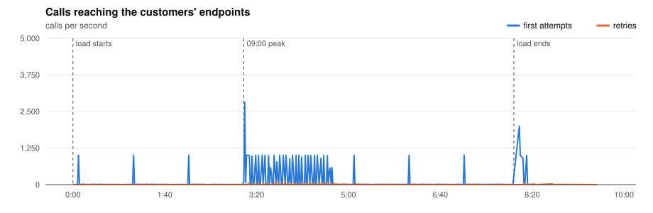

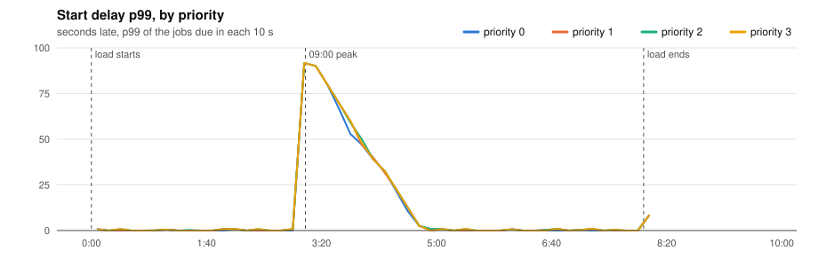

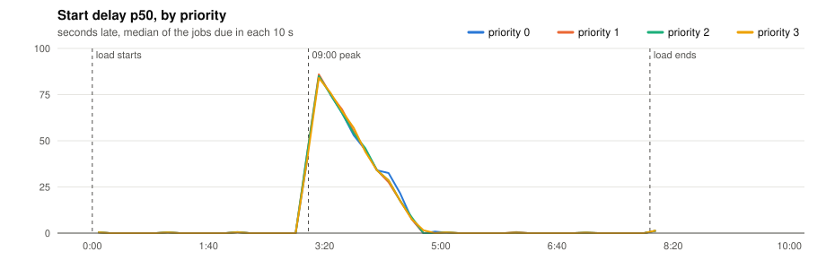

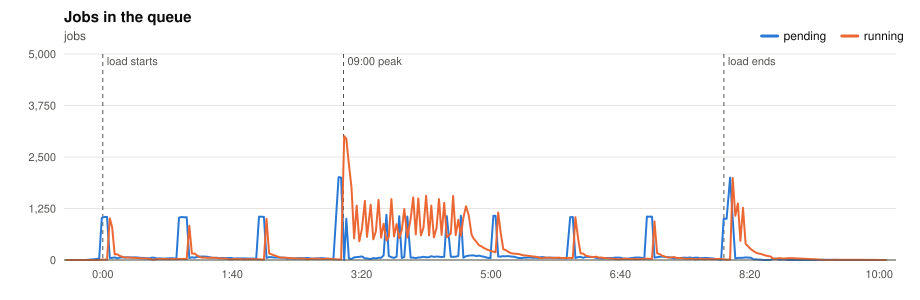

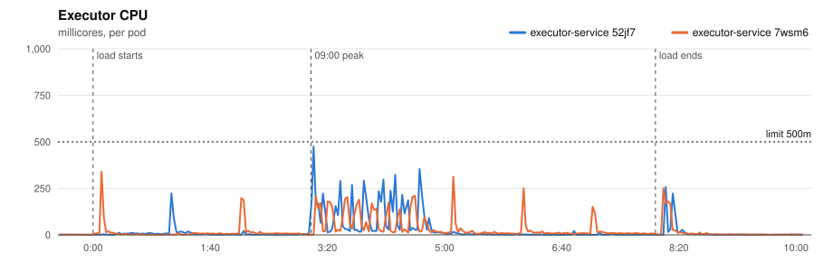

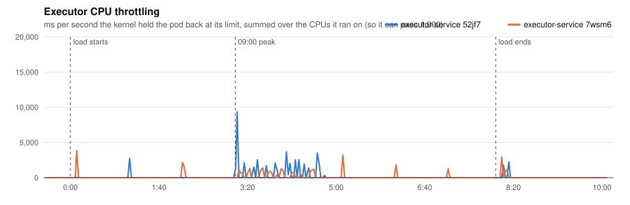

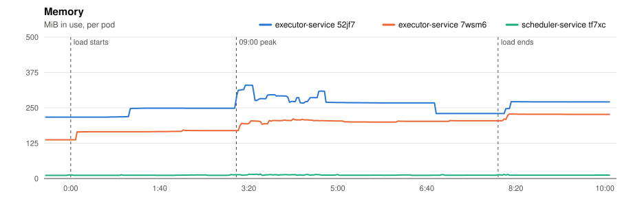

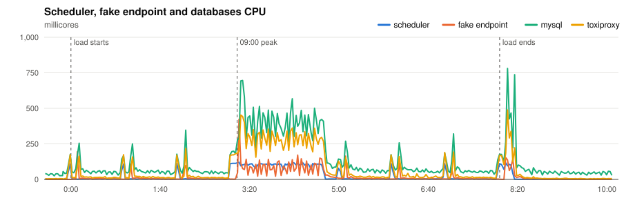

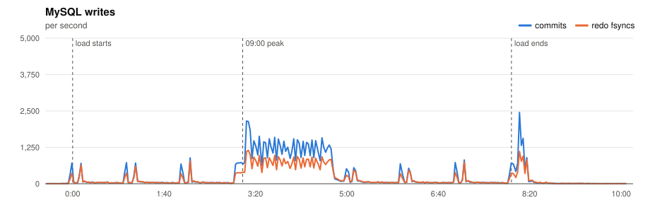

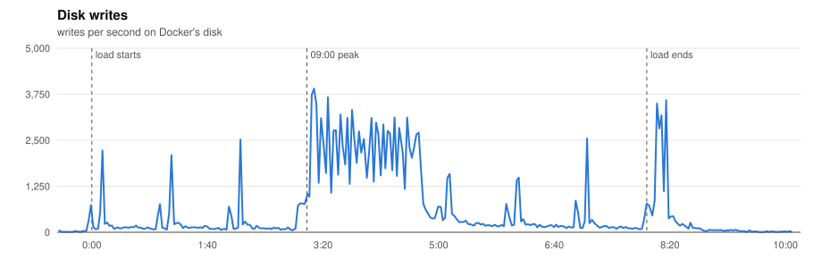

</details>

#### Resources

| Component | CPU avg (millicores) | CPU max | Throttled max (ms/s) | Memory max (MiB) |
|---|---|---|---|---|
| executor-service 52jf7 | 25 | 474 | 9368 | 330 |
| executor-service 7wsm6 | 26 | 340 | 3866 | 228 |
| scheduler-service tf7xc | 24 | 121 | 0 | 16 |
| fake-endpoint bcdlv | 21 | 423 | 0 | 160 |
| mysql | 128 | 780 | 0 | 976 |
| cassandra | 94 | 627 | 697 | 838 |
| toxiproxy | 71 | 488 | 0 | 24 |

MySQL: up to 2448 commits/s, 1148 redo fsyncs/s, 2 row lock waits/s, 15 connections.

#### CPU profiles

<details><summary>CPU profile: executor, 20 s from 3:11</summary>

```text
      flat  flat%   sum%        cum   cum%
     0.49s 40.50% 40.50%      0.49s 40.50%  internal/runtime/syscall.Syscall6
     0.17s 14.05% 54.55%      0.17s 14.05%  runtime.futex
     0.03s  2.48% 57.02%      0.03s  2.48%  runtime.memclrNoHeapPointers
     0.03s  2.48% 59.50%      0.04s  3.31%  runtime.pcvalue
     0.03s  2.48% 61.98%      0.05s  4.13%  runtime.selectgo
     0.02s  1.65% 63.64%      0.02s  1.65%  internal/runtime/atomic.(*Uint32).CompareAndSwap
     0.02s  1.65% 65.29%      0.03s  2.48%  runtime.(*stackScanState).addObject
     0.02s  1.65% 66.94%      0.04s  3.31%  runtime.(*unwinder).resolveInternal
     0.02s  1.65% 68.60%      0.03s  2.48%  runtime.lock2
     0.02s  1.65% 70.25%      0.06s  4.96%  runtime.netpoll
     0.02s  1.65% 71.90%      0.04s  3.31%  runtime.scanblock
     0.01s  0.83% 72.73%      0.04s  3.31%  bufio.(*Reader).fill
```

</details>

<details><summary>CPU profile: scheduler, 20 s from 3:11</summary>

```text
      flat  flat%   sum%        cum   cum%
     0.39s 31.71% 31.71%      0.39s 31.71%  internal/runtime/syscall.Syscall6
     0.35s 28.46% 60.16%      0.35s 28.46%  runtime.futex
     0.02s  1.63% 61.79%      0.02s  1.63%  internal/runtime/atomic.(*Uint32).CompareAndSwap (inline)
     0.02s  1.63% 63.41%      0.02s  1.63%  runtime.(*cleanupQueue).needsWake
     0.02s  1.63% 65.04%      0.02s  1.63%  runtime.execute
     0.02s  1.63% 66.67%      0.02s  1.63%  runtime.findObject
     0.02s  1.63% 68.29%      0.02s  1.63%  runtime.memclrNoHeapPointers
     0.02s  1.63% 69.92%      0.02s  1.63%  runtime.memmove
     0.02s  1.63% 71.54%      0.08s  6.50%  runtime.selectgo
     0.01s  0.81% 72.36%      0.72s 58.54%  database/sql.(*Tx).ExecContext
     0.01s  0.81% 73.17%      0.12s  9.76%  database/sql.(*driverStmt).Close
     0.01s  0.81% 73.98%      0.01s  0.81%  database/sql.convertAssignRows
```

</details>

Run page: [reports/20261110T194554Z/report.md](reports/20261110T194554Z/report.md)

### r2

- **Load:** 480 s of the platform model at scale 1.0: 1,000 minute, 4,000 five, 10,000 hour, 15,000 day, 2,667 at tasks; 32,667 tasks seeded.
- **Deployment:** 2 executors; executor-service: `JOB_TIME_LIMIT_SECONDS=1 WORKER_COUNT=10000 JOB_QUEUE_SIZE=10000 PPROF_ADDR=:6060`; scheduler-service: `SCHEDULE_INTERVAL=1s SCHEDULE_LOOKAHEAD=10s PPROF_ADDR=:6060`
- **Raw data:** `bench/results/P4-0900-peak/runs/20261119T204356Z-r2/` (local, not committed)

#### Jobs

| Created | Succeeded | Dead | Still pending or running | Retried | Duplicate successes | Timed out, done anyway | Calls per second (first attempts) |
|---|---|---|---|---|---|---|---|
| 39,667 | 39,266 | 401 | 0 | 2,077 | 20 | 663 | 80.9 |

*Duplicate successes*: the endpoint answered 200 twice for one job, which only a failure should cause. *Timed out, done anyway*: the executor gave up after the timeout while the endpoint finished the work, so the retry made the customer process the job again.

**Start delay** (when the call reached the endpoint minus when the job was due, first attempts):

| Priority | Jobs | p50 | p90 | p99 | max |
|---|---|---|---|---|---|
| 0 | 2,016 | 6.533 s | 23.031 s | 23.437 s | 23.633 s |
| 1 | 5,961 | 6.441 s | 23.136 s | 23.529 s | 23.638 s |
| 2 | 23,023 | 6.530 s | 23.533 s | 35.034 s | 37.768 s |
| 3 | 7,744 | 6.632 s | 33.530 s | 37.662 s | 37.768 s |
| all | 38,744 | 6.532 s | 23.437 s | 37.160 s | 37.768 s |

- **09:00 peak:** 29,099 jobs due on the same second. The last one started **37.8 s** late (p50 9.0 s, p99 37.6 s); priority 0 p99 **23.4 s**.

<details><summary>Charts</summary>

Time is minutes:seconds from the start of the load.

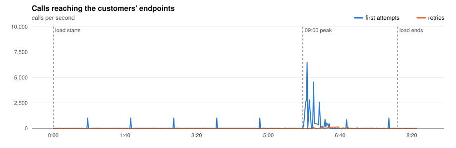

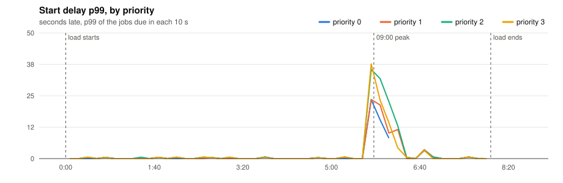

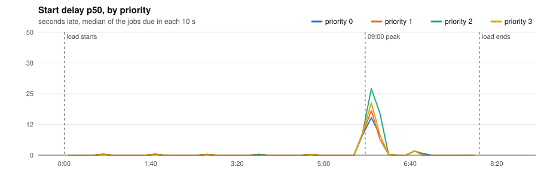

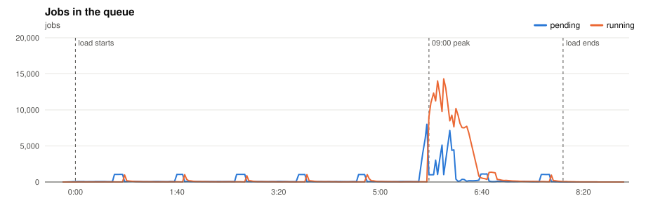

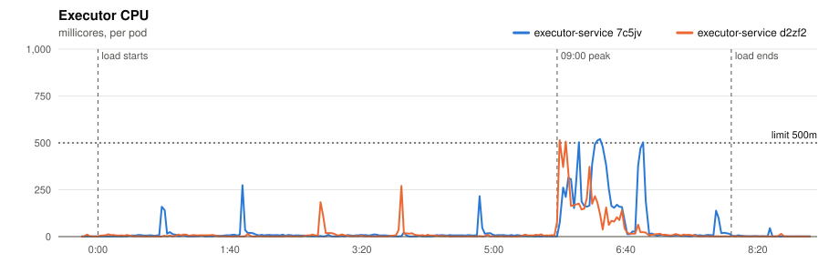

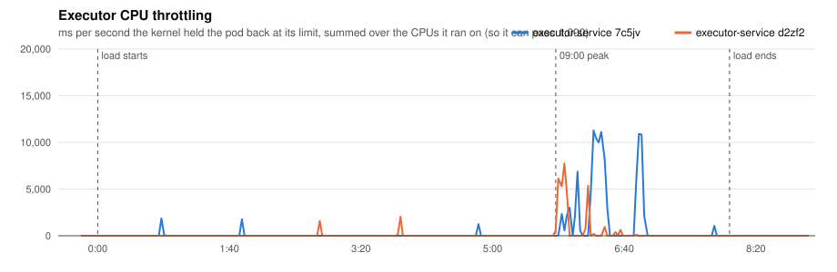

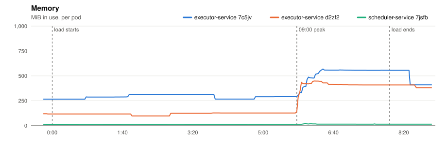

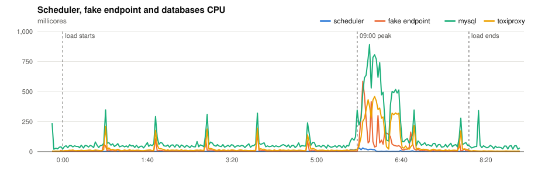

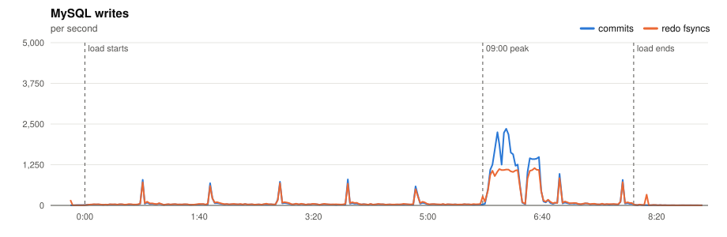

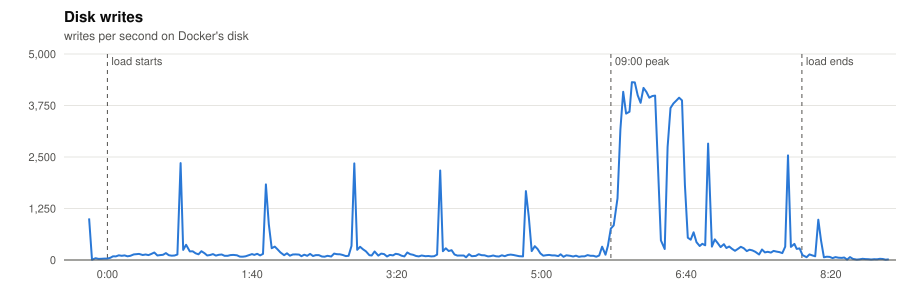

</details>

#### Resources

| Component | CPU avg (millicores) | CPU max | Throttled max (ms/s) | Memory max (MiB) |
|---|---|---|---|---|
| executor-service 7c5jv | 39 | 520 | 11267 | 569 |
| executor-service d2zf2 | 24 | 514 | 7741 | 449 |
| scheduler-service 7jsfb | 3 | 32 | 0 | 19 |
| fake-endpoint cf55t | 22 | 585 | 0 | 393 |
| mysql | 104 | 892 | 0 | 1195 |
| cassandra | 95 | 375 | 0 | 1080 |
| toxiproxy | 42 | 458 | 0 | 24 |

MySQL: up to 2355 commits/s, 1145 redo fsyncs/s, 3 row lock waits/s, 15 connections.

#### CPU profiles

<details><summary>CPU profile: executor, 20 s from 5:54</summary>

```text
      flat  flat%   sum%        cum   cum%
     920ms 36.51% 36.51%      920ms 36.51%  internal/runtime/syscall.Syscall6
     270ms 10.71% 47.22%      270ms 10.71%  runtime.futex
      60ms  2.38% 49.60%      160ms  6.35%  runtime.scanobject
      50ms  1.98% 51.59%       50ms  1.98%  runtime.memclrNoHeapPointers
      50ms  1.98% 53.57%       70ms  2.78%  runtime.step
      40ms  1.59% 55.16%       40ms  1.59%  runtime.(*gcWork).putObjFast (inline)
      40ms  1.59% 56.75%       40ms  1.59%  runtime.(*mspan).specialFindSplicePoint
      40ms  1.59% 58.33%       40ms  1.59%  runtime.findObject
      40ms  1.59% 59.92%      130ms  5.16%  runtime.pcvalue
      40ms  1.59% 61.51%      130ms  5.16%  runtime.selectgo
      30ms  1.19% 62.70%       30ms  1.19%  internal/runtime/atomic.(*Uint32).CompareAndSwap (inline)
      30ms  1.19% 63.89%       30ms  1.19%  runtime.(*gcBits).bitp (inline)
```

</details>

<details><summary>CPU profile: scheduler, 20 s from 5:54</summary>

```text
      flat  flat%   sum%        cum   cum%
      20ms 16.67% 16.67%       20ms 16.67%  reflect.Value.Set
      20ms 16.67% 33.33%       20ms 16.67%  runtime.memclrNoHeapPointers
      10ms  8.33% 41.67%       10ms  8.33%  runtime.(*mspan).writeHeapBitsSmall
      10ms  8.33% 50.00%       10ms  8.33%  runtime.(*sysMemStat).add
      10ms  8.33% 58.33%       20ms 16.67%  runtime.convT
      10ms  8.33% 66.67%       10ms  8.33%  runtime.freeSomeWbufs
      10ms  8.33% 75.00%       10ms  8.33%  runtime.futex
      10ms  8.33% 83.33%       10ms  8.33%  runtime.procyield
      10ms  8.33% 91.67%       10ms  8.33%  runtime.typePointers.next
      10ms  8.33%   100%       10ms  8.33%  time.absYday.split (inline)
         0     0%   100%       20ms 16.67%  database/sql.(*DB).execDC
         0     0%   100%       10ms  8.33%  database/sql.(*DB).execDC.func3
```

</details>

Run page: [reports/20261119T204356Z-r2/report.md](reports/20261119T204356Z-r2/report.md)

## Conclusions

**No on both counts.**

- **How long:** the 30,007 jobs took 94 s to start, the last one 94.1 s late, against the objective of 60 s for the whole peak.
- **Priority:** it made no difference. Priority 0 had a p99 of 91.6 s, the same as everyone else, against an objective of 5 s.

Both come from the scheduler:

- ~~At about 300 jobs per second, 30 batches of 1,000 take about 100 s.~~ **Fixed:** it was the N+1 in [P2](../P2-capacity/README.md#fixed-an-n1-in-the-scheduler); 30 batches now take a couple of seconds. 90% of the peak's jobs were created after they were due, and each was claimed as soon as it existed.
- It picks tasks by `next_run_at` alone. On a second where 30,000 tasks are due, the batches come out in no order of priority. The executor claims by priority, but only among the jobs that already exist, so a priority 0 job in the last batch waits for the 29 before it. Still open: faster batches shorten that wait but do not order it.

The rest held: the executors' CPU spiked and was throttled at the peak, and MySQL peaked at 2,448 commits/s, with at most 2 row lock waits per second.

### Round 2: after the scheduler fix

_2026-11-19._ The same load and resources with the fixed scheduler (the `r2` run above). Its 8-minute window caught one 5-minute burst fewer than round 1 (39,667 jobs against 44,667), and its 09:00 second held 29,099 jobs against 30,007; the peak is otherwise the same.

| | Round 1 | Round 2 |
|---|---|---|
| Last job of the peak | 94.1 s late | 37.8 s late |
| p50 of the peak | 43.3 s | 9.0 s |
| Priority 0 and 1, worst | 91.9 and 94.0 s | 23.6 s |
| Priority 2 and 3, worst | 94.1 s | 37.8 s |

- **The whole peak now runs within the 60 s objective.** Priority 0 is still far from its 5 s.
- **The executors are now the limit.** The scheduler's own setting, 1,000 jobs per tick and one tick a second, creates the last job of the peak about 19 s after it. The two executors then need until 37.8 s: at 0.5 vCPU each they fire 800 to 900 jobs per second ([P10](../P10-ceiling/README.md)), and they ran at their quota, throttled up to 11 s per second.
- **Priority started to count.** Jobs now exist before the executors can take them, and the claim takes priority 0 and 1 first, so they were done 14 s before 2 and 3.
- **20 jobs succeeded twice,** against 1 in round 1. All were very slow endpoints that answered close to the 30 s timeout: with the executors throttled, the answer came after the client had given up, and the retry ran the job again.
- MySQL peaked at 892 of its 2,000 millicores and 2,355 commits/s, a little more CPU than in round 1, with room left.
