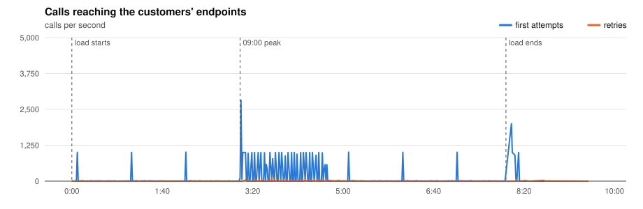
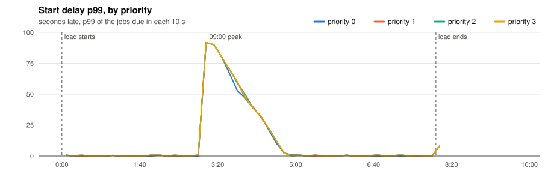
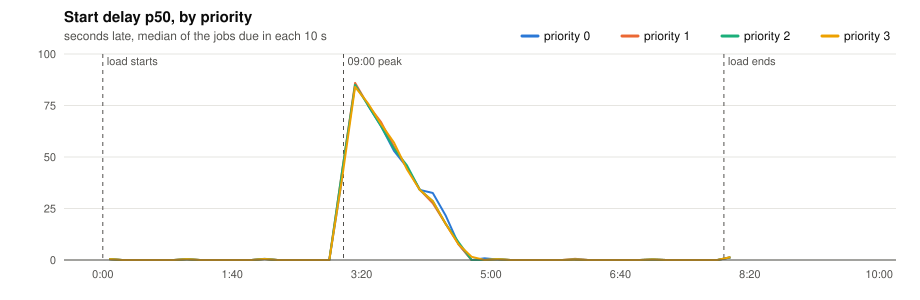
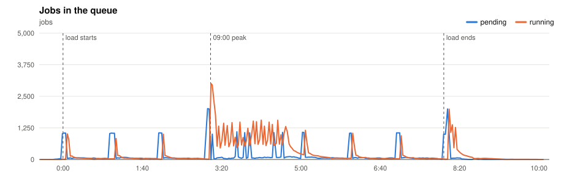
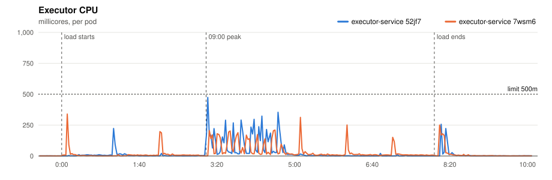
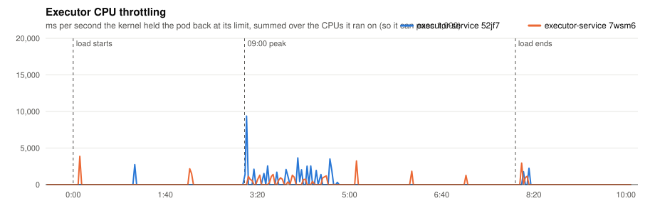
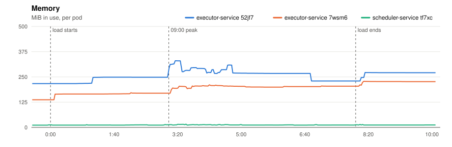
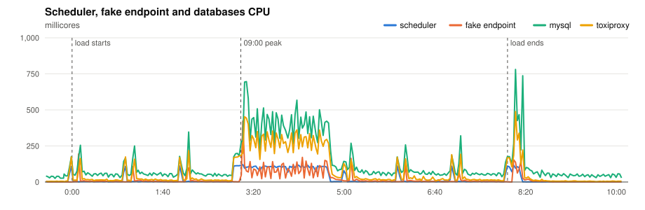
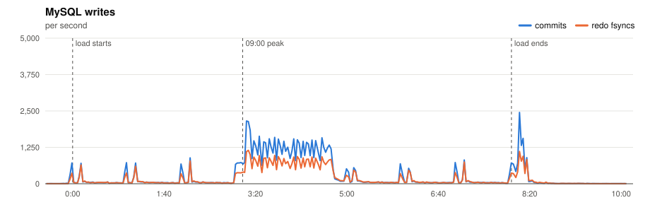
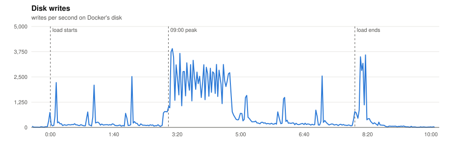

# P4 · 20261110T194554Z

- **Load:** 480 s of the platform model at scale 1.0: 1,000 minute, 4,000 five, 10,000 hour, 15,000 day, 2,667 at tasks; 32,667 tasks seeded.
- **Deployment:** 2 executors; executor-service: `JOB_TIME_LIMIT_SECONDS=1 WORKER_COUNT=10000 JOB_QUEUE_SIZE=10000 PPROF_ADDR=:6060`; scheduler-service: `SCHEDULE_INTERVAL=1s SCHEDULE_LOOKAHEAD=10s PPROF_ADDR=:6060`
- **Raw data:** `bench/results/P4-0900-peak/runs/20261110T194554Z/` (local, not committed)

## Jobs

| Created | Succeeded | Dead | Still pending or running | Retried | Duplicate successes | Timed out, done anyway | Calls per second (first attempts) |
|---|---|---|---|---|---|---|---|
| 44,667 | 44,168 | 499 | 0 | 1,237 | 1 | 603 | 90.3 |

*Duplicate successes*: the endpoint answered 200 twice for one job, which only a failure should cause. *Timed out, done anyway*: the executor gave up after the timeout while the endpoint finished the work, so the retry made the customer process the job again.

**Start delay** (when the call reached the endpoint minus when the job was due, first attempts):

| Priority | Jobs | p50 | p90 | p99 | max |
|---|---|---|---|---|---|
| 0 | 2,116 | 23.465 s | 77.298 s | 91.638 s | 91.851 s |
| 1 | 6,614 | 23.364 s | 77.482 s | 91.642 s | 93.967 s |
| 2 | 26,765 | 23.462 s | 77.383 s | 91.742 s | 94.138 s |
| 3 | 9,172 | 20.569 s | 77.582 s | 91.742 s | 94.137 s |
| all | 44,667 | 23.364 s | 77.384 s | 91.742 s | 94.138 s |

- **09:00 peak:** 30,007 jobs due on the same second. The last one started **94.1 s** late (p50 43.3 s, p99 91.7 s); priority 0 p99 **91.6 s**.

## Charts

Time is minutes:seconds from the start of the load.





















## Resources

| Component | CPU avg (millicores) | CPU max | Throttled max (ms/s) | Memory max (MiB) |
|---|---|---|---|---|
| executor-service 52jf7 | 25 | 474 | 9368 | 330 |
| executor-service 7wsm6 | 26 | 340 | 3866 | 228 |
| scheduler-service tf7xc | 24 | 121 | 0 | 16 |
| fake-endpoint bcdlv | 21 | 423 | 0 | 160 |
| mysql | 128 | 780 | 0 | 976 |
| cassandra | 94 | 627 | 697 | 838 |
| toxiproxy | 71 | 488 | 0 | 24 |

MySQL: up to 2448 commits/s, 1148 redo fsyncs/s, 2 row lock waits/s, 15 connections.

## CPU profile: executor, 20 s from 3:11

```text
      flat  flat%   sum%        cum   cum%
     0.49s 40.50% 40.50%      0.49s 40.50%  internal/runtime/syscall.Syscall6
     0.17s 14.05% 54.55%      0.17s 14.05%  runtime.futex
     0.03s  2.48% 57.02%      0.03s  2.48%  runtime.memclrNoHeapPointers
     0.03s  2.48% 59.50%      0.04s  3.31%  runtime.pcvalue
     0.03s  2.48% 61.98%      0.05s  4.13%  runtime.selectgo
     0.02s  1.65% 63.64%      0.02s  1.65%  internal/runtime/atomic.(*Uint32).CompareAndSwap
     0.02s  1.65% 65.29%      0.03s  2.48%  runtime.(*stackScanState).addObject
     0.02s  1.65% 66.94%      0.04s  3.31%  runtime.(*unwinder).resolveInternal
     0.02s  1.65% 68.60%      0.03s  2.48%  runtime.lock2
     0.02s  1.65% 70.25%      0.06s  4.96%  runtime.netpoll
     0.02s  1.65% 71.90%      0.04s  3.31%  runtime.scanblock
     0.01s  0.83% 72.73%      0.04s  3.31%  bufio.(*Reader).fill
```

## CPU profile: scheduler, 20 s from 3:11

```text
      flat  flat%   sum%        cum   cum%
     0.39s 31.71% 31.71%      0.39s 31.71%  internal/runtime/syscall.Syscall6
     0.35s 28.46% 60.16%      0.35s 28.46%  runtime.futex
     0.02s  1.63% 61.79%      0.02s  1.63%  internal/runtime/atomic.(*Uint32).CompareAndSwap (inline)
     0.02s  1.63% 63.41%      0.02s  1.63%  runtime.(*cleanupQueue).needsWake
     0.02s  1.63% 65.04%      0.02s  1.63%  runtime.execute
     0.02s  1.63% 66.67%      0.02s  1.63%  runtime.findObject
     0.02s  1.63% 68.29%      0.02s  1.63%  runtime.memclrNoHeapPointers
     0.02s  1.63% 69.92%      0.02s  1.63%  runtime.memmove
     0.02s  1.63% 71.54%      0.08s  6.50%  runtime.selectgo
     0.01s  0.81% 72.36%      0.72s 58.54%  database/sql.(*Tx).ExecContext
     0.01s  0.81% 73.17%      0.12s  9.76%  database/sql.(*driverStmt).Close
     0.01s  0.81% 73.98%      0.01s  0.81%  database/sql.convertAssignRows
```

## Conclusions

*(to be written)*
