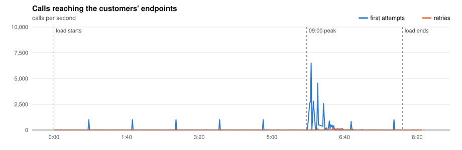
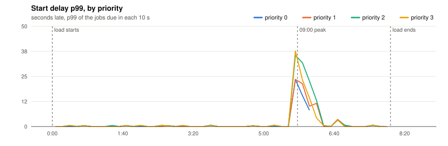
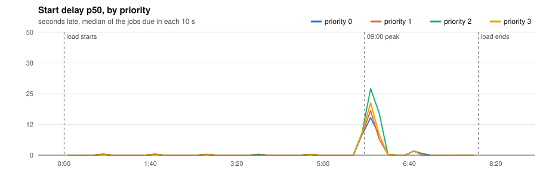
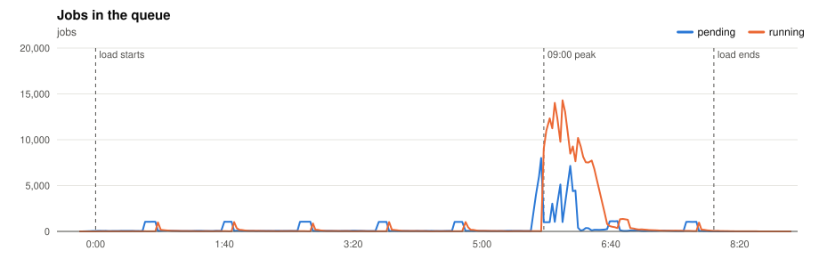
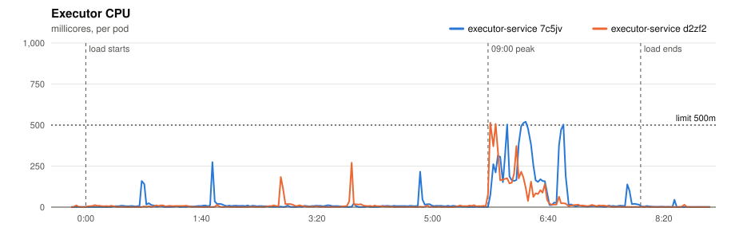
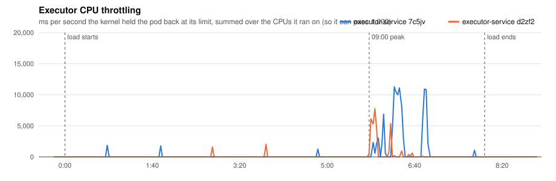
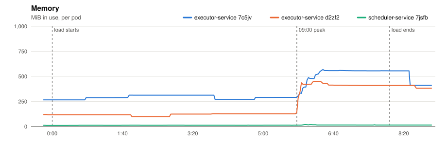
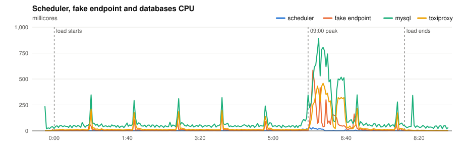
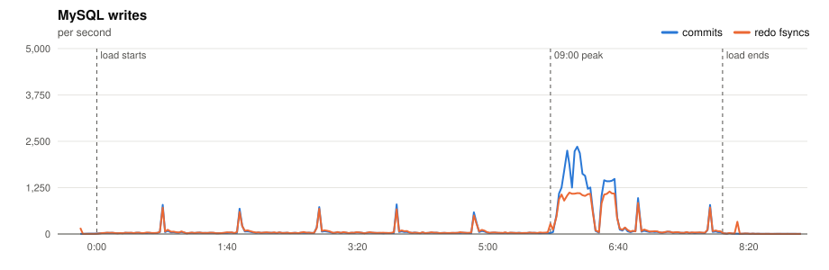
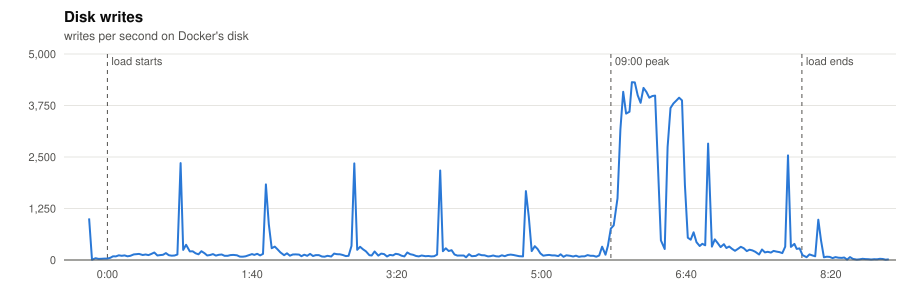

# P4 · 20261119T204356Z-r2 (r2)

- **Load:** 480 s of the platform model at scale 1.0: 1,000 minute, 4,000 five, 10,000 hour, 15,000 day, 2,667 at tasks; 32,667 tasks seeded.
- **Deployment:** 2 executors; executor-service: `JOB_TIME_LIMIT_SECONDS=1 WORKER_COUNT=10000 JOB_QUEUE_SIZE=10000 PPROF_ADDR=:6060`; scheduler-service: `SCHEDULE_INTERVAL=1s SCHEDULE_LOOKAHEAD=10s PPROF_ADDR=:6060`
- **Raw data:** `bench/results/P4-0900-peak/runs/20261119T204356Z-r2/` (local, not committed)

## Jobs

| Created | Succeeded | Dead | Still pending or running | Retried | Duplicate successes | Timed out, done anyway | Calls per second (first attempts) |
|---|---|---|---|---|---|---|---|
| 39,667 | 39,266 | 401 | 0 | 2,077 | 20 | 663 | 80.9 |

*Duplicate successes*: the endpoint answered 200 twice for one job, which only a failure should cause. *Timed out, done anyway*: the executor gave up after the timeout while the endpoint finished the work, so the retry made the customer process the job again.

**Start delay** (when the call reached the endpoint minus when the job was due, first attempts):

| Priority | Jobs | p50 | p90 | p99 | max |
|---|---|---|---|---|---|
| 0 | 2,016 | 6.533 s | 23.031 s | 23.437 s | 23.633 s |
| 1 | 5,961 | 6.441 s | 23.136 s | 23.529 s | 23.638 s |
| 2 | 23,023 | 6.530 s | 23.533 s | 35.034 s | 37.768 s |
| 3 | 7,744 | 6.632 s | 33.530 s | 37.662 s | 37.768 s |
| all | 38,744 | 6.532 s | 23.437 s | 37.160 s | 37.768 s |

- **09:00 peak:** 29,099 jobs due on the same second. The last one started **37.8 s** late (p50 9.0 s, p99 37.6 s); priority 0 p99 **23.4 s**.
- **Peak throughput:** every job of the peak had started **50.1 s** after it (p99 46.5 s), **599 jobs/s**; 6,502 in its busiest second. First attempts that never reached the endpoint: **908**.
- **Peak by priority** (p50 / p99 / max, first attempts): 0: 8.2 / 23.4 / 23.6 s; 1: 8.5 / 23.5 / 23.6 s; 2: 9.0 / 35.4 / 37.8 s; 3: 9.0 / 37.7 / 37.8 s.

## Charts

Time is minutes:seconds from the start of the load.





















## Resources

| Component | CPU avg (millicores) | CPU max | Throttled max (ms/s) | Memory max (MiB) |
|---|---|---|---|---|
| executor-service 7c5jv | 39 | 520 | 11267 | 569 |
| executor-service d2zf2 | 24 | 514 | 7741 | 449 |
| scheduler-service 7jsfb | 3 | 32 | 0 | 19 |
| fake-endpoint cf55t | 22 | 585 | 0 | 393 |
| mysql | 104 | 892 | 0 | 1195 |
| cassandra | 95 | 375 | 0 | 1080 |
| toxiproxy | 42 | 458 | 0 | 24 |

MySQL: up to 2355 commits/s, 1145 redo fsyncs/s, 3 row lock waits/s, 15 connections.

## CPU profile: executor, 20 s from 5:54

```text
      flat  flat%   sum%        cum   cum%
     920ms 36.51% 36.51%      920ms 36.51%  internal/runtime/syscall.Syscall6
     270ms 10.71% 47.22%      270ms 10.71%  runtime.futex
      60ms  2.38% 49.60%      160ms  6.35%  runtime.scanobject
      50ms  1.98% 51.59%       50ms  1.98%  runtime.memclrNoHeapPointers
      50ms  1.98% 53.57%       70ms  2.78%  runtime.step
      40ms  1.59% 55.16%       40ms  1.59%  runtime.(*gcWork).putObjFast (inline)
      40ms  1.59% 56.75%       40ms  1.59%  runtime.(*mspan).specialFindSplicePoint
      40ms  1.59% 58.33%       40ms  1.59%  runtime.findObject
      40ms  1.59% 59.92%      130ms  5.16%  runtime.pcvalue
      40ms  1.59% 61.51%      130ms  5.16%  runtime.selectgo
      30ms  1.19% 62.70%       30ms  1.19%  internal/runtime/atomic.(*Uint32).CompareAndSwap (inline)
      30ms  1.19% 63.89%       30ms  1.19%  runtime.(*gcBits).bitp (inline)
```

## CPU profile: scheduler, 20 s from 5:54

```text
      flat  flat%   sum%        cum   cum%
      20ms 16.67% 16.67%       20ms 16.67%  reflect.Value.Set
      20ms 16.67% 33.33%       20ms 16.67%  runtime.memclrNoHeapPointers
      10ms  8.33% 41.67%       10ms  8.33%  runtime.(*mspan).writeHeapBitsSmall
      10ms  8.33% 50.00%       10ms  8.33%  runtime.(*sysMemStat).add
      10ms  8.33% 58.33%       20ms 16.67%  runtime.convT
      10ms  8.33% 66.67%       10ms  8.33%  runtime.freeSomeWbufs
      10ms  8.33% 75.00%       10ms  8.33%  runtime.futex
      10ms  8.33% 83.33%       10ms  8.33%  runtime.procyield
      10ms  8.33% 91.67%       10ms  8.33%  runtime.typePointers.next
      10ms  8.33%   100%       10ms  8.33%  time.absYday.split (inline)
         0     0%   100%       20ms 16.67%  database/sql.(*DB).execDC
         0     0%   100%       10ms  8.33%  database/sql.(*DB).execDC.func3
```
