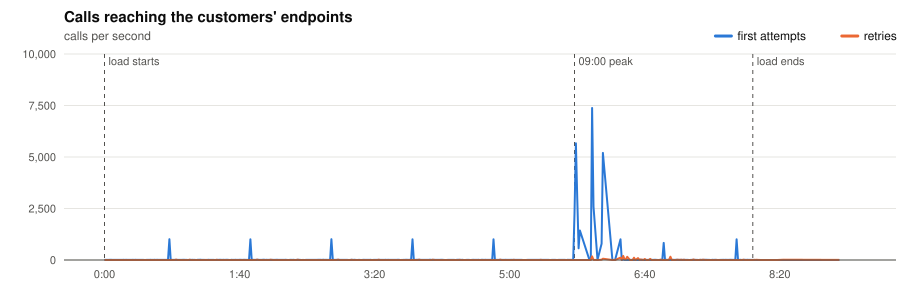
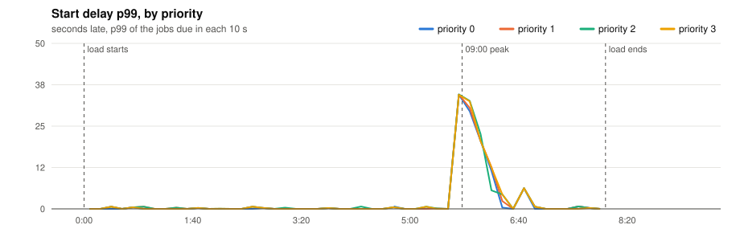
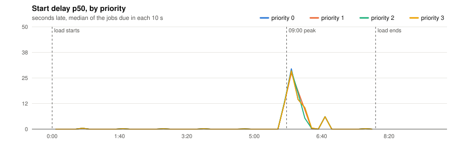
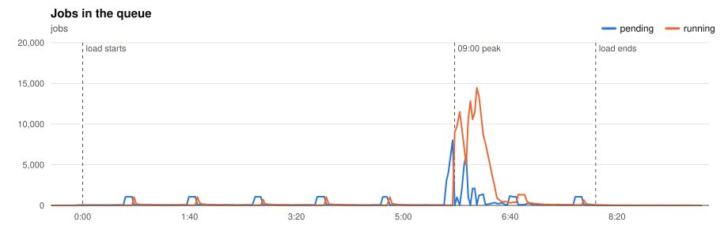
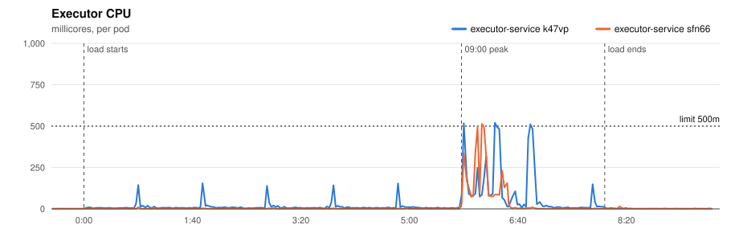
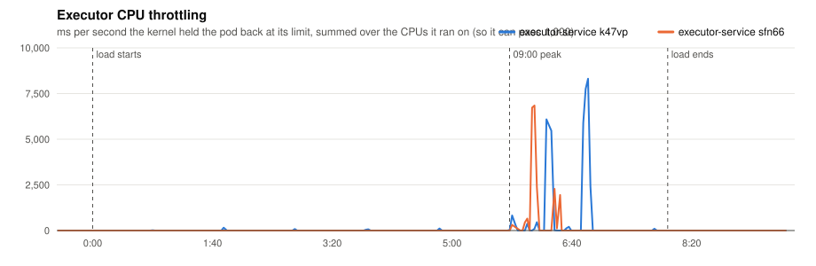
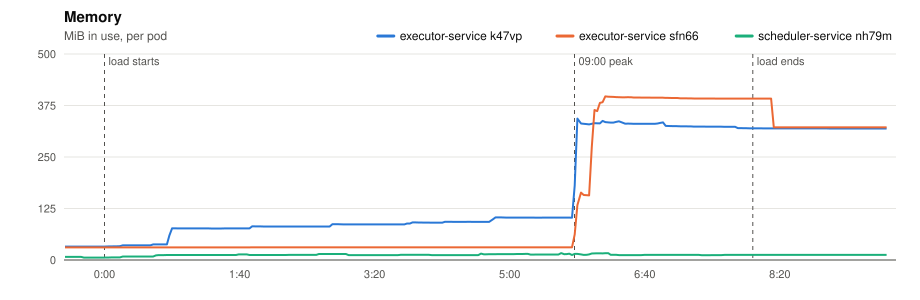
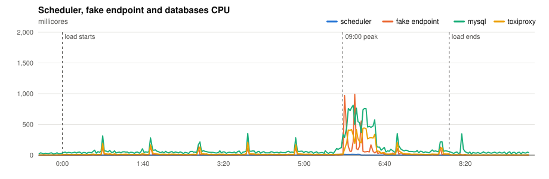
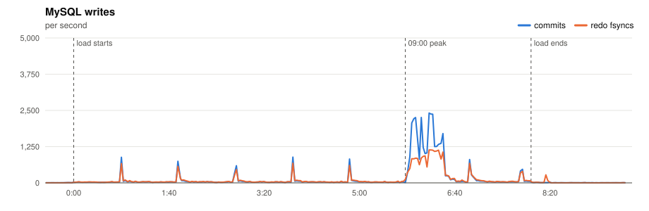
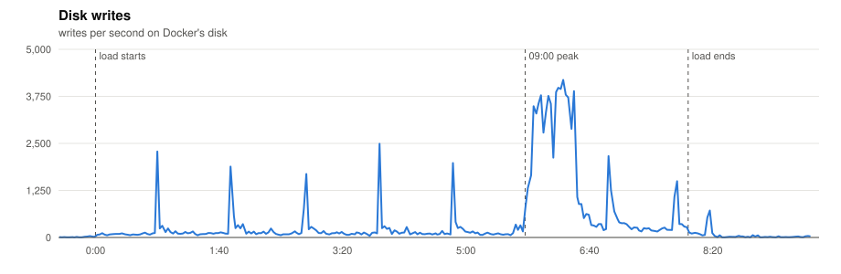

# P4 · 20261119T212505Z-r3 (r3)

- **Load:** 480 s of the platform model at scale 1.0: 1,000 minute, 4,000 five, 10,000 hour, 15,000 day, 2,667 at tasks; 32,667 tasks seeded.
- **Deployment:** 2 executors; executor-service: `GOMAXPROCS= JOB_TIME_LIMIT_SECONDS=1 WORKER_COUNT=10000 JOB_QUEUE_SIZE=10000 PPROF_ADDR=:6060`; scheduler-service: `GOMAXPROCS= SCHEDULE_INTERVAL=1s SCHEDULE_LOOKAHEAD=10s PPROF_ADDR=:6060`
- **Raw data:** `bench/results/P4-0900-peak/runs/20261119T212505Z-r3/` (local, not committed)

## Jobs

| Created | Succeeded | Dead | Still pending or running | Retried | Duplicate successes | Timed out, done anyway | Calls per second (first attempts) |
|---|---|---|---|---|---|---|---|
| 39,667 | 39,211 | 456 | 0 | 1,471 | 31 | 636 | 82.2 |

*Duplicate successes*: the endpoint answered 200 twice for one job, which only a failure should cause. *Timed out, done anyway*: the executor gave up after the timeout while the endpoint finished the work, so the retry made the customer process the job again.

**Start delay** (when the call reached the endpoint minus when the job was due, first attempts):

| Priority | Jobs | p50 | p90 | p99 | max |
|---|---|---|---|---|---|
| 0 | 1,981 | 3.772 s | 20.809 s | 34.486 s | 34.497 s |
| 1 | 5,938 | 3.781 s | 21.294 s | 34.566 s | 34.593 s |
| 2 | 23,481 | 4.692 s | 21.607 s | 34.563 s | 34.665 s |
| 3 | 7,966 | 2.886 s | 21.467 s | 34.468 s | 34.587 s |
| all | 39,366 | 3.704 s | 21.590 s | 34.518 s | 34.665 s |

- **09:00 peak:** 29,893 jobs due on the same second. The last one started **34.7 s** late (p50 13.3 s, p99 34.6 s); priority 0 p99 **34.5 s**.
- **Peak throughput:** every job of the peak had started **40.0 s** after it (p99 34.6 s), **749 jobs/s**; 7,379 in its busiest second. First attempts that never reached the endpoint: **112**.
- **Peak by priority** (p50 / p99 / max, first attempts): 0: 13.2 / 34.5 / 34.5 s; 1: 13.2 / 34.6 / 34.6 s; 2: 13.6 / 34.6 / 34.7 s; 3: 13.1 / 34.5 / 34.6 s.

## Charts

Time is minutes:seconds from the start of the load.





















## Resources

| Component | CPU avg (millicores) | CPU max | Throttled max (ms/s) | Memory max (MiB) |
|---|---|---|---|---|
| executor-service k47vp | 21 | 520 | 8309 | 343 |
| executor-service sfn66 | 11 | 514 | 6844 | 397 |
| scheduler-service nh79m | 2 | 18 | 0 | 17 |
| fake-endpoint cf55t | 17 | 990 | 128 | 279 |
| mysql | 77 | 812 | 0 | 1174 |
| cassandra | 95 | 362 | 0 | 1027 |
| toxiproxy | 28 | 442 | 0 | 19 |

MySQL: up to 2411 commits/s, 1136 redo fsyncs/s, 3 row lock waits/s, 14 connections.

## CPU profile: executor, 20 s from 5:59

```text
      flat  flat%   sum%        cum   cum%
     1.41s 64.38% 64.38%      1.41s 64.38%  internal/runtime/syscall.Syscall6
     0.06s  2.74% 67.12%      0.06s  2.74%  runtime.futex
     0.03s  1.37% 68.49%      0.03s  1.37%  runtime.nextFreeFast (inline)
     0.03s  1.37% 69.86%      0.03s  1.37%  runtime.unlock2
     0.02s  0.91% 70.78%      0.10s  4.57%  github.com/go-sql-driver/mysql.(*buffer).fill
     0.02s  0.91% 71.69%      0.04s  1.83%  runtime.(*unwinder).resolveInternal
     0.02s  0.91% 72.60%      0.02s  0.91%  runtime.findObject
     0.02s  0.91% 73.52%      0.02s  0.91%  runtime.findfunc
     0.02s  0.91% 74.43%      0.18s  8.22%  runtime.mallocgc
     0.02s  0.91% 75.34%      0.02s  0.91%  runtime.nanotime
     0.02s  0.91% 76.26%      0.09s  4.11%  runtime.schedule
     0.02s  0.91% 77.17%      0.03s  1.37%  runtime.step
```

## CPU profile: scheduler, 20 s from 5:59

```text
      flat  flat%   sum%        cum   cum%
      20ms 20.00% 20.00%       20ms 20.00%  internal/runtime/syscall.Syscall6
      20ms 20.00% 40.00%       20ms 20.00%  runtime.memclrNoHeapPointers
      10ms 10.00% 50.00%       10ms 10.00%  database/sql.NullString.Value
      10ms 10.00% 60.00%       10ms 10.00%  github.com/go-sql-driver/mysql.namedValueToValue (inline)
      10ms 10.00% 70.00%       10ms 10.00%  runtime.bulkBarrierPreWriteSrcOnly
      10ms 10.00% 80.00%       10ms 10.00%  runtime.memmove
      10ms 10.00% 90.00%       10ms 10.00%  runtime.nextFreeFast
      10ms 10.00%   100%       10ms 10.00%  runtime.scanblock
         0     0%   100%       50ms 50.00%  database/sql.(*DB).execDC
         0     0%   100%       20ms 20.00%  database/sql.(*DB).execDC.func2
         0     0%   100%       10ms 10.00%  database/sql.(*DB).execDC.func3
         0     0%   100%       50ms 50.00%  database/sql.(*Tx).ExecContext
```
