# P5 · Slow endpoints

> What if our customers' endpoints are slow, 10 to 30 seconds per call?

**Load:** 20 jobs/s, every endpoint 10-30 s, timeout 30 s then 20 s, 2 × 4 min
**Status:** run on 2026-11-10.

## What we test

20 one-off jobs per second for 4 minutes, and every endpoint takes between 10 and 30 s to answer. Each job keeps its worker for the whole call, so about 400 calls are in flight at any moment.

It runs twice: with the usual 30 s timeout, which every call fits in, and with a 20 s timeout, which about half the calls exceed. Those calls time out, retry after 5 s and, after 3 attempts, end `dead`.

**What to look at:**

- Whether jobs still start on time while hundreds of workers wait on slow calls.
- With 20 s: how many jobs end `dead`, and how many endpoints finished the work after the executor gave up (*timed out, done anyway*): those customers process the job twice.
- Executor memory and goroutines with that many calls open.

## Results

| Run | Jobs | Succeeded | Dead | Unfinished | Duplicates | Calls/s | Start delay p50 / p90 / p99 / max |
|---|---|---|---|---|---|---|---|
| [timeout-30](reports/20261110T195707Z-timeout-30/report.md) | 4,800 | 4,800 | 0 | 0 | 0 | 20.1 | 0.00 / 0.00 / 0.53 / 0.93 s |
| [timeout-20](reports/20261110T200247Z-timeout-20/report.md) | 4,800 | 4,182 | 618 | 0 | 0 | 20.1 | 0.00 / 0.01 / 0.94 / 0.96 s |

### timeout-30

- **Load:** 240 s of 20 one-off jobs per second, endpoint `dist=uniform&min=10000&max=30000`, timeout 30 s; 4,800 tasks seeded.
- **Deployment:** 2 executors; executor-service: `JOB_TIME_LIMIT_SECONDS=1 WORKER_COUNT=10000 JOB_QUEUE_SIZE=10000 PPROF_ADDR=:6060`; scheduler-service: `SCHEDULE_INTERVAL=1s SCHEDULE_LOOKAHEAD=10s PPROF_ADDR=:6060`
- **Raw data:** `bench/results/P5-slow-endpoints/runs/20261110T195707Z-timeout-30/` (local, not committed)

#### Jobs

| Created | Succeeded | Dead | Still pending or running | Retried | Duplicate successes | Timed out, done anyway | Calls per second (first attempts) |
|---|---|---|---|---|---|---|---|
| 4,800 | 4,800 | 0 | 0 | 0 | 0 | 0 | 20.1 |

*Duplicate successes*: the endpoint answered 200 twice for one job, which only a failure should cause. *Timed out, done anyway*: the executor gave up after the timeout while the endpoint finished the work, so the retry made the customer process the job again.

**Start delay** (when the call reached the endpoint minus when the job was due, first attempts):

| Priority | Jobs | p50 | p90 | p99 | max |
|---|---|---|---|---|---|
| 0 | 1,200 | 0.002 s | 0.004 s | 0.533 s | 0.926 s |
| 1 | 1,200 | 0.002 s | 0.004 s | 0.533 s | 0.926 s |
| 2 | 1,200 | 0.002 s | 0.004 s | 0.533 s | 0.926 s |
| 3 | 1,200 | 0.002 s | 0.004 s | 0.533 s | 0.926 s |
| all | 4,800 | 0.002 s | 0.004 s | 0.533 s | 0.926 s |

<details><summary>Charts</summary>

Time is minutes:seconds from the start of the load.

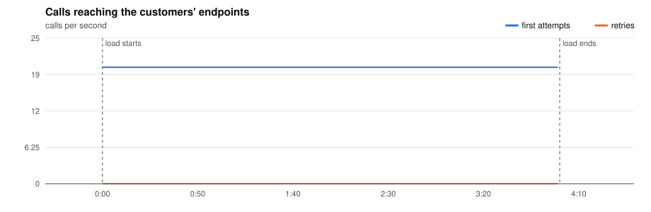

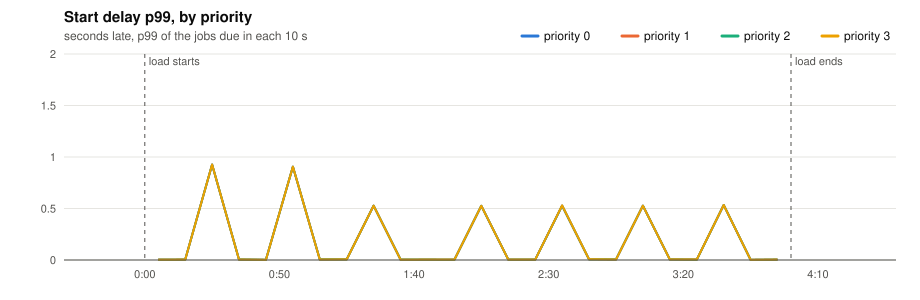

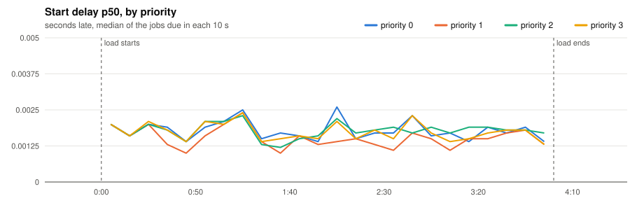

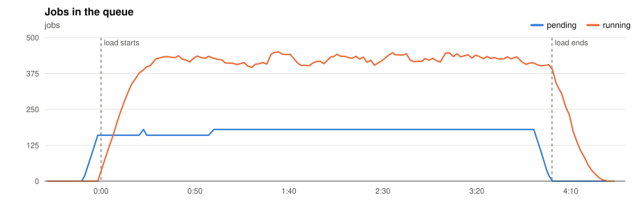

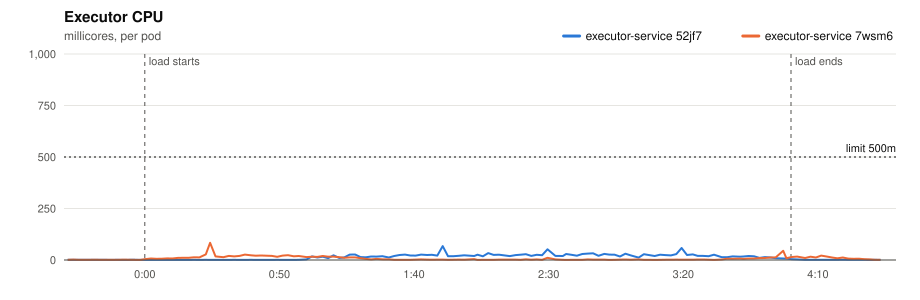

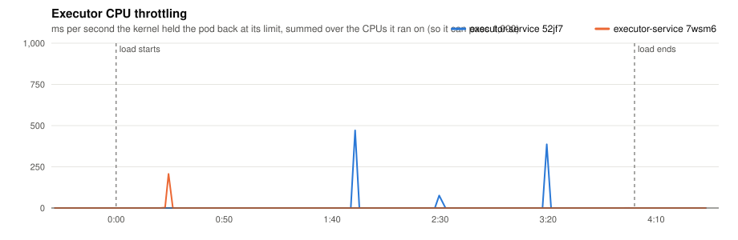

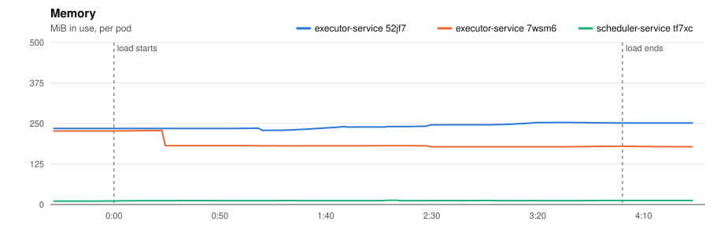

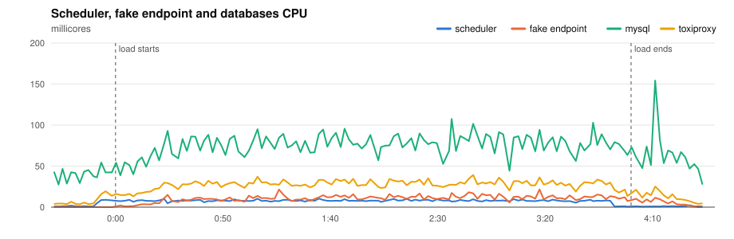

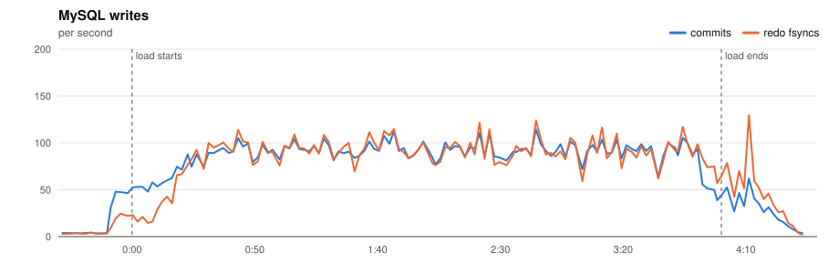

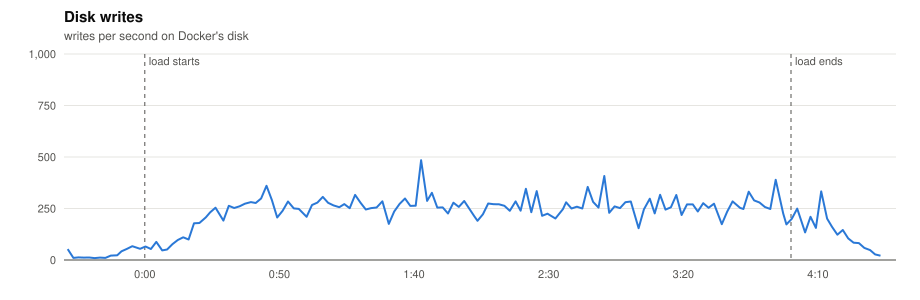

</details>

#### Resources

| Component | CPU avg (millicores) | CPU max | Throttled max (ms/s) | Memory max (MiB) |
|---|---|---|---|---|
| executor-service 52jf7 | 12 | 68 | 471 | 271 |
| executor-service 7wsm6 | 7 | 84 | 207 | 228 |
| scheduler-service tf7xc | 6 | 10 | 0 | 13 |
| fake-endpoint bcdlv | 8 | 22 | 0 | 158 |
| mysql | 68 | 154 | 0 | 987 |
| cassandra | 86 | 270 | 0 | 831 |
| toxiproxy | 22 | 39 | 0 | 22 |

MySQL: up to 114 commits/s, 130 redo fsyncs/s, 0 row lock waits/s, 14 connections.

#### CPU profiles

<details><summary>CPU profile: executor, 20 s from 2:08</summary>

```text
      flat  flat%   sum%        cum   cum%
      90ms 47.37% 47.37%       90ms 47.37%  runtime.futex
      40ms 21.05% 68.42%       40ms 21.05%  internal/runtime/syscall.Syscall6
      10ms  5.26% 73.68%       10ms  5.26%  github.com/go-sql-driver/mysql.(*mysqlConn).syncSequence (inline)
      10ms  5.26% 78.95%       10ms  5.26%  internal/runtime/atomic.(*Int32).Load
      10ms  5.26% 84.21%       10ms  5.26%  net.(*TCPConn).Write
      10ms  5.26% 89.47%       10ms  5.26%  runtime.cheaprandn
      10ms  5.26% 94.74%       10ms  5.26%  runtime.lock2
      10ms  5.26%   100%       10ms  5.26%  runtime.sellock
         0     0%   100%       90ms 47.37%  database/sql.(*DB).ExecContext
         0     0%   100%       90ms 47.37%  database/sql.(*DB).ExecContext.func1
         0     0%   100%       90ms 47.37%  database/sql.(*DB).exec
         0     0%   100%      100ms 52.63%  database/sql.(*DB).execDC
```

</details>

<details><summary>CPU profile: scheduler, 20 s from 2:08</summary>

```text
      flat  flat%   sum%        cum   cum%
      40ms 44.44% 44.44%       40ms 44.44%  internal/runtime/syscall.Syscall6
      10ms 11.11% 55.56%       10ms 11.11%  database/sql.ctxDriverQuery
      10ms 11.11% 66.67%       10ms 11.11%  runtime.futex
      10ms 11.11% 77.78%       10ms 11.11%  runtime.nanotime
      10ms 11.11% 88.89%       10ms 11.11%  runtime.nextFreeFast (inline)
      10ms 11.11%   100%       10ms 11.11%  runtime.pMask.read
         0     0%   100%       60ms 66.67%  database/sql.(*DB).execDC
         0     0%   100%       10ms 11.11%  database/sql.(*DB).queryDC
         0     0%   100%       10ms 11.11%  database/sql.(*DB).queryDC.func1
         0     0%   100%       60ms 66.67%  database/sql.(*Tx).ExecContext
         0     0%   100%       10ms 11.11%  database/sql.(*Tx).QueryContext
         0     0%   100%       30ms 33.33%  database/sql.(*driverStmt).Close
```

</details>

Run page: [reports/20261110T195707Z-timeout-30/report.md](reports/20261110T195707Z-timeout-30/report.md)

### timeout-20

- **Load:** 240 s of 20 one-off jobs per second, endpoint `dist=uniform&min=10000&max=30000`, timeout 20 s; 4,800 tasks seeded.
- **Deployment:** 2 executors; executor-service: `JOB_TIME_LIMIT_SECONDS=1 WORKER_COUNT=10000 JOB_QUEUE_SIZE=10000 PPROF_ADDR=:6060`; scheduler-service: `SCHEDULE_INTERVAL=1s SCHEDULE_LOOKAHEAD=10s PPROF_ADDR=:6060`
- **Raw data:** `bench/results/P5-slow-endpoints/runs/20261110T200247Z-timeout-20/` (local, not committed)

#### Jobs

| Created | Succeeded | Dead | Still pending or running | Retried | Duplicate successes | Timed out, done anyway | Calls per second (first attempts) |
|---|---|---|---|---|---|---|---|
| 4,800 | 4,182 | 618 | 0 | 2,465 | 0 | 4,326 | 20.1 |

*Duplicate successes*: the endpoint answered 200 twice for one job, which only a failure should cause. *Timed out, done anyway*: the executor gave up after the timeout while the endpoint finished the work, so the retry made the customer process the job again.

**Start delay** (when the call reached the endpoint minus when the job was due, first attempts):

| Priority | Jobs | p50 | p90 | p99 | max |
|---|---|---|---|---|---|
| 0 | 1,200 | 0.002 s | 0.006 s | 0.937 s | 0.965 s |
| 1 | 1,200 | 0.002 s | 0.006 s | 0.935 s | 0.965 s |
| 2 | 1,200 | 0.002 s | 0.007 s | 0.937 s | 0.965 s |
| 3 | 1,200 | 0.002 s | 0.006 s | 0.937 s | 0.965 s |
| all | 4,800 | 0.002 s | 0.006 s | 0.937 s | 0.965 s |

<details><summary>Charts</summary>

Time is minutes:seconds from the start of the load.

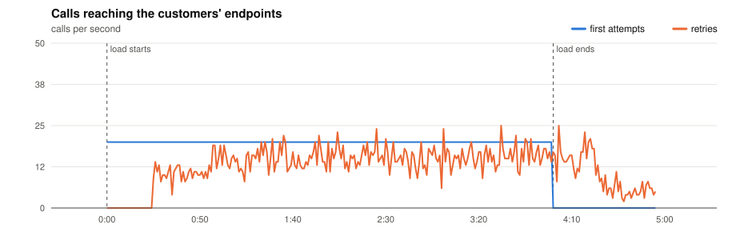

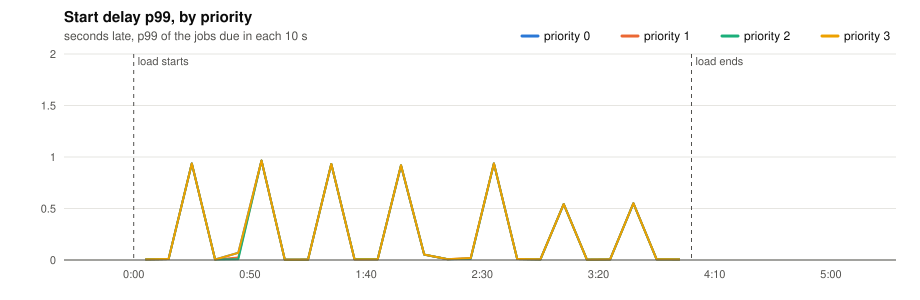

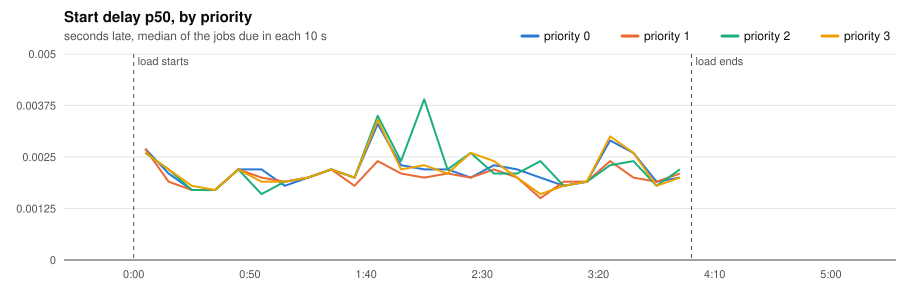

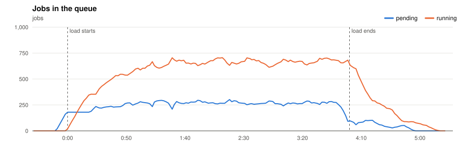

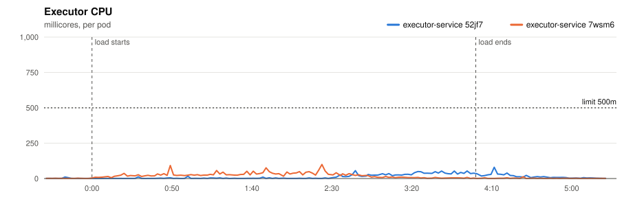

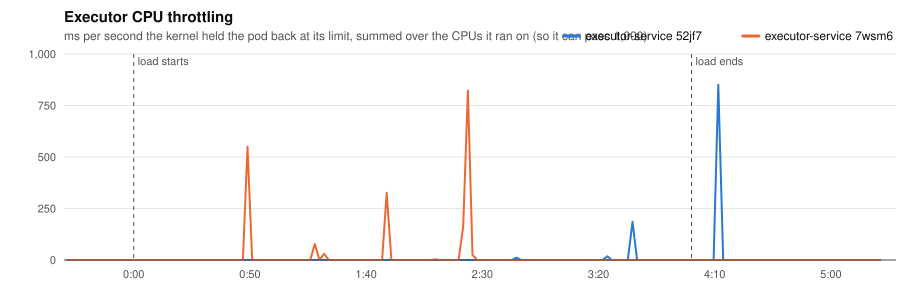

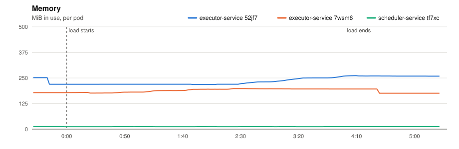

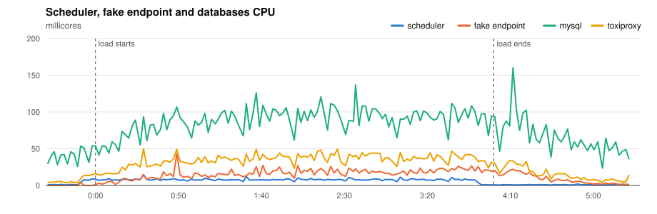

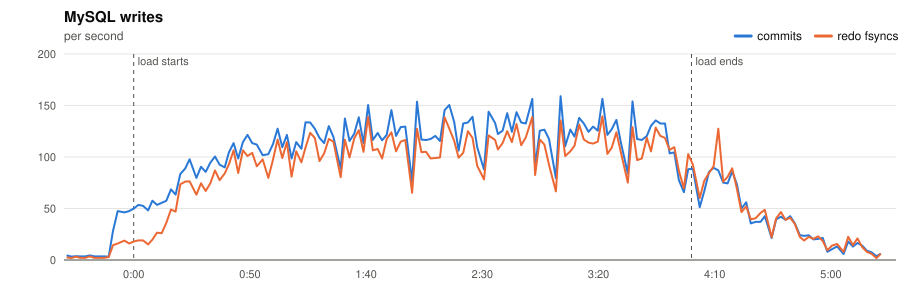

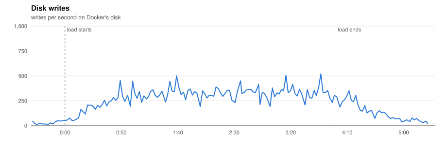

</details>

#### Resources

| Component | CPU avg (millicores) | CPU max | Throttled max (ms/s) | Memory max (MiB) |
|---|---|---|---|---|
| executor-service 52jf7 | 12 | 80 | 850 | 262 |
| executor-service 7wsm6 | 16 | 99 | 823 | 198 |
| scheduler-service tf7xc | 5 | 14 | 0 | 12 |
| fake-endpoint bcdlv | 12 | 44 | 0 | 116 |
| mysql | 76 | 160 | 0 | 996 |
| cassandra | 90 | 249 | 0 | 832 |
| toxiproxy | 26 | 50 | 0 | 22 |

MySQL: up to 159 commits/s, 140 redo fsyncs/s, 2 row lock waits/s, 15 connections.

#### CPU profiles

<details><summary>CPU profile: executor, 20 s from 2:08</summary>

```text
      flat  flat%   sum%        cum   cum%
```

</details>

<details><summary>CPU profile: scheduler, 20 s from 2:08</summary>

```text
      flat  flat%   sum%        cum   cum%
      50ms 62.50% 62.50%       50ms 62.50%  runtime.futex
      10ms 12.50% 75.00%       10ms 12.50%  github.com/go-sql-driver/mysql.(*mysqlConn).readPacket
      10ms 12.50% 87.50%       10ms 12.50%  internal/runtime/syscall.Syscall6
      10ms 12.50%   100%       10ms 12.50%  runtime.stealWork
         0     0%   100%       20ms 25.00%  database/sql.(*DB).execDC
         0     0%   100%       10ms 12.50%  database/sql.(*DB).execDC.func3
         0     0%   100%       20ms 25.00%  database/sql.(*Tx).ExecContext
         0     0%   100%       10ms 12.50%  database/sql.(*driverStmt).Close
         0     0%   100%       10ms 12.50%  database/sql.ctxDriverPrepare
         0     0%   100%       10ms 12.50%  database/sql.withLock
         0     0%   100%       20ms 25.00%  github.com/JoelTeoGom/distributed-scheduler/scheduler-service/internal/adapters/out/mysql.(*SchedulerRepository).ScheduleJobs
         0     0%   100%       20ms 25.00%  github.com/JoelTeoGom/distributed-scheduler/scheduler-service/internal/service.(*SchedulerService).Start
```

</details>

Run page: [reports/20261110T200247Z-timeout-20/report.md](reports/20261110T200247Z-timeout-20/report.md)

## Conclusions

**With the usual 30 s timeout, slow endpoints are harmless. With a timeout shorter than the endpoint, the customer does the work several times.**

- **Timeout 30 s:** 4,800 of 4,800 succeeded and the p99 start delay stayed at 0.53 s, with about 400 calls in flight. 10,000 workers per executor leave plenty of room for slow calls, and each executor stayed under 300 MiB.
- **Timeout 20 s:** about half the calls take longer. 618 jobs ended `dead`, the ones whose three attempts all passed 20 s (the expected 1 in 8). The endpoint finished 4,326 calls after the executor had given up: the customer did the work, the platform recorded a failure and sent the job again.
- The start delay was not affected in either run (p99 under 1 s): slow calls hold workers, but workers are not scarce.

A retry after a timeout cannot know whether the customer did the work. Only an idempotency key sent with every attempt lets the customer drop the repeats.
