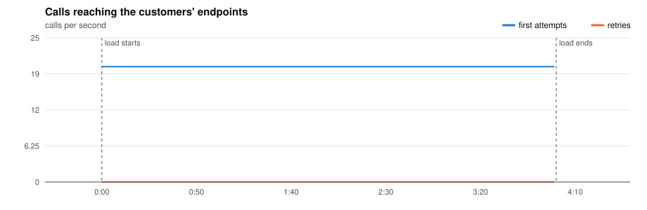
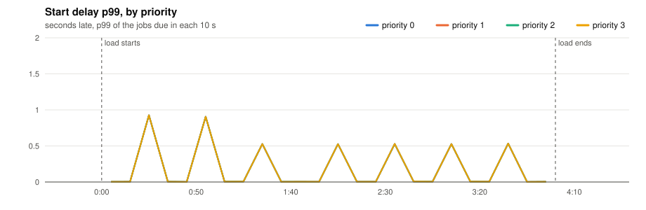
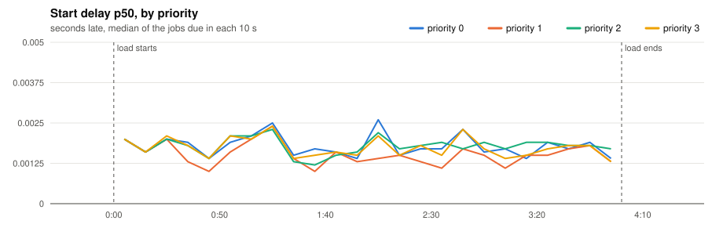
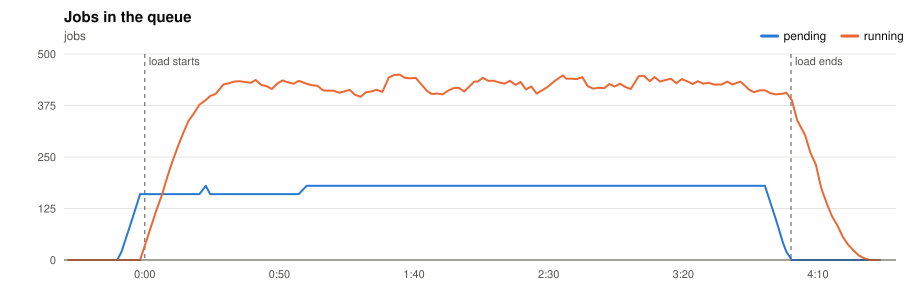
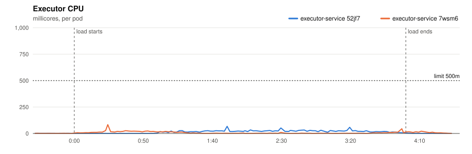
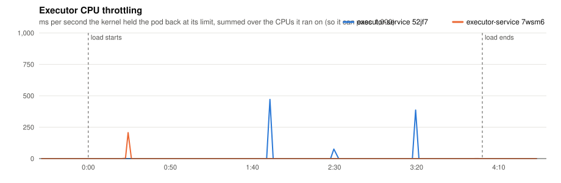
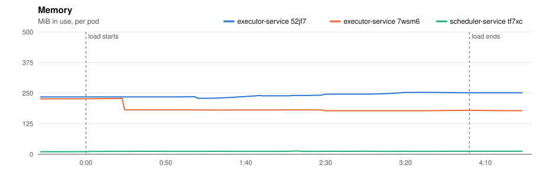
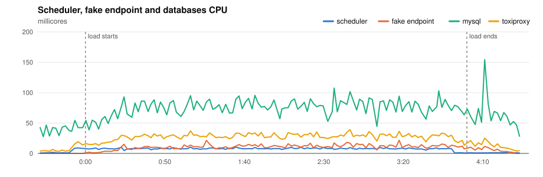
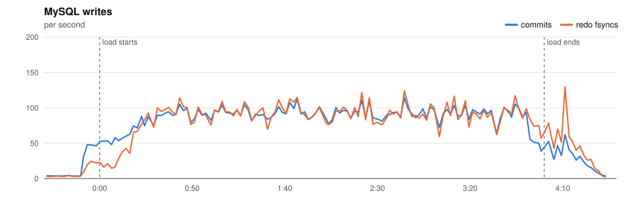
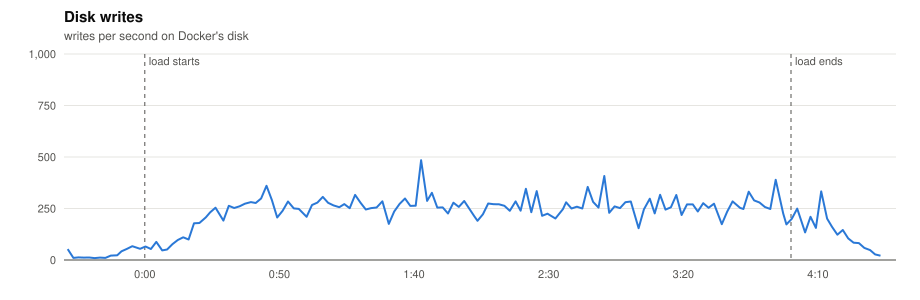

# P5 · 20261110T195707Z-timeout-30 (timeout-30)

- **Load:** 240 s of 20 one-off jobs per second, endpoint `dist=uniform&min=10000&max=30000`, timeout 30 s; 4,800 tasks seeded.
- **Deployment:** 2 executors; executor-service: `JOB_TIME_LIMIT_SECONDS=1 WORKER_COUNT=10000 JOB_QUEUE_SIZE=10000 PPROF_ADDR=:6060`; scheduler-service: `SCHEDULE_INTERVAL=1s SCHEDULE_LOOKAHEAD=10s PPROF_ADDR=:6060`
- **Raw data:** `bench/results/P5-slow-endpoints/runs/20261110T195707Z-timeout-30/` (local, not committed)

## Jobs

| Created | Succeeded | Dead | Still pending or running | Retried | Duplicate successes | Timed out, done anyway | Calls per second (first attempts) |
|---|---|---|---|---|---|---|---|
| 4,800 | 4,800 | 0 | 0 | 0 | 0 | 0 | 20.1 |

*Duplicate successes*: the endpoint answered 200 twice for one job, which only a failure should cause. *Timed out, done anyway*: the executor gave up after the timeout while the endpoint finished the work, so the retry made the customer process the job again.

**Start delay** (when the call reached the endpoint minus when the job was due, first attempts):

| Priority | Jobs | p50 | p90 | p99 | max |
|---|---|---|---|---|---|
| 0 | 1,200 | 0.002 s | 0.004 s | 0.533 s | 0.926 s |
| 1 | 1,200 | 0.002 s | 0.004 s | 0.533 s | 0.926 s |
| 2 | 1,200 | 0.002 s | 0.004 s | 0.533 s | 0.926 s |
| 3 | 1,200 | 0.002 s | 0.004 s | 0.533 s | 0.926 s |
| all | 4,800 | 0.002 s | 0.004 s | 0.533 s | 0.926 s |

## Charts

Time is minutes:seconds from the start of the load.





















## Resources

| Component | CPU avg (millicores) | CPU max | Throttled max (ms/s) | Memory max (MiB) |
|---|---|---|---|---|
| executor-service 52jf7 | 12 | 68 | 471 | 271 |
| executor-service 7wsm6 | 7 | 84 | 207 | 228 |
| scheduler-service tf7xc | 6 | 10 | 0 | 13 |
| fake-endpoint bcdlv | 8 | 22 | 0 | 158 |
| mysql | 68 | 154 | 0 | 987 |
| cassandra | 86 | 270 | 0 | 831 |
| toxiproxy | 22 | 39 | 0 | 22 |

MySQL: up to 114 commits/s, 130 redo fsyncs/s, 0 row lock waits/s, 14 connections.

## CPU profile: executor, 20 s from 2:08

```text
      flat  flat%   sum%        cum   cum%
      90ms 47.37% 47.37%       90ms 47.37%  runtime.futex
      40ms 21.05% 68.42%       40ms 21.05%  internal/runtime/syscall.Syscall6
      10ms  5.26% 73.68%       10ms  5.26%  github.com/go-sql-driver/mysql.(*mysqlConn).syncSequence (inline)
      10ms  5.26% 78.95%       10ms  5.26%  internal/runtime/atomic.(*Int32).Load
      10ms  5.26% 84.21%       10ms  5.26%  net.(*TCPConn).Write
      10ms  5.26% 89.47%       10ms  5.26%  runtime.cheaprandn
      10ms  5.26% 94.74%       10ms  5.26%  runtime.lock2
      10ms  5.26%   100%       10ms  5.26%  runtime.sellock
         0     0%   100%       90ms 47.37%  database/sql.(*DB).ExecContext
         0     0%   100%       90ms 47.37%  database/sql.(*DB).ExecContext.func1
         0     0%   100%       90ms 47.37%  database/sql.(*DB).exec
         0     0%   100%      100ms 52.63%  database/sql.(*DB).execDC
```

## CPU profile: scheduler, 20 s from 2:08

```text
      flat  flat%   sum%        cum   cum%
      40ms 44.44% 44.44%       40ms 44.44%  internal/runtime/syscall.Syscall6
      10ms 11.11% 55.56%       10ms 11.11%  database/sql.ctxDriverQuery
      10ms 11.11% 66.67%       10ms 11.11%  runtime.futex
      10ms 11.11% 77.78%       10ms 11.11%  runtime.nanotime
      10ms 11.11% 88.89%       10ms 11.11%  runtime.nextFreeFast (inline)
      10ms 11.11%   100%       10ms 11.11%  runtime.pMask.read
         0     0%   100%       60ms 66.67%  database/sql.(*DB).execDC
         0     0%   100%       10ms 11.11%  database/sql.(*DB).queryDC
         0     0%   100%       10ms 11.11%  database/sql.(*DB).queryDC.func1
         0     0%   100%       60ms 66.67%  database/sql.(*Tx).ExecContext
         0     0%   100%       10ms 11.11%  database/sql.(*Tx).QueryContext
         0     0%   100%       30ms 33.33%  database/sql.(*driverStmt).Close
```

## Conclusions

*(to be written)*
