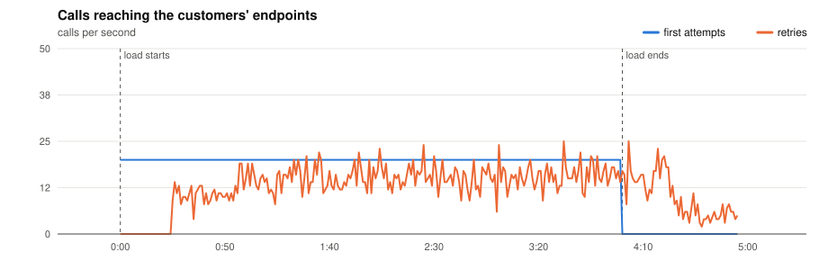
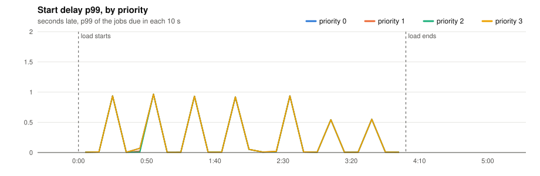
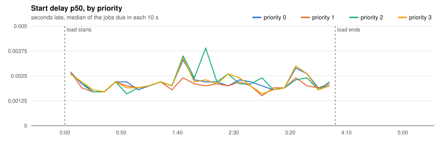
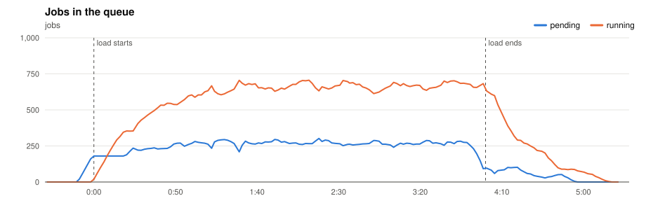
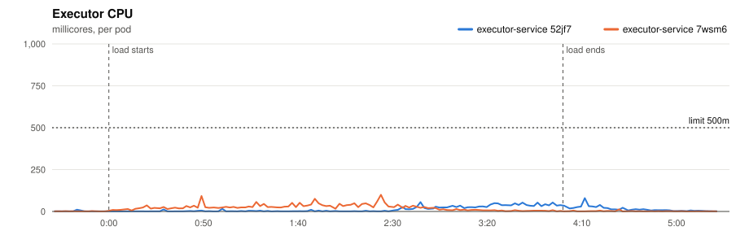
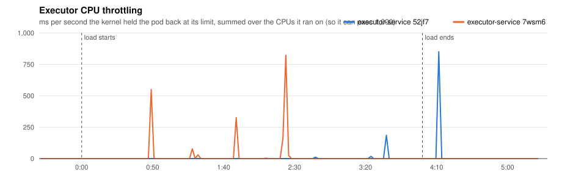
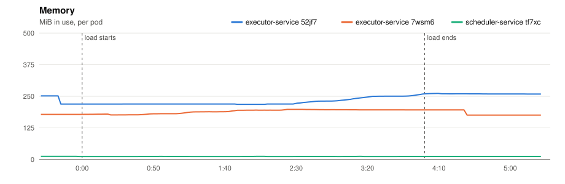
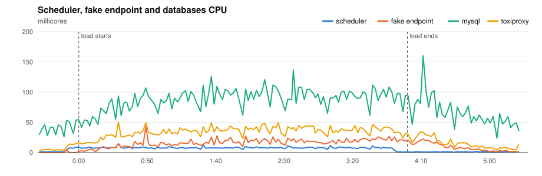
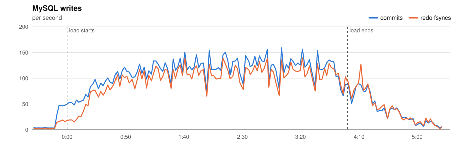
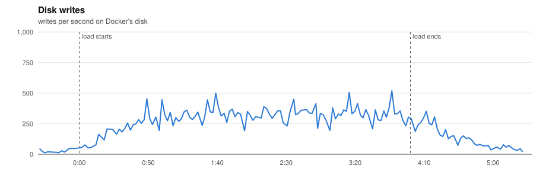

# P5 · 20261110T200247Z-timeout-20 (timeout-20)

- **Load:** 240 s of 20 one-off jobs per second, endpoint `dist=uniform&min=10000&max=30000`, timeout 20 s; 4,800 tasks seeded.
- **Deployment:** 2 executors; executor-service: `JOB_TIME_LIMIT_SECONDS=1 WORKER_COUNT=10000 JOB_QUEUE_SIZE=10000 PPROF_ADDR=:6060`; scheduler-service: `SCHEDULE_INTERVAL=1s SCHEDULE_LOOKAHEAD=10s PPROF_ADDR=:6060`
- **Raw data:** `bench/results/P5-slow-endpoints/runs/20261110T200247Z-timeout-20/` (local, not committed)

## Jobs

| Created | Succeeded | Dead | Still pending or running | Retried | Duplicate successes | Timed out, done anyway | Calls per second (first attempts) |
|---|---|---|---|---|---|---|---|
| 4,800 | 4,182 | 618 | 0 | 2,465 | 0 | 4,326 | 20.1 |

*Duplicate successes*: the endpoint answered 200 twice for one job, which only a failure should cause. *Timed out, done anyway*: the executor gave up after the timeout while the endpoint finished the work, so the retry made the customer process the job again.

**Start delay** (when the call reached the endpoint minus when the job was due, first attempts):

| Priority | Jobs | p50 | p90 | p99 | max |
|---|---|---|---|---|---|
| 0 | 1,200 | 0.002 s | 0.006 s | 0.937 s | 0.965 s |
| 1 | 1,200 | 0.002 s | 0.006 s | 0.935 s | 0.965 s |
| 2 | 1,200 | 0.002 s | 0.007 s | 0.937 s | 0.965 s |
| 3 | 1,200 | 0.002 s | 0.006 s | 0.937 s | 0.965 s |
| all | 4,800 | 0.002 s | 0.006 s | 0.937 s | 0.965 s |

## Charts

Time is minutes:seconds from the start of the load.





















## Resources

| Component | CPU avg (millicores) | CPU max | Throttled max (ms/s) | Memory max (MiB) |
|---|---|---|---|---|
| executor-service 52jf7 | 12 | 80 | 850 | 262 |
| executor-service 7wsm6 | 16 | 99 | 823 | 198 |
| scheduler-service tf7xc | 5 | 14 | 0 | 12 |
| fake-endpoint bcdlv | 12 | 44 | 0 | 116 |
| mysql | 76 | 160 | 0 | 996 |
| cassandra | 90 | 249 | 0 | 832 |
| toxiproxy | 26 | 50 | 0 | 22 |

MySQL: up to 159 commits/s, 140 redo fsyncs/s, 2 row lock waits/s, 15 connections.

## CPU profile: executor, 20 s from 2:08

```text
      flat  flat%   sum%        cum   cum%
```

## CPU profile: scheduler, 20 s from 2:08

```text
      flat  flat%   sum%        cum   cum%
      50ms 62.50% 62.50%       50ms 62.50%  runtime.futex
      10ms 12.50% 75.00%       10ms 12.50%  github.com/go-sql-driver/mysql.(*mysqlConn).readPacket
      10ms 12.50% 87.50%       10ms 12.50%  internal/runtime/syscall.Syscall6
      10ms 12.50%   100%       10ms 12.50%  runtime.stealWork
         0     0%   100%       20ms 25.00%  database/sql.(*DB).execDC
         0     0%   100%       10ms 12.50%  database/sql.(*DB).execDC.func3
         0     0%   100%       20ms 25.00%  database/sql.(*Tx).ExecContext
         0     0%   100%       10ms 12.50%  database/sql.(*driverStmt).Close
         0     0%   100%       10ms 12.50%  database/sql.ctxDriverPrepare
         0     0%   100%       10ms 12.50%  database/sql.withLock
         0     0%   100%       20ms 25.00%  github.com/JoelTeoGom/distributed-scheduler/scheduler-service/internal/adapters/out/mysql.(*SchedulerRepository).ScheduleJobs
         0     0%   100%       20ms 25.00%  github.com/JoelTeoGom/distributed-scheduler/scheduler-service/internal/service.(*SchedulerService).Start
```

## Conclusions

*(to be written)*
