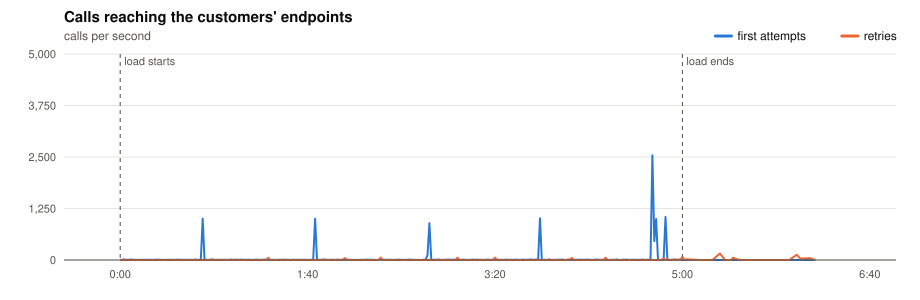
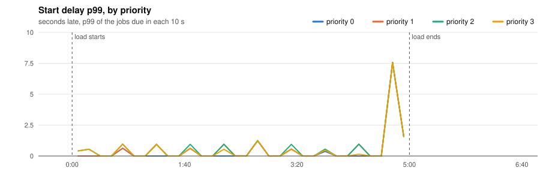
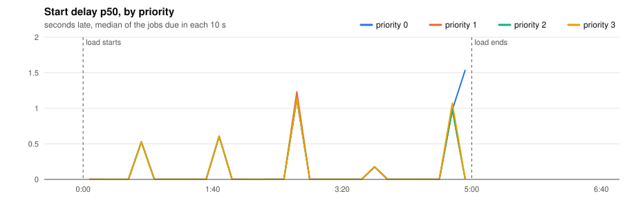
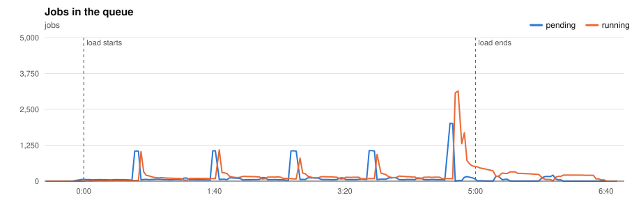
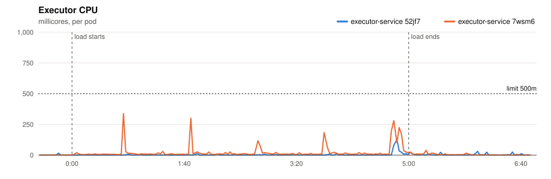
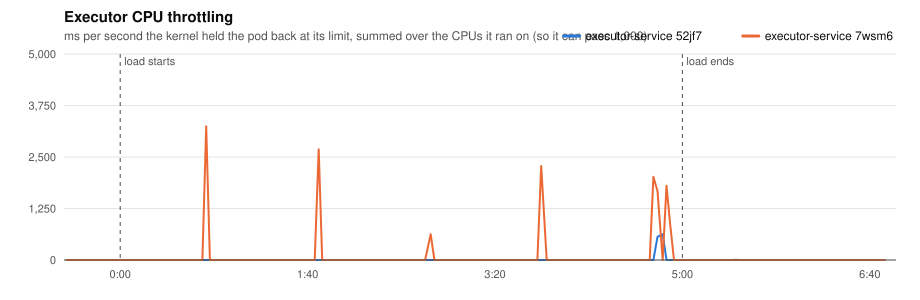
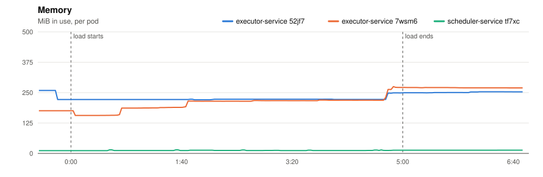
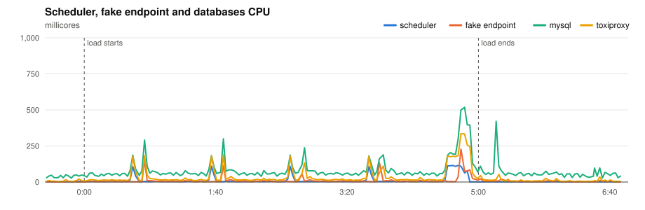
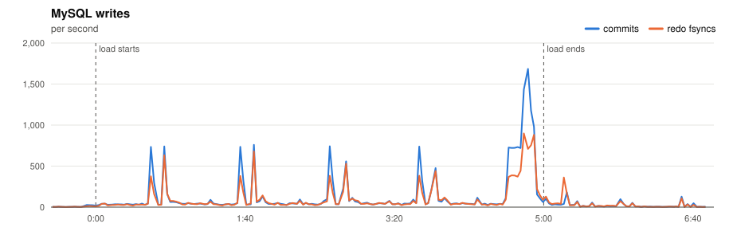
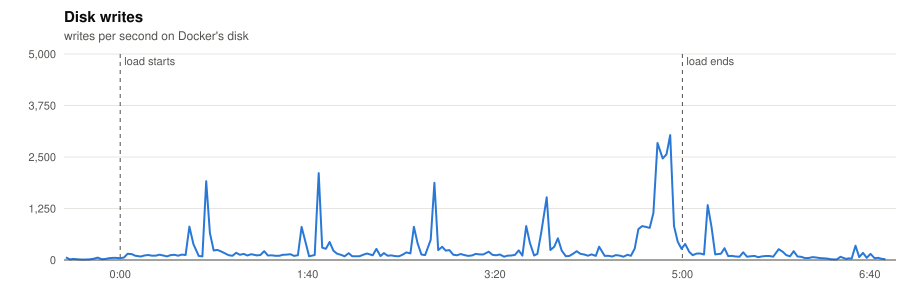

# P6 · Noisy neighbour

> Can one customer with a broken endpoint slow everybody else down?

**Load:** the model + one large customer whose endpoint hangs, 5 min
**Status:** run on 2026-11-10.

## What we test

P3's load, with one change: one of the ten largest customers has an endpoint that hangs for 30-31 s, past the 30 s timeout. Every one of its calls times out, retries twice and ends `dead`, holding a worker for 30 s each time.

**What to look at:**

- The start delay of every other customer, compared with P3: it should rise less than 20%.
- How many workers and how much executor CPU the broken customer takes.
- Whether its retries crowd out other customers' jobs at the :00 bursts.

## Results

- **Load:** 300 s of the platform model at scale 1.0: 1,000 minute, 4,000 five, 10,000 hour, 15,000 day, 1,667 at tasks; 31,667 tasks seeded.
- **Deployment:** 2 executors; executor-service: `JOB_TIME_LIMIT_SECONDS=1 WORKER_COUNT=10000 JOB_QUEUE_SIZE=10000 PPROF_ADDR=:6060`; scheduler-service: `SCHEDULE_INTERVAL=1s SCHEDULE_LOOKAHEAD=10s PPROF_ADDR=:6060`
- **Raw data:** `bench/results/P6-noisy-neighbour/runs/20261110T200915Z/` (local, not committed)

### Jobs

| Created | Succeeded | Dead | Still pending or running | Retried | Duplicate successes | Timed out, done anyway | Calls per second (first attempts) |
|---|---|---|---|---|---|---|---|
| 10,667 | 10,109 | 558 | 0 | 735 | 0 | 1,486 | 35.7 |

*Duplicate successes*: the endpoint answered 200 twice for one job, which only a failure should cause. *Timed out, done anyway*: the executor gave up after the timeout while the endpoint finished the work, so the retry made the customer process the job again.

**Start delay** (when the call reached the endpoint minus when the job was due, first attempts):

| Priority | Jobs | p50 | p90 | p99 | max |
|---|---|---|---|---|---|
| 0 | 523 | 0.840 s | 7.172 s | 7.465 s | 7.562 s |
| 1 | 1,561 | 0.823 s | 2.974 s | 7.561 s | 7.659 s |
| 2 | 6,577 | 0.824 s | 2.976 s | 7.563 s | 7.564 s |
| 3 | 2,006 | 0.827 s | 7.366 s | 7.562 s | 7.563 s |
| all | 10,667 | 0.824 s | 2.978 s | 7.562 s | 7.659 s |

- **Noisy tenant:** 1,338 calls to its hanging endpoint. Every other tenant: p99 **7.562 s**, p50 0.824 s, over 10,221 jobs.

### Charts

Time is minutes:seconds from the start of the load.





















### Resources

| Component | CPU avg (millicores) | CPU max | Throttled max (ms/s) | Memory max (MiB) |
|---|---|---|---|---|
| executor-service 52jf7 | 4 | 128 | 625 | 259 |
| executor-service 7wsm6 | 17 | 338 | 3246 | 275 |
| scheduler-service tf7xc | 9 | 114 | 0 | 14 |
| fake-endpoint bcdlv | 8 | 228 | 0 | 153 |
| mysql | 77 | 518 | 0 | 1015 |
| cassandra | 90 | 289 | 0 | 849 |
| toxiproxy | 30 | 335 | 0 | 24 |

MySQL: up to 1685 commits/s, 898 redo fsyncs/s, 1 row lock waits/s, 14 connections.

### CPU profiles

<details><summary>CPU profile: executor, 20 s from 1:47</summary>

```text
      flat  flat%   sum%        cum   cum%
      10ms 50.00% 50.00%       10ms 50.00%  internal/runtime/syscall.Syscall6
      10ms 50.00%   100%       10ms 50.00%  runtime.schedule
         0     0%   100%       10ms 50.00%  database/sql.(*Rows).Close
         0     0%   100%       10ms 50.00%  database/sql.(*Rows).Next
         0     0%   100%       10ms 50.00%  database/sql.(*Rows).close
         0     0%   100%       10ms 50.00%  database/sql.(*driverStmt).Close
         0     0%   100%       10ms 50.00%  github.com/JoelTeoGom/distributed-scheduler/executor-service/internal/adapters/out/mysql.(*JobRepository).ClaimJobs
         0     0%   100%       10ms 50.00%  github.com/JoelTeoGom/distributed-scheduler/executor-service/internal/adapters/out/mysql.selectClaimableJobIDs
         0     0%   100%       10ms 50.00%  github.com/JoelTeoGom/distributed-scheduler/executor-service/internal/service.(*WorkerService).StartWorkerPool
         0     0%   100%       10ms 50.00%  github.com/go-sql-driver/mysql.(*mysqlConn).writeCommandPacketUint32
         0     0%   100%       10ms 50.00%  github.com/go-sql-driver/mysql.(*mysqlConn).writePacket
         0     0%   100%       10ms 50.00%  github.com/go-sql-driver/mysql.(*mysqlConn).writeWithTimeout
```

</details>

<details><summary>CPU profile: scheduler, 20 s from 1:47</summary>

```text
      flat  flat%   sum%        cum   cum%
      10ms 33.33% 33.33%       20ms 66.67%  database/sql.withLock
      10ms 33.33% 66.67%       10ms 33.33%  internal/runtime/syscall.Syscall6
      10ms 33.33%   100%       10ms 33.33%  runtime.futex
         0     0%   100%       10ms 33.33%  database/sql.(*DB).BeginTx
         0     0%   100%       10ms 33.33%  database/sql.(*DB).BeginTx.func1
         0     0%   100%       10ms 33.33%  database/sql.(*DB).begin
         0     0%   100%       10ms 33.33%  database/sql.(*DB).beginDC
         0     0%   100%       10ms 33.33%  database/sql.(*DB).queryDC
         0     0%   100%       10ms 33.33%  database/sql.(*DB).queryDC.func2
         0     0%   100%       10ms 33.33%  database/sql.(*DB).retry
         0     0%   100%       10ms 33.33%  database/sql.(*Tx).QueryContext
         0     0%   100%       10ms 33.33%  database/sql.ctxDriverPrepare
```

</details>

Run page: [reports/20261110T200915Z/report.md](reports/20261110T200915Z/report.md)

## Conclusions

**No, within the objective.**

- The other customers' p99 was 7.56 s, against 6.67 s with the same load in P3: 13% more, under the 20% allowed. That p99 is still the scheduler's 5-minute batch, not the noisy customer.
- Its 1,338 hanging calls each held a worker for 30 s, at most a few hundred of the 20,000 workers.
- Its endpoint finished 1,486 calls after they had timed out: the repeated work of P5, now for one customer.
