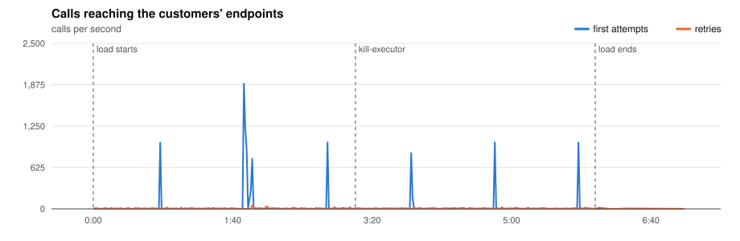
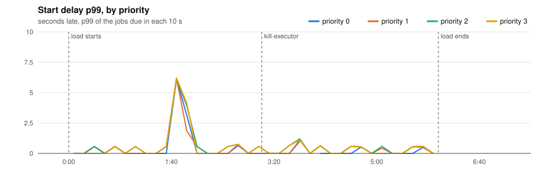
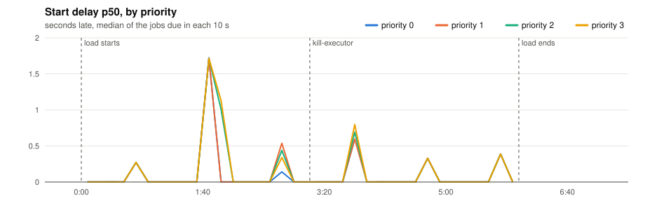
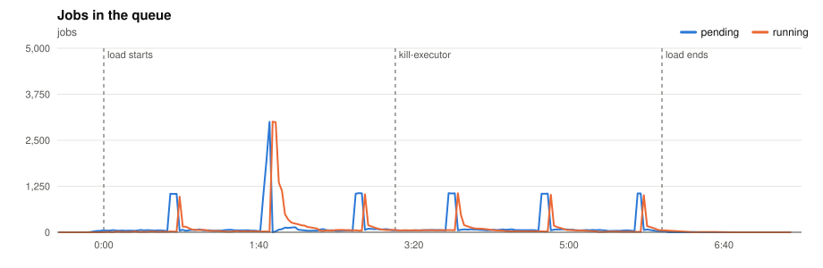
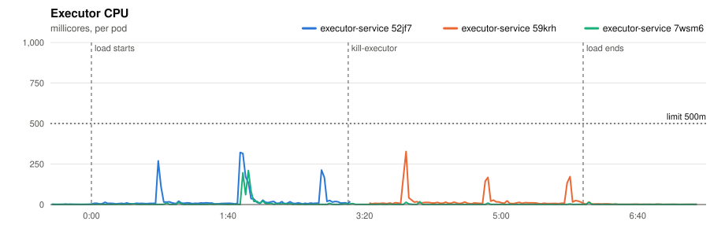
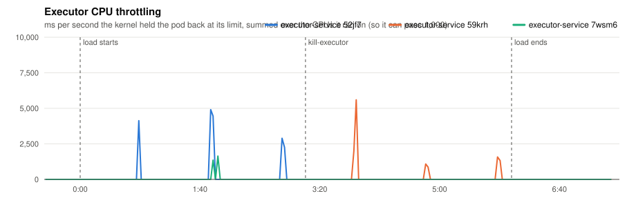
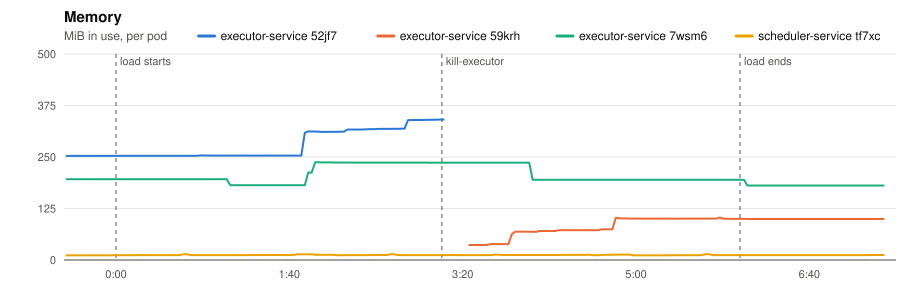
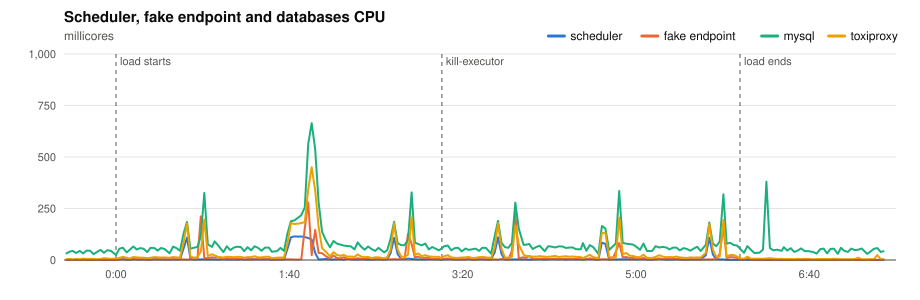
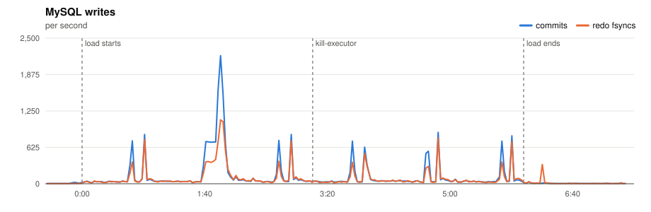
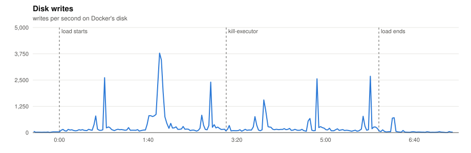

# P7 · 20261110T201711Z

- **Load:** 360 s of the platform model at scale 1.0: 1,000 minute, 4,000 five, 10,000 hour, 15,000 day, 2,000 at tasks; 32,000 tasks seeded.
- **Deployment:** 2 executors; executor-service: `JOB_TIME_LIMIT_SECONDS=1 WORKER_COUNT=10000 JOB_QUEUE_SIZE=10000 PPROF_ADDR=:6060`; scheduler-service: `SCHEDULE_INTERVAL=1s SCHEDULE_LOOKAHEAD=10s PPROF_ADDR=:6060`
- **Raw data:** `bench/results/P7-executor-dies/runs/20261110T201711Z/` (local, not committed)

## Jobs

| Created | Succeeded | Dead | Still pending or running | Retried | Duplicate successes | Timed out, done anyway | Calls per second (first attempts) |
|---|---|---|---|---|---|---|---|
| 12,000 | 11,821 | 179 | 0 | 379 | 0 | 163 | 33.4 |

*Duplicate successes*: the endpoint answered 200 twice for one job, which only a failure should cause. *Timed out, done anyway*: the executor gave up after the timeout while the endpoint finished the work, so the retry made the customer process the job again.

**Start delay** (when the call reached the endpoint minus when the job was due, first attempts):

| Priority | Jobs | p50 | p90 | p99 | max |
|---|---|---|---|---|---|
| 0 | 659 | 0.564 s | 2.118 s | 6.130 s | 6.131 s |
| 1 | 1,731 | 0.589 s | 2.118 s | 6.130 s | 6.209 s |
| 2 | 7,201 | 0.592 s | 2.117 s | 6.130 s | 6.216 s |
| 3 | 2,409 | 0.593 s | 2.118 s | 6.136 s | 6.210 s |
| all | 12,000 | 0.592 s | 2.118 s | 6.130 s | 6.216 s |

- **kill-executor** at 3:08: 1,009 jobs started more than 5 s late, the worst 6 s late. Duplicate successes: **0**.

## Charts

Time is minutes:seconds from the start of the load.





















## Resources

| Component | CPU avg (millicores) | CPU max | Throttled max (ms/s) | Memory max (MiB) |
|---|---|---|---|---|
| executor-service 52jf7 | 21 | 321 | 4906 | 341 |
| executor-service 59krh | 17 | 327 | 5596 | 103 |
| executor-service 7wsm6 | 4 | 210 | 1642 | 237 |
| scheduler-service tf7xc | 9 | 114 | 0 | 14 |
| fake-endpoint bcdlv | 11 | 279 | 0 | 152 |
| mysql | 79 | 664 | 0 | 1074 |
| cassandra | 87 | 307 | 0 | 853 |
| toxiproxy | 30 | 450 | 0 | 24 |

MySQL: up to 2199 commits/s, 1097 redo fsyncs/s, 1 row lock waits/s, 14 connections.

## CPU profile: executor, 20 s from 1:50

```text
      flat  flat%   sum%        cum   cum%
     200ms 39.22% 39.22%      200ms 39.22%  internal/runtime/syscall.Syscall6
     100ms 19.61% 58.82%      100ms 19.61%  runtime.futex
      20ms  3.92% 62.75%       40ms  7.84%  runtime.selectgo
      20ms  3.92% 66.67%       20ms  3.92%  runtime.write1
      10ms  1.96% 68.63%       10ms  1.96%  database/sql.(*Tx).rollback
      10ms  1.96% 70.59%       20ms  3.92%  database/sql.driverArgsConnLocked
      10ms  1.96% 72.55%      280ms 54.90%  github.com/JoelTeoGom/distributed-scheduler/executor-service/internal/service.(*WorkerService).executeJob
      10ms  1.96% 74.51%       60ms 11.76%  github.com/go-sql-driver/mysql.(*buffer).fill
      10ms  1.96% 76.47%       10ms  1.96%  github.com/go-sql-driver/mysql.(*mysqlResult).RowsAffected
      10ms  1.96% 78.43%       10ms  1.96%  github.com/go-sql-driver/mysql.(*mysqlStmt).CheckNamedValue
      10ms  1.96% 80.39%       10ms  1.96%  internal/runtime/atomic.(*Uint32).Load
      10ms  1.96% 82.35%       10ms  1.96%  net.(*rawConn).Read
```

## CPU profile: scheduler, 20 s from 1:50

```text
      flat  flat%   sum%        cum   cum%
      60ms 33.33% 33.33%       60ms 33.33%  internal/runtime/syscall.Syscall6
      50ms 27.78% 61.11%       50ms 27.78%  runtime.futex
      10ms  5.56% 66.67%       20ms 11.11%  github.com/go-sql-driver/mysql.(*mysqlConn).writeCommandPacketUint32
      10ms  5.56% 72.22%       10ms  5.56%  github.com/go-sql-driver/mysql.converter.ConvertValue
      10ms  5.56% 77.78%       20ms 11.11%  internal/poll.(*FD).Read
      10ms  5.56% 83.33%       10ms  5.56%  runtime.checkTimersNoP
      10ms  5.56% 88.89%       10ms  5.56%  runtime.nanotime
      10ms  5.56% 94.44%       30ms 16.67%  runtime.netpoll
      10ms  5.56%   100%       10ms  5.56%  runtime.nextFreeFast (inline)
         0     0%   100%      100ms 55.56%  database/sql.(*DB).execDC
         0     0%   100%       10ms  5.56%  database/sql.(*DB).execDC.func2
         0     0%   100%       40ms 22.22%  database/sql.(*DB).execDC.func3
```

## Conclusions

*(to be written)*
