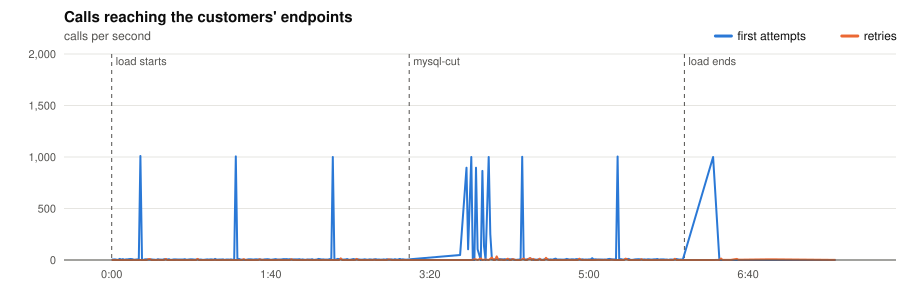
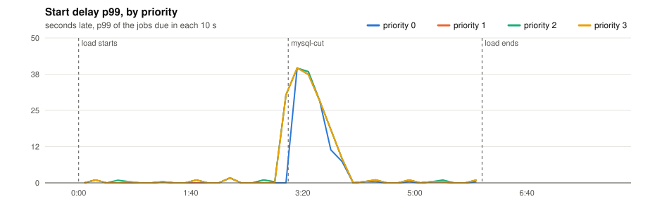
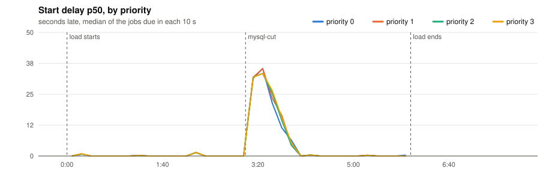
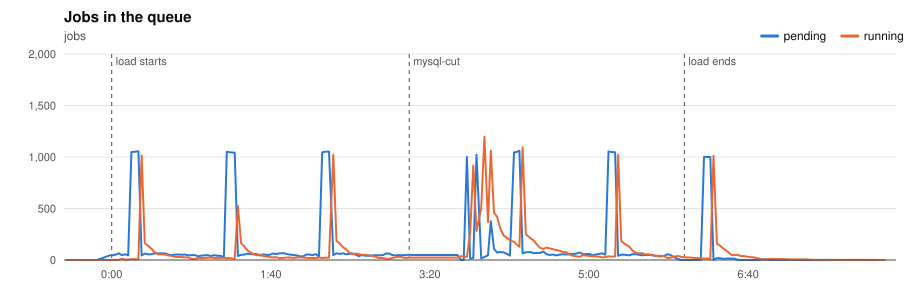
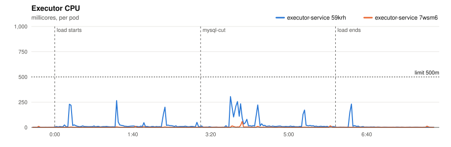
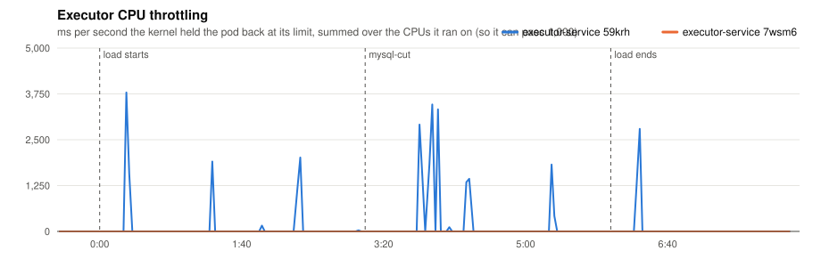
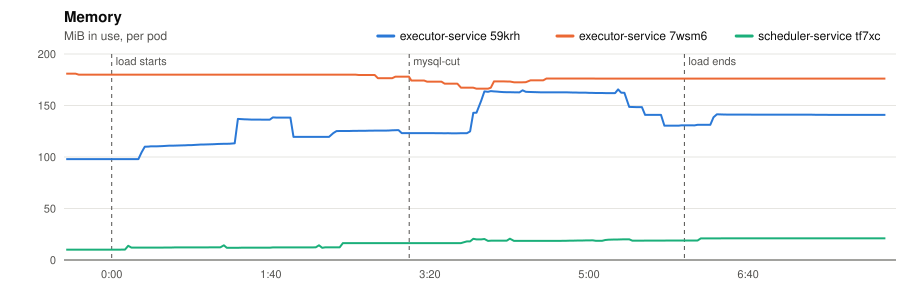
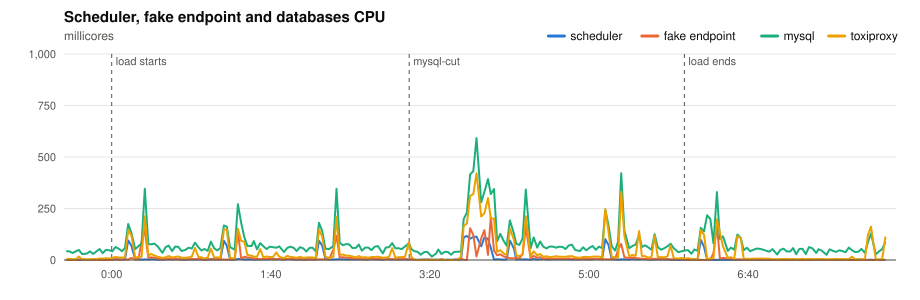
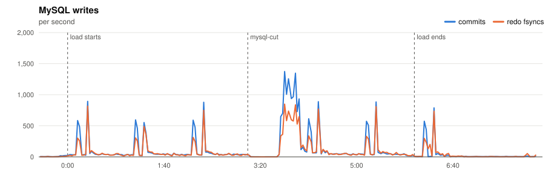
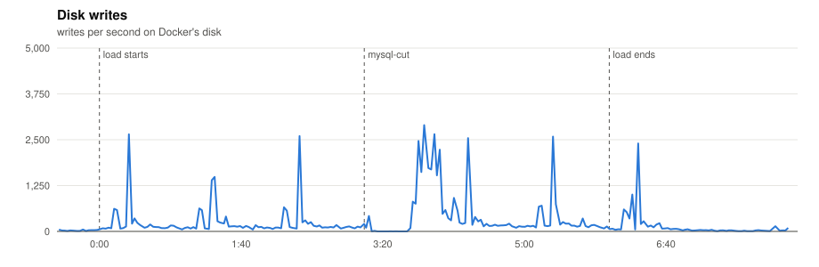

# P8 · MySQL outage

> If the database disappears for 30 seconds, do we lose anything?

**Load:** P3 + MySQL cut for 30 s, 6 min
**Status:** run on 2026-11-10.

## What we test

P3's load for 6 minutes. At 3:00 Toxiproxy refuses every connection to MySQL for 30 s, from every service, as if the database had failed over. Then it comes back.

**What to look at:**

- No job is lost: nothing is left pending or running after the drain.
- Duplicates: a job whose result could not be saved during the cut may run again.
- How long the services take to recover, and how late the jobs due during the cut start.

## Results

- **Load:** 360 s of the platform model at scale 1.0: 1,000 minute, 4,000 five, 10,000 hour, 15,000 day, 2,000 at tasks; 32,000 tasks seeded.
- **Deployment:** 2 executors; executor-service: `JOB_TIME_LIMIT_SECONDS=1 WORKER_COUNT=10000 JOB_QUEUE_SIZE=10000 PPROF_ADDR=:6060`; scheduler-service: `SCHEDULE_INTERVAL=1s SCHEDULE_LOOKAHEAD=10s PPROF_ADDR=:6060`
- **Raw data:** `bench/results/P8-mysql-outage/runs/20261110T202542Z/` (local, not committed)

### Jobs

| Created | Succeeded | Dead | Still pending or running | Retried | Duplicate successes | Timed out, done anyway | Calls per second (first attempts) |
|---|---|---|---|---|---|---|---|
| 13,000 | 12,883 | 117 | 0 | 327 | 16 | 164 | 34.3 |

*Duplicate successes*: the endpoint answered 200 twice for one job, which only a failure should cause. *Timed out, done anyway*: the executor gave up after the timeout while the endpoint finished the work, so the retry made the customer process the job again.

**Start delay** (when the call reached the endpoint minus when the job was due, first attempts):

| Priority | Jobs | p50 | p90 | p99 | max |
|---|---|---|---|---|---|
| 0 | 701 | 0.693 s | 35.489 s | 39.595 s | 39.691 s |
| 1 | 1,841 | 0.996 s | 35.996 s | 39.595 s | 39.691 s |
| 2 | 7,770 | 0.893 s | 35.989 s | 39.595 s | 40.377 s |
| 3 | 2,688 | 0.992 s | 35.999 s | 39.595 s | 40.373 s |
| all | 13,000 | 0.895 s | 35.990 s | 39.595 s | 40.377 s |

- **mysql-cut** at 3:07: 5,270 jobs started more than 5 s late, the worst 40 s late. Duplicate successes: **16**.

### Charts

Time is minutes:seconds from the start of the load.





















### Resources

| Component | CPU avg (millicores) | CPU max | Throttled max (ms/s) | Memory max (MiB) |
|---|---|---|---|---|
| executor-service 59krh | 21 | 305 | 3790 | 166 |
| executor-service 7wsm6 | 2 | 59 | 0 | 181 |
| scheduler-service tf7xc | 9 | 117 | 0 | 21 |
| fake-endpoint bcdlv | 11 | 209 | 0 | 113 |
| mysql | 82 | 592 | 0 | 1112 |
| cassandra | 125 | 1167 | 614 | 910 |
| toxiproxy | 37 | 421 | 0 | 24 |

MySQL: up to 1374 commits/s, 848 redo fsyncs/s, 1 row lock waits/s, 15 connections.

### CPU profiles

<details><summary>CPU profile: executor, 20 s from 1:20</summary>

```text
      flat  flat%   sum%        cum   cum%
      70ms 58.33% 58.33%       70ms 58.33%  internal/runtime/syscall.Syscall6
      10ms  8.33% 66.67%       40ms 33.33%  github.com/go-sql-driver/mysql.(*mysqlConn).writePacket
      10ms  8.33% 75.00%       10ms  8.33%  internal/poll.(*fdMutex).rwunlock
      10ms  8.33% 83.33%       10ms  8.33%  internal/runtime/maps.ctrlGroup.matchH2 (inline)
      10ms  8.33% 91.67%       10ms  8.33%  runtime.(*guintptr).cas (inline)
      10ms  8.33%   100%       10ms  8.33%  runtime.nanotime
         0     0%   100%       20ms 16.67%  bufio.(*Reader).Peek
         0     0%   100%       20ms 16.67%  bufio.(*Reader).fill
         0     0%   100%       10ms  8.33%  context.(*timerCtx).cancel
         0     0%   100%       10ms  8.33%  context.WithDeadlineCause.func2
         0     0%   100%       10ms  8.33%  context.removeChild
         0     0%   100%       30ms 25.00%  database/sql.(*DB).ExecContext
```

</details>

<details><summary>CPU profile: scheduler, 20 s from 1:20</summary>

```text
      flat  flat%   sum%        cum   cum%
      20ms 40.00% 40.00%       20ms 40.00%  internal/runtime/syscall.Syscall6
      20ms 40.00% 80.00%       20ms 40.00%  runtime.futex
      10ms 20.00%   100%       10ms 20.00%  runtime.unlock2
         0     0%   100%       20ms 40.00%  database/sql.(*DB).BeginTx
         0     0%   100%       20ms 40.00%  database/sql.(*DB).BeginTx.func1
         0     0%   100%       20ms 40.00%  database/sql.(*DB).begin
         0     0%   100%       20ms 40.00%  database/sql.(*DB).beginDC
         0     0%   100%       20ms 40.00%  database/sql.(*DB).beginDC.func1
         0     0%   100%       10ms 20.00%  database/sql.(*DB).queryDC
         0     0%   100%       10ms 20.00%  database/sql.(*DB).queryDC.func2
         0     0%   100%       20ms 40.00%  database/sql.(*DB).retry
         0     0%   100%       10ms 20.00%  database/sql.(*Tx).QueryContext
```

</details>

Run page: [reports/20261110T202542Z/report.md](reports/20261110T202542Z/report.md)

## Conclusions

**Nothing lost; 16 jobs ran twice, as the design allows.**

- Every job finished once MySQL came back, and nothing was left pending.
- The jobs due during the cut waited for it: 5,270 started more than 5 s late, the worst 40 s (the 30 s cut plus the recovery).
- 16 jobs succeeded twice. They were called on time and succeeded, but their result could not be saved while MySQL was down, so their lease expired and the reconciler ran them again, about 70 s after they were due. That is at-least-once delivery, within the objective: duplicates only after a failure, and at most the jobs in flight.
- Every service recovered on its own, with no restart: the claim and the schedule loops log the error and try again on the next tick.
