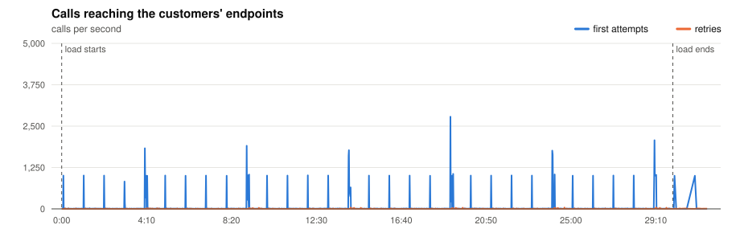
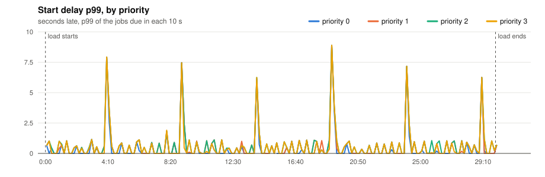
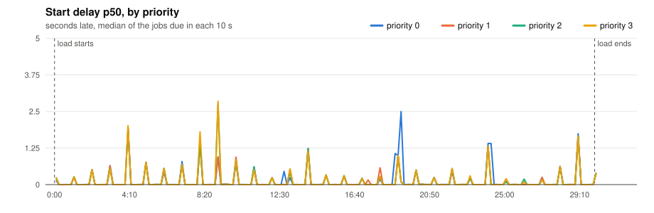
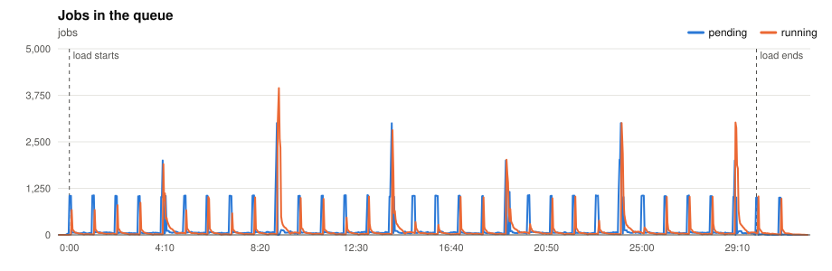
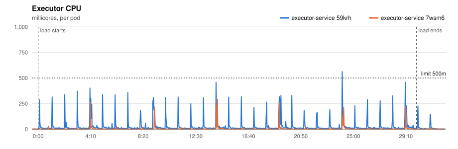
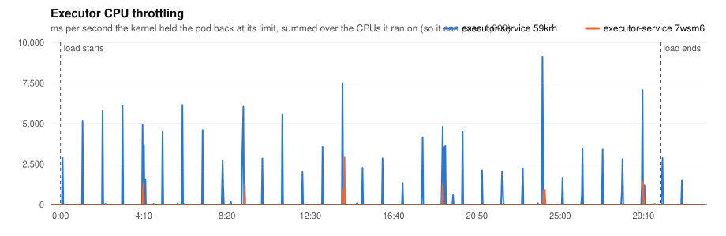
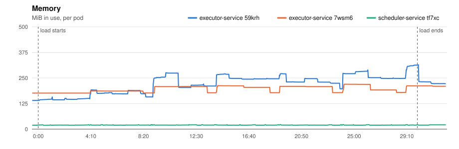
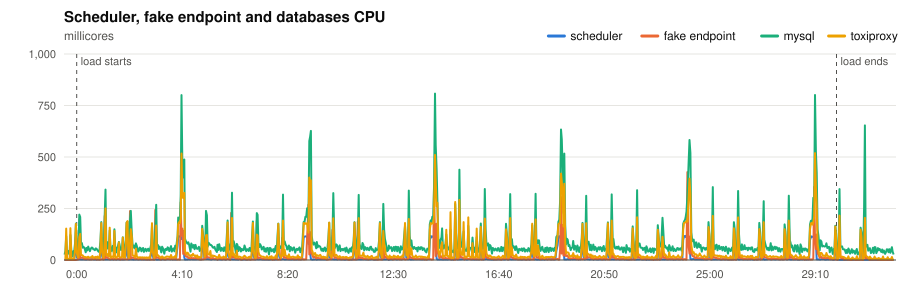
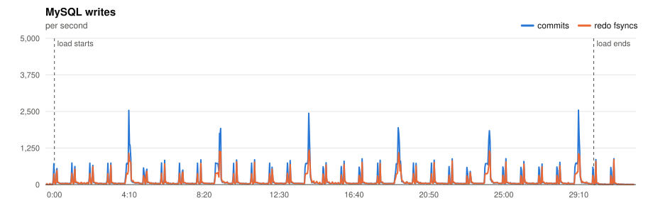
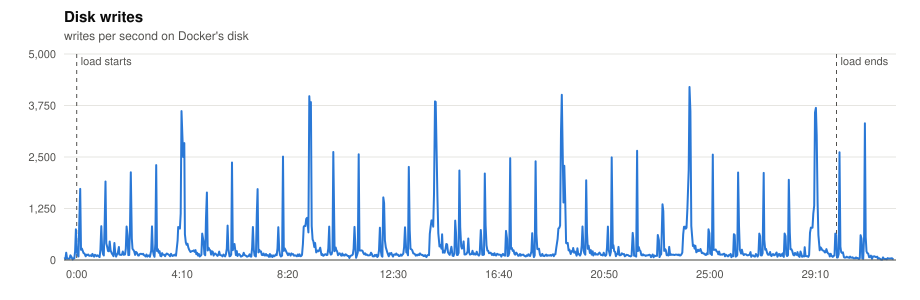

# P9 · Long run

> After hours of running, is it still as fast as at the start?

**Load:** the model, 30 min
**Status:** run on 2026-11-10.

## What we test

The platform model for 30 minutes on 2 executors, the longest run of this round. CPU profiles are taken at 5 and at 28 minutes, to compare.

**What to look at:**

- The start delay over time: p99 at the end should match the start.
- Memory of every service over time: it should stay flat, not climb.
- MySQL: whether writes or row lock waits grow as the tables do, and whether the archiver keeps up.

## Results

- **Load:** 1800 s of the platform model at scale 1.0: 1,000 minute, 4,000 five, 10,000 hour, 15,000 day, 10,000 at tasks; 40,000 tasks seeded.
- **Deployment:** 2 executors; executor-service: `JOB_TIME_LIMIT_SECONDS=1 WORKER_COUNT=10000 JOB_QUEUE_SIZE=10000 PPROF_ADDR=:6060`; scheduler-service: `SCHEDULE_INTERVAL=1s SCHEDULE_LOOKAHEAD=10s PPROF_ADDR=:6060`
- **Raw data:** `bench/results/P9-long-run/runs/20261110T203454Z/` (local, not committed)

### Jobs

| Created | Succeeded | Dead | Still pending or running | Retried | Duplicate successes | Timed out, done anyway | Calls per second (first attempts) |
|---|---|---|---|---|---|---|---|
| 66,000 | 65,297 | 703 | 0 | 1,648 | 0 | 844 | 35.4 |

*Duplicate successes*: the endpoint answered 200 twice for one job, which only a failure should cause. *Timed out, done anyway*: the executor gave up after the timeout while the endpoint finished the work, so the retry made the customer process the job again.

**Start delay** (when the call reached the endpoint minus when the job was due, first attempts):

| Priority | Jobs | p50 | p90 | p99 | max |
|---|---|---|---|---|---|
| 0 | 3,579 | 0.609 s | 4.253 s | 8.495 s | 8.894 s |
| 1 | 9,569 | 0.646 s | 4.992 s | 8.696 s | 8.894 s |
| 2 | 39,920 | 0.646 s | 4.699 s | 8.697 s | 8.896 s |
| 3 | 12,932 | 0.621 s | 4.699 s | 8.798 s | 8.896 s |
| all | 66,000 | 0.639 s | 4.699 s | 8.696 s | 8.896 s |

### Charts

Time is minutes:seconds from the start of the load.





















### Resources

| Component | CPU avg (millicores) | CPU max | Throttled max (ms/s) | Memory max (MiB) |
|---|---|---|---|---|
| executor-service 59krh | 26 | 561 | 9131 | 315 |
| executor-service 7wsm6 | 4 | 293 | 2946 | 220 |
| scheduler-service tf7xc | 12 | 119 | 0 | 22 |
| fake-endpoint bcdlv | 14 | 427 | 0 | 174 |
| mysql | 89 | 808 | 0 | 1202 |
| cassandra | 110 | 1734 | 2040 | 992 |
| toxiproxy | 44 | 519 | 0 | 24 |

MySQL: up to 2546 commits/s, 1182 redo fsyncs/s, 3 row lock waits/s, 15 connections.

### CPU profiles

<details><summary>CPU profile: executor, 20 s from 5:14</summary>

```text
      flat  flat%   sum%        cum   cum%
      60ms 60.00% 60.00%       60ms 60.00%  internal/runtime/syscall.Syscall6
      10ms 10.00% 70.00%       10ms 10.00%  internal/godebug.(*Setting).Value
      10ms 10.00% 80.00%       10ms 10.00%  runtime.futex
      10ms 10.00% 90.00%       10ms 10.00%  runtime.gopark
      10ms 10.00%   100%       10ms 10.00%  runtime.selectgo
         0     0%   100%       10ms 10.00%  bufio.(*Reader).Peek
         0     0%   100%       10ms 10.00%  bufio.(*Reader).fill
         0     0%   100%       40ms 40.00%  database/sql.(*DB).ExecContext
         0     0%   100%       40ms 40.00%  database/sql.(*DB).ExecContext.func1
         0     0%   100%       40ms 40.00%  database/sql.(*DB).exec
         0     0%   100%       40ms 40.00%  database/sql.(*DB).execDC
         0     0%   100%       40ms 40.00%  database/sql.(*DB).execDC.func3
```

</details>

<details><summary>CPU profile: executor, 20 s from 29:24</summary>

```text
      flat  flat%   sum%        cum   cum%
      90ms 47.37% 47.37%       90ms 47.37%  internal/runtime/syscall.Syscall6
      20ms 10.53% 57.89%       20ms 10.53%  runtime.futex
      20ms 10.53% 68.42%       20ms 10.53%  runtime.memclrNoHeapPointers
      10ms  5.26% 73.68%       20ms 10.53%  net/http.(*persistConn).readLoop
      10ms  5.26% 78.95%       10ms  5.26%  runtime.getcallerfp
      10ms  5.26% 84.21%       20ms 10.53%  runtime.mallocgcSmallScanNoHeader
      10ms  5.26% 89.47%       40ms 21.05%  runtime.schedule
      10ms  5.26% 94.74%       10ms  5.26%  runtime.selectgo
      10ms  5.26%   100%       10ms  5.26%  time.Time.appendFormatRFC3339
         0     0%   100%       40ms 21.05%  bufio.(*Writer).Flush
         0     0%   100%       10ms  5.26%  context.WithDeadline
         0     0%   100%       10ms  5.26%  context.WithDeadlineCause
```

</details>

<details><summary>CPU profile: scheduler, 20 s from 5:14</summary>

```text
      flat  flat%   sum%        cum   cum%
      20ms 50.00% 50.00%       20ms 50.00%  internal/runtime/syscall.Syscall6
      10ms 25.00% 75.00%       10ms 25.00%  runtime.casgstatus
      10ms 25.00%   100%       10ms 25.00%  runtime.gopark
         0     0%   100%       10ms 25.00%  database/sql.(*DB).execDC
         0     0%   100%       10ms 25.00%  database/sql.(*DB).queryDC
         0     0%   100%       10ms 25.00%  database/sql.(*DB).queryDC.func2
         0     0%   100%       10ms 25.00%  database/sql.(*Tx).ExecContext
         0     0%   100%       10ms 25.00%  database/sql.(*Tx).QueryContext
         0     0%   100%       10ms 25.00%  database/sql.(*driverStmt).Close
         0     0%   100%       10ms 25.00%  database/sql.ctxDriverPrepare
         0     0%   100%       10ms 25.00%  database/sql.withLock
         0     0%   100%       20ms 50.00%  github.com/JoelTeoGom/distributed-scheduler/scheduler-service/internal/adapters/out/mysql.(*SchedulerRepository).ScheduleJobs
```

</details>

<details><summary>CPU profile: scheduler, 20 s from 29:24</summary>

```text
      flat  flat%   sum%        cum   cum%
      10ms 50.00% 50.00%       10ms 50.00%  runtime.isSystemGoroutine
      10ms 50.00%   100%       10ms 50.00%  runtime.nanotime (inline)
         0     0%   100%       10ms 50.00%  database/sql.(*DB).BeginTx
         0     0%   100%       10ms 50.00%  database/sql.(*DB).BeginTx.func1
         0     0%   100%       10ms 50.00%  database/sql.(*DB).begin
         0     0%   100%       10ms 50.00%  database/sql.(*DB).beginDC
         0     0%   100%       10ms 50.00%  database/sql.(*DB).retry
         0     0%   100%       10ms 50.00%  github.com/JoelTeoGom/distributed-scheduler/scheduler-service/internal/adapters/out/mysql.(*SchedulerRepository).ScheduleJobs
         0     0%   100%       10ms 50.00%  github.com/JoelTeoGom/distributed-scheduler/scheduler-service/internal/service.(*SchedulerService).Start
         0     0%   100%       10ms 50.00%  main.main.func2
         0     0%   100%       10ms 50.00%  runtime.(*timers).check
         0     0%   100%       10ms 50.00%  runtime.findRunnable
```

</details>

Run page: [reports/20261110T203454Z/report.md](reports/20261110T203454Z/report.md)

## Conclusions

**Yes, for 30 minutes.**

| Window | Jobs | Start delay p50 / p99 |
|---|---|---|
| 0-5 min | 10,652 | 0.54 / 7.92 s |
| 5-10 min | 10,651 | 0.84 / 7.45 s |
| 10-15 min | 10,650 | 0.71 / 6.24 s |
| 15-20 min | 10,633 | 0.50 / 8.89 s |
| 20-25 min | 10,769 | 0.55 / 7.16 s |
| 25-30 min | 10,645 | 0.74 / 6.25 s |

- No trend: the p99 moves between 6 and 9 s with the 5-minute bursts, as in P3, and the p50 stays under 1 s.
- Memory stayed flat: the executors went up and down between 175 and 313 MiB, the scheduler stayed at ~20 MiB, and MySQL went from 1.15 to 1.20 GiB as its buffer pool warmed up.
- 30 minutes rules out a fast leak. Hours, or the archiver under a full hour of history, need a longer run.
