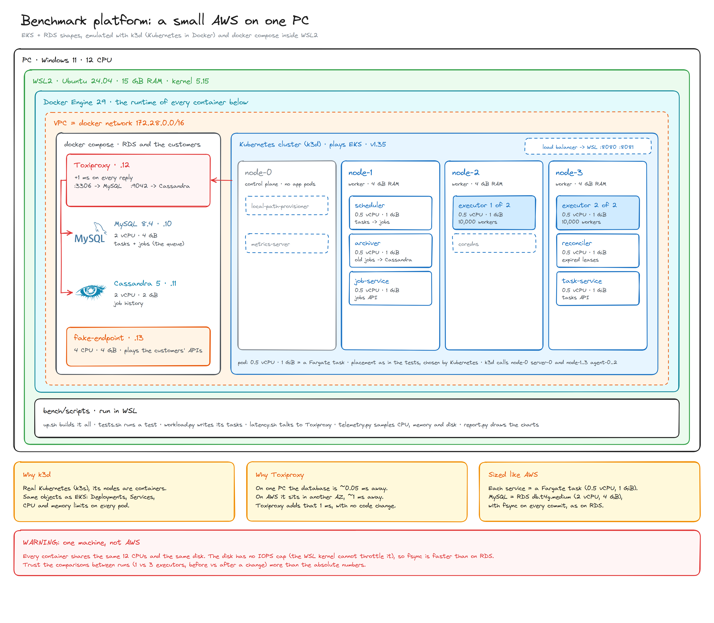
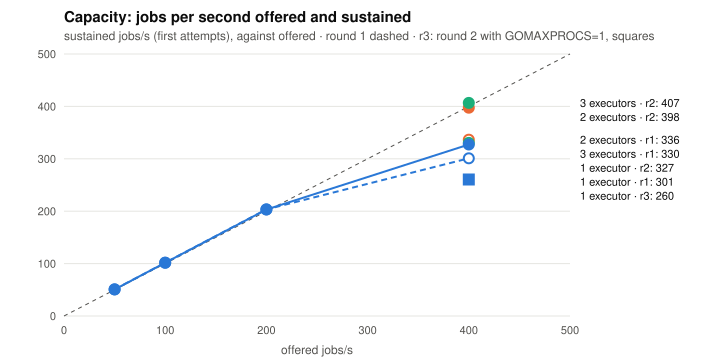
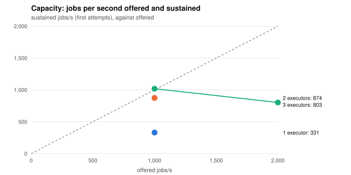

# Benchmarks

> How the scheduler behaves under the load of a real platform: how many jobs it runs, how late they start, and what breaks first.

The tests answer the questions a product owner would ask before launch. The work went in four steps:

1. **Build the platform.** A small AWS-shaped deployment on one PC: a Kubernetes cluster that plays EKS, with the databases outside it like RDS, 1 ms away. See [the platform](#1-the-platform).
2. **Model the load.** A cron platform with 1,000 customers and 50,000 tasks, whose crons all land on second :00. See [the workload](#2-the-workload-a-platform-like-a-real-one).
3. **Decide what to measure.** Objectives for the start delay and for lost or duplicated jobs, and telemetry of every pod every 2 seconds. See [how we measure](#3-how-we-measure).
4. **Run the tests.** A calibration round, P0, then nine tests, P1 to P9, each answering one question. See [the tests](#4-the-tests) and [what we learned](#5-what-we-learned).

| Test | Question |
|---|---|
| [P0](#p0--calibration) | Does the bench measure well, and is it never the bottleneck itself? |
| [P1](#p1--smoke-test) | Does every job run once, and on time, when nothing is going on? |
| [P2](#p2--capacity) | How many jobs per second can we run, and does adding servers help? |
| [P3](#p3--normal-day) | On a normal day, do jobs start when they should? |
| [P4](#p4--the-0900-peak) | At 09:00, when 30,000 jobs are due in the same second, how long until they have all run? Do the important ones go first? |
| [P5](#p5--slow-endpoints) | What if our customers' endpoints are slow, 10 to 30 seconds per call? |
| [P6](#p6--noisy-neighbour) | Can one customer with a broken endpoint slow everybody else down? |
| [P7](#p7--an-executor-dies) | If a server dies in the middle of the work, are its jobs lost or run twice? |
| [P8](#p8--mysql-outage) | If the database disappears for 30 seconds, do we lose anything? |
| [P9](#p9--long-run) | After hours of running, is it still as fast as at the start? |
| [P10](#p10--the-ceiling) | With the scheduler fixed, how many jobs per second can 1, 2 and 3 executors run, and how many workers do they need? |
| [P11](#p11--peak-tuning) | How many jobs per second can the platform drain at the 09:00 peak, tuning only settings and replicas? |

**Status:** every test ran on 2026-11-10. After the scheduler fix, P2, P3 and P4 ran again and P10 was added, on 2026-11-19; the peak was tuned in P11 on 2026-11-19 and 20, summed up step by step in [peak-tuning.pdf](docs/benchmarks/peak-tuning.pdf). [What we learned](#5-what-we-learned) sums them up, and [round 2](#round-2-after-the-scheduler-fix) compares the two rounds.

> [!WARNING]
> Every number here comes from an **emulated** AWS on one machine. It shows the order of magnitude and, above all, **what breaks first**. Comparisons between runs (1 vs 3 executors, before vs after a change) are more reliable than absolute values. See [threats to validity](#7-threats-to-validity).

---

## 1. The platform



*Drawn from [docs/benchmarks/diagram](docs/benchmarks/diagram): edit `draw.mjs` and run `render.sh` to export it again.*

> [!NOTE]
> This is the most realistic setup that can be built quickly on one PC: a real Kubernetes cluster (k3d) with a control plane and three worker nodes, every service sized like an AWS Fargate task, and the databases outside the cluster like RDS, 1 ms away as in another availability zone. The services run unchanged: the same images and configuration as anywhere else.

### What runs where

| Component | Plays the role of | Runs on | CPU | Memory |
|---|---|---|---|---|
| node-0 | EKS control plane | k3d server | shared | no cap |
| node-1, node-2, node-3 | EKS worker nodes | k3d agents | shared | 4 GB each |
| executor-service × 2 | | worker nodes | 0.5 vCPU each | 1 GiB each |
| scheduler-service | | a worker node | 0.5 vCPU | 1 GiB |
| reconciler, archiver, task-service, job-service | | worker nodes | 0.5 vCPU each | 1 GiB each |
| fake-endpoint | customers' APIs | docker compose, outside the cluster (a worker node until P11) | 4 vCPU (2 until P11) | 4 GB (512 MiB until P11) |
| MySQL 8.4 | RDS `db.t4g.medium` | docker compose | 2 vCPU | 4 GB (3 GB buffer pool) |
| Cassandra 5 | a small Cassandra node | docker compose | 2 vCPU | 2 GB |
| Toxiproxy | the network between AZs | docker compose | | |

CPU and memory limits equal requests on every pod, so no pod can borrow from another. CoreDNS, metrics-server and the local-path provisioner come with k3s.

> [!IMPORTANT]
> **Decisions forced by the machine** (Windows + WSL2 + Docker Engine 29):
> - **Latency with Toxiproxy, not `tc netem`.** The WSL kernel has no `netem`. The pods reach `mysql:3306` and `cassandra:9042` through Toxiproxy, which delays every reply by 1 ms. Cassandra announces Toxiproxy's address, or the driver would find the real one and skip it.
> - **No disk cap.** The WSL kernel cannot throttle block I/O, and Docker drops the cap without an error. MySQL writes to the local disk, faster than an RDS volume.
> - **Three worker nodes, not two.** Seven pods of 1 GiB do not fit in two nodes of 4 GB, and node-0 runs no app pods, like an EKS control plane.
> - **cgroup v1.** Docker in WSL runs on cgroup v1, which the kubelet refuses since Kubernetes 1.35 unless told otherwise (`fail-cgroupv1=false`).
> - **CPU limits forced on.** k3s misreads WSL's cgroup v1 layout and starts the kubelet without CPU quotas, so every pod could use all 12 CPUs. `cpu-cfs-quota=true` turns them back on: found by the calibration round, [P0](bench/results/P0-calibration/README.md).

### Service settings for the tests

Every database poll runs faster than the defaults, and the executors have workers to spare. The first runs, before the tests, showed why: the executor claims every `JOB_TIME_LIMIT_SECONDS`, and a job holds its worker while it waits for its time, so one executor runs at most `WORKER_COUNT / JOB_TIME_LIMIT_SECONDS` jobs per second, 5 with the defaults (see [P0](bench/results/P0-calibration/README.md)).

| Service | Setting | Default | In the tests |
|---|---|---|---|
| executor | replicas × `WORKER_COUNT` | 1 × 50 | **2 × 10,000** |
| executor | claim every `JOB_TIME_LIMIT_SECONDS`, that far ahead | 10 s | **1 s** |
| scheduler | `SCHEDULE_INTERVAL` / `SCHEDULE_LOOKAHEAD` | 5 s / 30 s | **1 s / 10 s** |
| reconciler | `RECONCILE_INTERVAL` | 1 min | **10 s** |
| archiver | `ARCHIVE_INTERVAL` | 1 min | **10 s** |

P11 tuned the peak further: a 200 ms scheduler tick, 4 executors, claims every 250 ms, 500 ms ahead, and GOMAXPROCS from each pod's CPU limit. Its table lists every value tried.

The executor and the scheduler serve Go's `pprof` on `:6060` (`PPROF_ADDR`), off unless set.

How it works underneath, in separate articles:

- [How a query reaches MySQL](docs/benchmarks/articles/latency.md): the path through Toxiproxy, and how the 1 ms was checked.
- [The life of a job during a test](docs/benchmarks/articles/life-of-a-job.md): from the seeded task to the saved result.
- [The fake endpoint](docs/benchmarks/articles/fake-endpoint.md): what the jobs call, and how it measures them.


## 2. The workload: a platform like a real one

What defines a cron platform is not its average load but its **aligned peaks**: people schedule at the top of the minute and the hour (`0 * * * *`, `0 9 * * *`), so the average is low and everything lands on second :00.

The model: **1,000 customers and 50,000 active tasks**, the 10 largest customers holding 40% of them.

| Kind of task | Share | Tasks | When they fire |
|---|---|---|---|
| Cron every minute | 2% | 1,000 | 1,000 jobs on second :00 of every minute |
| Cron every 5 minutes | 8% | 4,000 | 4,000 jobs at :00, :05, :10… |
| Cron every hour | 20% | 10,000 | 10,000 jobs at the top of the hour |
| Cron every day at 09:00 | 30% | 15,000 | 15,000 jobs at 09:00:00 |
| One-off (`at`): reminders, delayed webhooks | 40% | ~20,000 per hour | at random times, ~5.5 per second |

About **38 jobs per second on average**, with peaks of 1,000 jobs every minute, 5,000 every 5 minutes, 15,000 every hour and **30,000 at 09:00:00**, when all of them meet.

Every task calls a customer endpoint with one of these behaviours:

| Endpoint | Share | Behaviour |
|---|---|---|
| Fast | 80% | ~150 ms, with a long tail |
| Slow | 12% | 1 to 10 s |
| Very slow | 5% | 10 to 30 s; some reach the timeout |
| Flaky | 2% | 503 on 30% of the calls, so it retries |
| Down | 1% | always 503, ends `dead` |

Every task has a 30 s timeout, 3 attempts and a 5 s backoff. Priorities: 5% critical (0), 15% high (1), 60% normal (2), 20% low (3). The base deployment runs **2 executors**, as production would for availability.


## 3. How we measure

**Service level objectives** for this round:

| | Target |
|---|---|
| On time, normal load | p99 start delay ≤ 1 s, every priority |
| On time, during a peak | priority 0 p99 ≤ 5 s; the whole peak run within 60 s |
| Nothing lost | 0 lost jobs; duplicates only after a failure, at most the jobs in flight |
| Isolation | a customer with a broken endpoint raises the others' p99 by less than 20% |
| Retries | flaky endpoints succeed within their 3 attempts; dead ones end `dead` |

**Start delay** is when the call reached the endpoint minus when the job was due, measured by the fake endpoint. Every test reports it as **p50, p90, p99 and max**, per priority and over time.

**Resources, every 2 seconds**, read straight from the kernel (cgroups and `/proc`), with nothing installed in the cluster:

| What | Metrics | Units |
|---|---|---|
| Every pod | CPU, % of its limit, time throttled by the limit, memory in use | millicores, %, ms per second, MiB |
| MySQL, Cassandra, Toxiproxy | CPU, memory | millicores, MiB |
| Disk | writes, throughput, write latency, busy time | per second, MB/s, ms, % |
| MySQL | commits, redo `fsync`s, row lock waits, running queries, connections | per second, count |
| Queue | jobs pending and running, finished and dead per second | count, per second |

**Every call and every job:** the fake endpoint records each call it receives (arrival, due time, priority, tenant, endpoint profile, attempt, status), and each job row is exported from MySQL at the end, so a delay can be followed from the claim to the call.

**Profiling:** each test takes 20-second CPU profiles of one executor and of the scheduler at its busiest moment, plus the executor's heap and goroutines.

**Durations**, kept short for this first round:

| Test | Load | Duration |
|---|---|---|
| Calibration | minimal | ~10 min |
| P1 | 10% of the model | 3 min |
| P2 | fast endpoints, 50 → 800 jobs/s in steps; then 2 and 3 executors | ~20 min |
| P3 | the model | 5 min |
| P4 | the model + the 09:00 peak | 8 min |
| P5 | 20 jobs/s, every endpoint 10-30 s; timeout 30 s, then 20 s | 2 × 4 min |
| P6 | the model + one large customer whose endpoint hangs | 5 min |
| P7 | P3 + one executor killed halfway | 6 min |
| P8 | P3 + MySQL cut for 30 s | 6 min |
| P9 | the model | 30 min |

Each test also waits one minute before the load and until the queue is empty after it.

## 4. The tests

Each test has its question, what it does, its results and conclusions here, and a full write-up behind its link: how it runs, what to look at, every chart over time, the resources each component used and the CPU profiles.

### P0 · Calibration

> Does the bench measure well, and is it never the bottleneck itself?

**What we test:** the bench itself, before any test: every network link, what each component uses when idle, the 1 ms of emulated latency, how much load the fake endpoint takes, and a reference run of 50 jobs per second.

| Check | Result |
|---|---|
| Connectivity | 26 checks ok |
| Telemetry cost | 15 millicores while sampling every 2 s |
| Emulated latency | +1.17 ms per query with the toxic |
| Fake endpoint headroom | 1,996 of 2,000 calls/s, 0 errors |
| Reference run | 3,000 / 3,000 succeeded, 0 duplicates, start delay p99 0.21 s |

**Conclusions:** the bench measures well and is not the bottleneck. It found CPU limits off (k3s misreads WSL's cgroups; forced on now), and whole seconds of jobs starting up to 1 s late every ~31 s, which the later tests point to the host's disk writeback.

→ [The full test](bench/results/P0-calibration/README.md): the steps, the first runs before the plan, and both findings.

### P1 · Smoke test

> Does every job run once, and on time, when nothing is going on?

**What we test:** 10% of the model for 3 minutes on 2 executors: the first test after calibration, with nothing else in the way.

<!-- results:P1 -->
| Run | Jobs | Succeeded | Dead | Unfinished | Duplicates | Calls/s | Start delay p50 / p90 / p99 / max |
|---|---|---|---|---|---|---|---|
| [run](bench/results/P1-smoke/reports/20261110T191929Z/report.md) | 400 | 397 | 3 | 0 | 0 | 2.3 | 0.01 / 0.07 / 0.24 / 0.72 s |
<!-- /results:P1 -->

**Conclusions:** Yes: every job ran once (the 3 dead are the always-down endpoint), p99 0.24 s, and nothing came close to a limit.

→ [The full test](bench/results/P1-smoke/README.md): how it runs, what to look at, every chart, resources and CPU profiles.

### P2 · Capacity

> How many jobs per second can we run, and does adding servers help?

**What we test:** one executor with fast endpoints, 50 to 800 jobs per second in 60-second steps until it cannot keep up; then that rate on 2 and 3 executors.

<!-- results:P2 -->
| Run | Jobs | Succeeded | Dead | Unfinished | Duplicates | Calls/s | Start delay p50 / p90 / p99 / max |
|---|---|---|---|---|---|---|---|
| [1x-50](bench/results/P2-capacity/reports/20261110T192413Z-1x-50/report.md) | 3,000 | 3,000 | 0 | 0 | 0 | 50.8 | 0.00 / 0.01 / 0.80 / 0.80 s |
| [1x-100](bench/results/P2-capacity/reports/20261110T192623Z-1x-100/report.md) | 6,000 | 6,000 | 0 | 0 | 0 | 101.7 | 0.00 / 0.01 / 0.80 / 0.80 s |
| [1x-200](bench/results/P2-capacity/reports/20261110T192832Z-1x-200/report.md) | 12,000 | 12,000 | 0 | 0 | 0 | 203.4 | 0.01 / 0.10 / 0.81 / 1.01 s |
| [1x-400](bench/results/P2-capacity/reports/20261110T193042Z-1x-400/report.md) | 24,000 | 24,000 | 0 | 0 | 0 | 300.9 | 3.36 / 21.85 / 26.65 / 27.95 s |
| [2x-400](bench/results/P2-capacity/reports/20261110T193326Z-2x-400/report.md) | 24,000 | 24,000 | 0 | 0 | 0 | 336.5 | 3.52 / 11.73 / 13.92 / 14.22 s |
| [3x-400](bench/results/P2-capacity/reports/20261110T193552Z-3x-400/report.md) | 24,000 | 24,000 | 0 | 0 | 0 | 330.3 | 4.28 / 12.47 / 14.67 / 16.07 s |
| [r2-1x-50](bench/results/P2-capacity/reports/20261119T202410Z-r2-1x-50/report.md) | 3,000 | 3,000 | 0 | 0 | 0 | 50.8 | 0.00 / 0.01 / 0.62 / 0.62 s |
| [r2-1x-100](bench/results/P2-capacity/reports/20261119T202620Z-r2-1x-100/report.md) | 6,000 | 6,000 | 0 | 0 | 0 | 101.7 | 0.00 / 0.01 / 0.64 / 0.65 s |
| [r2-1x-200](bench/results/P2-capacity/reports/20261119T202828Z-r2-1x-200/report.md) | 12,000 | 12,000 | 0 | 0 | 0 | 203.3 | 0.01 / 0.10 / 0.53 / 0.53 s |
| [r2-1x-400](bench/results/P2-capacity/reports/20261119T203217Z-r2-1x-400/report.md) | 24,000 | 24,000 | 0 | 0 | 0 | 327.3 | 3.46 / 13.85 / 19.34 / 20.55 s |
| [r2-2x-400](bench/results/P2-capacity/reports/20261119T203410Z-r2-2x-400/report.md) | 24,000 | 24,000 | 0 | 0 | 0 | 397.5 | 0.01 / 0.39 / 1.09 / 1.95 s |
| [r2-3x-400](bench/results/P2-capacity/reports/20261119T203538Z-r2-3x-400/report.md) | 24,000 | 24,000 | 0 | 0 | 0 | 406.7 | 0.01 / 0.12 / 0.62 / 0.84 s |
| [r3-1x-400](bench/results/P2-capacity/reports/20261119T210827Z-r3-1x-400/report.md) | 24,000 | 24,000 | 0 | 0 | 0 | 260.5 | 0.06 / 11.75 / 20.25 / 21.35 s |


<!-- /results:P2 -->

**Conclusions:** About 300 jobs/s, and more executors do not help: the **scheduler** is the limit. It creates at most 1,000 jobs per tick with one `UPDATE` per task, ~~about 3.3 s per tick, so about 300 jobs/s~~ (**fixed:** an N+1, now one statement per tick, [details](bench/results/P2-capacity/README.md#fixed-an-n1-in-the-scheduler)); it used 100 of its 500 millicores, waiting on the database. The executors sit idle waiting for jobs, and MySQL had room left. **Round 2, after the fix:** 1, 2 and 3 executors do 327, 398 and 407 jobs/s at 400 offered, with p99 19.3, 1.09 and 0.62 s. Executors scale out, and the new limit is one executor's 0.5 vCPU at ~330 jobs/s. `GOMAXPROCS=1` lowered the throttling but also the throughput, to 260/s.

→ [The full test](bench/results/P2-capacity/README.md): how it runs, what to look at, every chart, resources and CPU profiles.

### P3 · Normal day

> On a normal day, do jobs start when they should?

**What we test:** the whole model for 5 minutes on 2 executors: 1,000 jobs on second :00 of every minute, 4,000 more at the 5-minute mark, one-off jobs in between. The reference for P6, P7 and P8.

<!-- results:P3 -->
| Run | Jobs | Succeeded | Dead | Unfinished | Duplicates | Calls/s | Start delay p50 / p90 / p99 / max |
|---|---|---|---|---|---|---|---|
| [run](bench/results/P3-normal-day/reports/20261110T193822Z/report.md) | 10,667 | 10,496 | 171 | 0 | 0 | 35.7 | 0.60 / 2.19 / 6.67 / 6.68 s |
| [r2](bench/results/P3-normal-day/reports/20261119T203712Z-r2/report.md) | 10,667 | 10,576 | 91 | 0 | 0 | 35.7 | 0.31 / 2.18 / 2.28 / 2.28 s |
<!-- /results:P3 -->

**Conclusions:** On ordinary seconds yes (≤ 0.9 s); at the 5-minute mark, with 5,005 jobs due at once, no: 6.7 s. Part is the executors firing ~3,000 calls at 0.5 vCPU (~2 s), most is the scheduler's last batches of 1,000 arriving after their time. **Fixed** for the scheduler's part (see P2); the executors' ~2 s remains. **Round 2, after the fix:** p99 2.28 s. Every job is claimed on time; the 5-minute burst is now the executors' CPU alone, and one-off jobs have a p99 of 0.57 s.

→ [The full test](bench/results/P3-normal-day/README.md): how it runs, what to look at, every chart, resources and CPU profiles.

### P4 · The 09:00 peak

> When 30,000 jobs are due in the same second, how long until they have all run? Do the important ones go first?

**What we test:** the model for 8 minutes with the 09:00 moved into the run, when every kind of cron meets: about 30,000 jobs due on one second.

<!-- results:P4 -->
| Run | Jobs | Succeeded | Dead | Unfinished | Duplicates | Calls/s | Start delay p50 / p90 / p99 / max |
|---|---|---|---|---|---|---|---|
| [run](bench/results/P4-0900-peak/reports/20261110T194554Z/report.md) | 44,667 | 44,168 | 499 | 0 | 1 | 90.3 | 23.36 / 77.38 / 91.74 / 94.14 s |
| [r2](bench/results/P4-0900-peak/reports/20261119T204356Z-r2/report.md) | 39,667 | 39,266 | 401 | 0 | 20 | 80.9 | 6.53 / 23.44 / 37.16 / 37.77 s |
| [r3](bench/results/P4-0900-peak/reports/20261119T212505Z-r3/report.md) | 39,667 | 39,211 | 456 | 0 | 31 | 82.2 | 3.70 / 21.59 / 34.52 / 34.66 s |

- **09:00 peak:** 30,007 jobs due on the same second. The last one started **94.1 s** late (p50 43.3 s, p99 91.7 s); priority 0 p99 **91.6 s**.
- **Peak throughput:** every job of the peak had started **94.1 s** after it (p99 91.7 s), **319 jobs/s**; 2,816 in its busiest second. First attempts that never reached the endpoint: **0**.
- **Peak by priority** (p50 / p99 / max, first attempts): 0: 40.0 / 91.6 / 91.9 s; 1: 43.5 / 91.7 / 94.0 s; 2: 43.5 / 91.7 / 94.1 s; 3: 40.0 / 91.7 / 94.1 s.

- **09:00 peak:** 29,099 jobs due on the same second. The last one started **37.8 s** late (p50 9.0 s, p99 37.6 s); priority 0 p99 **23.4 s**.
- **Peak throughput:** every job of the peak had started **50.1 s** after it (p99 46.5 s), **599 jobs/s**; 6,502 in its busiest second. First attempts that never reached the endpoint: **908**.
- **Peak by priority** (p50 / p99 / max, first attempts): 0: 8.2 / 23.4 / 23.6 s; 1: 8.5 / 23.5 / 23.6 s; 2: 9.0 / 35.4 / 37.8 s; 3: 9.0 / 37.7 / 37.8 s.

- **09:00 peak:** 29,893 jobs due on the same second. The last one started **34.7 s** late (p50 13.3 s, p99 34.6 s); priority 0 p99 **34.5 s**.
- **Peak throughput:** every job of the peak had started **40.0 s** after it (p99 34.6 s), **749 jobs/s**; 7,379 in its busiest second. First attempts that never reached the endpoint: **112**.
- **Peak by priority** (p50 / p99 / max, first attempts): 0: 13.2 / 34.5 / 34.5 s; 1: 13.2 / 34.6 / 34.6 s; 2: 13.6 / 34.6 / 34.7 s; 3: 13.1 / 34.5 / 34.6 s.
<!-- /results:P4 -->

**Conclusions:** No: 94 s for the whole peak, against 60 s, and priority 0 as late as everyone else. The scheduler creates the 30 batches of 1,000 in ~~about 100 s~~ (**fixed**, see P2) and picks tasks by time alone, so priority cannot help jobs that do not exist yet (still open). **Round 2, after the fix:** every job of the peak had started by 50.1 s, within the 60 s (599 jobs/s), and the first attempts of priority 0 and 1 by 23.6 s against 37.8 s for 2 and 3. Priority 0 is still far from its 5 s; the executors' CPU is now the limit. **GOMAXPROCS from the CPU limit:** the peak drained at 749 jobs/s instead of 599 (+25%), with 64% less throttling and 23% less executor CPU; priority stopped counting, because the scheduler's 1,000 jobs per second became the limit again. From round 1: ×2.35 jobs/s at the peak, every job started by 40.0 s instead of 94.1 s.

→ [The full test](bench/results/P4-0900-peak/README.md): how it runs, what to look at, every chart, resources and CPU profiles.

### P5 · Slow endpoints

> What if our customers' endpoints are slow, 10 to 30 seconds per call?

**What we test:** 20 jobs per second for 4 minutes, every endpoint taking 10 to 30 s; once with the 30 s timeout and once with 20 s, which half the calls exceed.

<!-- results:P5 -->
| Run | Jobs | Succeeded | Dead | Unfinished | Duplicates | Calls/s | Start delay p50 / p90 / p99 / max |
|---|---|---|---|---|---|---|---|
| [timeout-30](bench/results/P5-slow-endpoints/reports/20261110T195707Z-timeout-30/report.md) | 4,800 | 4,800 | 0 | 0 | 0 | 20.1 | 0.00 / 0.00 / 0.53 / 0.93 s |
| [timeout-20](bench/results/P5-slow-endpoints/reports/20261110T200247Z-timeout-20/report.md) | 4,800 | 4,182 | 618 | 0 | 0 | 20.1 | 0.00 / 0.01 / 0.94 / 0.96 s |
<!-- /results:P5 -->

**Conclusions:** Harmless with the 30 s timeout (4,800/4,800, p99 0.53 s). With 20 s, 618 jobs ended dead and the customers finished 4,326 calls the platform had given up on, so the work was repeated: retries need an idempotency key.

→ [The full test](bench/results/P5-slow-endpoints/README.md): how it runs, what to look at, every chart, resources and CPU profiles.

### P6 · Noisy neighbour

> Can one customer with a broken endpoint slow everybody else down?

**What we test:** P3's load, with one of the ten largest customers' endpoint hanging past the 30 s timeout.

<!-- results:P6 -->
| Run | Jobs | Succeeded | Dead | Unfinished | Duplicates | Calls/s | Start delay p50 / p90 / p99 / max |
|---|---|---|---|---|---|---|---|
| [run](bench/results/P6-noisy-neighbour/reports/20261110T200915Z/report.md) | 10,667 | 10,109 | 558 | 0 | 0 | 35.7 | 0.82 / 2.98 / 7.56 / 7.66 s |

- **Noisy tenant:** 1,338 calls to its hanging endpoint. Every other tenant: p99 **7.562 s**, p50 0.824 s, over 10,221 jobs.
<!-- /results:P6 -->

**Conclusions:** No: the others' p99 rose 13% (7.56 s against 6.67 s in P3), under the 20% allowed. The hanging customer held a few hundred of the 20,000 workers.

→ [The full test](bench/results/P6-noisy-neighbour/README.md): how it runs, what to look at, every chart, resources and CPU profiles.

### P7 · An executor dies

> If a server dies in the middle of the work, are its jobs lost or run twice?

**What we test:** P3's load for 6 minutes, with one of the two executors killed at 3:00 with no grace period.

<!-- results:P7 -->
| Run | Jobs | Succeeded | Dead | Unfinished | Duplicates | Calls/s | Start delay p50 / p90 / p99 / max |
|---|---|---|---|---|---|---|---|
| [run](bench/results/P7-executor-dies/reports/20261110T201711Z/report.md) | 12,000 | 11,821 | 179 | 0 | 0 | 33.4 | 0.59 / 2.12 / 6.13 / 6.22 s |

- **kill-executor** at 3:08: 1,009 jobs started more than 5 s late, the worst 6 s late. Duplicate successes: **0**.
<!-- /results:P7 -->

**Conclusions:** Nothing lost, nothing run twice, and no visible delay. The kill came between bursts, when the executor held few jobs; a kill during a burst would test the reconciler harder.

→ [The full test](bench/results/P7-executor-dies/README.md): how it runs, what to look at, every chart, resources and CPU profiles.

### P8 · MySQL outage

> If the database disappears for 30 seconds, do we lose anything?

**What we test:** P3's load for 6 minutes, with every connection to MySQL refused for 30 s at 3:00.

<!-- results:P8 -->
| Run | Jobs | Succeeded | Dead | Unfinished | Duplicates | Calls/s | Start delay p50 / p90 / p99 / max |
|---|---|---|---|---|---|---|---|
| [run](bench/results/P8-mysql-outage/reports/20261110T202542Z/report.md) | 13,000 | 12,883 | 117 | 0 | 16 | 34.3 | 0.90 / 35.99 / 39.59 / 40.38 s |

- **mysql-cut** at 3:07: 5,270 jobs started more than 5 s late, the worst 40 s late. Duplicate successes: **16**.
<!-- /results:P8 -->

**Conclusions:** Nothing lost; 16 jobs ran twice because their result could not be saved during the cut, and the reconciler ran them again after their lease. Every service recovered on its own.

→ [The full test](bench/results/P8-mysql-outage/README.md): how it runs, what to look at, every chart, resources and CPU profiles.

### P9 · Long run

> After hours of running, is it still as fast as at the start?

**What we test:** the model for 30 minutes, with CPU profiles at 5 and at 28 minutes.

<!-- results:P9 -->
| Run | Jobs | Succeeded | Dead | Unfinished | Duplicates | Calls/s | Start delay p50 / p90 / p99 / max |
|---|---|---|---|---|---|---|---|
| [run](bench/results/P9-long-run/reports/20261110T203454Z/report.md) | 66,000 | 65,297 | 703 | 0 | 0 | 35.4 | 0.64 / 4.70 / 8.70 / 8.90 s |
<!-- /results:P9 -->

**Conclusions:** Yes: the p99 of each 5-minute window stays between 6 and 9 s with no trend, and memory is flat. A run of hours is still to do.

→ [The full test](bench/results/P9-long-run/README.md): how it runs, what to look at, every chart, resources and CPU profiles.

### P10 · The ceiling

> With the scheduler fixed, how many jobs per second can 1, 2 and 3 executors run, and how many workers do they need?

**What we test:** round 2, after the scheduler fix, same resources, with the scheduler ticking every 200 ms so its 1,000 jobs per tick do not cap the test. Fast endpoints at 1,000 to 4,000 jobs per second in 30-second steps on 1, 2 and 3 executors, then 2 executors with 250 to 30,000 workers each, at 1,000 and at 400 jobs per second.

<!-- results:P10 -->
| Run | Jobs | Succeeded | Dead | Unfinished | Duplicates | Calls/s | Start delay p50 / p90 / p99 / max |
|---|---|---|---|---|---|---|---|
| [1x-1000](bench/results/P10-ceiling/reports/20261119T205322Z-1x-1000/report.md) | 30,000 | 30,000 | 0 | 0 | 48 | 330.6 | 4.26 / 55.50 / 63.03 / 64.83 s |
| [2x-1000](bench/results/P10-ceiling/reports/20261119T205530Z-2x-1000/report.md) | 30,000 | 30,000 | 0 | 0 | 0 | 874.0 | 0.48 / 2.03 / 2.93 / 6.33 s |
| [3x-1000](bench/results/P10-ceiling/reports/20261119T205642Z-3x-1000/report.md) | 30,000 | 30,000 | 0 | 0 | 0 | 1019.4 | 0.18 / 0.47 / 1.23 / 1.25 s |
| [3x-2000](bench/results/P10-ceiling/reports/20261119T205737Z-3x-2000/report.md) | 60,000 | 60,000 | 0 | 0 | 313 | 803.4 | 5.55 / 23.94 / 43.54 / 44.12 s |
| [2x-1000-w250](bench/results/P10-ceiling/reports/20261119T205934Z-2x-1000-w250/report.md) | 30,000 | 30,000 | 0 | 0 | 0 | 469.9 | 6.13 / 42.45 / 47.57 / 48.45 s |
| [2x-1000-w1000](bench/results/P10-ceiling/reports/20261119T210102Z-2x-1000-w1000/report.md) | 30,000 | 30,000 | 0 | 0 | 0 | 902.3 | 0.20 / 6.49 / 11.98 / 12.35 s |
| [2x-1000-w10000](bench/results/P10-ceiling/reports/20261119T210202Z-2x-1000-w10000/report.md) | 30,000 | 30,000 | 0 | 0 | 0 | 855.7 | 0.62 / 3.12 / 9.31 / 10.41 s |
| [2x-1000-w30000](bench/results/P10-ceiling/reports/20261119T210314Z-2x-1000-w30000/report.md) | 30,000 | 30,000 | 0 | 0 | 0 | 801.0 | 1.04 / 4.73 / 7.73 / 13.31 s |
| [2x-400-w250](bench/results/P10-ceiling/reports/20261119T210435Z-2x-400-w250/report.md) | 12,000 | 12,000 | 0 | 0 | 0 | 397.6 | 0.01 / 0.67 / 4.47 / 5.19 s |
| [2x-400-w1000](bench/results/P10-ceiling/reports/20261119T210532Z-2x-400-w1000/report.md) | 12,000 | 12,000 | 0 | 0 | 0 | 415.6 | 0.08 / 0.28 / 0.39 / 0.49 s |
| [2x-400-w10000](bench/results/P10-ceiling/reports/20261119T210628Z-2x-400-w10000/report.md) | 12,000 | 12,000 | 0 | 0 | 0 | 413.5 | 0.01 / 0.08 / 0.37 / 0.37 s |
| [2x-400-w30000](bench/results/P10-ceiling/reports/20261119T210723Z-2x-400-w30000/report.md) | 12,000 | 12,000 | 0 | 0 | 0 | 410.4 | 0.01 / 0.24 / 1.01 / 1.01 s |


<!-- /results:P10 -->

**Conclusions:** about 1,000 jobs/s on this machine, with 3 executors (p99 1.23 s). Each 0.5 vCPU executor fires ~330 to 440 jobs/s; past the knee throughput falls (803/s at 2,000 offered), and results saved too late make the reconciler run jobs twice (313). About 1,000 workers per executor are enough; 10,000 or 30,000 admit more work than the CPU can do.

→ [The full test](bench/results/P10-ceiling/README.md): how it runs, what to look at, every chart, resources and CPU profiles.

### P11 · Peak tuning

> How many jobs per second can the platform drain at the 09:00 peak, tuning only settings and replicas?

**What we test:** the 09:00 peak in a short run, ~30,000 jobs due on one second, changing one setting per run and keeping what won: the scheduler's tick and batch size, the number of executors, their workers, claim interval and pool, then the executors at 1 CPU, then three times the peak.

<!-- results:P11 -->
| Run | Jobs | Succeeded | Dead | Unfinished | Duplicates | Calls/s | Start delay p50 / p90 / p99 / max |
|---|---|---|---|---|---|---|---|
| [a-base](bench/results/P11-peak/reports/20261119T214410Z-a-base/report.md) | 38,361 | 37,914 | 447 | 0 | 78 | 82.9 | 3.48 / 26.95 / 36.63 / 36.83 s |
| [b-tick200ms](bench/results/P11-peak/reports/20261119T215303Z-b-tick200ms/report.md) | 33,067 | 32,628 | 439 | 0 | 133 | 130.6 | 3.08 / 5.13 / 32.60 / 32.76 s |
| [c-4x](bench/results/P11-peak/reports/20261119T215757Z-c-4x/report.md) | 33,094 | 32,709 | 385 | 0 | 0 | 168.8 | 2.32 / 4.60 / 5.23 / 5.43 s |
| [d-5x](bench/results/P11-peak/reports/20261119T220633Z-d-5x/report.md) | 35,567 | 35,093 | 474 | 0 | 0 | 19.8 | 0.11 / 5.21 / 6.72 / 6.72 s |
| [e-5x-w2000](bench/results/P11-peak/reports/20261119T221251Z-e-5x-w2000/report.md) | 33,133 | 32,765 | 368 | 0 | 0 | 163.2 | 5.15 / 10.00 / 12.16 / 12.79 s |
| [f-5x-pool10](bench/results/P11-peak/reports/20261119T221808Z-f-5x-pool10/report.md) | 33,039 | 32,569 | 470 | 0 | 0 | 19.7 | 0.12 / 0.20 / 8.48 / 9.09 s |
| [s1-4x](bench/results/P11-peak/reports/20261119T222742Z-s1-4x/report.md) | 34,183 | 33,812 | 371 | 0 | 0 | 161.2 | 2.35 / 3.89 / 4.29 / 5.17 s |
| [s2-5x](bench/results/P11-peak/reports/20261119T223300Z-s2-5x/report.md) | 33,083 | 32,745 | 338 | 0 | 0 | 170.5 | 3.47 / 5.17 / 6.36 / 7.00 s |
| [s3-6x](bench/results/P11-peak/reports/20261119T223800Z-s3-6x/report.md) | 33,078 | 32,709 | 369 | 0 | 1 | 172.0 | 2.80 / 5.52 / 6.03 / 6.10 s |
| [t1-4x-w5000](bench/results/P11-peak/reports/20261119T224312Z-t1-4x-w5000/report.md) | 33,011 | 32,647 | 364 | 0 | 0 | 183.1 | 1.43 / 10.59 / 12.27 / 12.93 s |
| [t2-4x-w2000](bench/results/P11-peak/reports/20261119T224758Z-t2-4x-w2000/report.md) | 33,094 | 32,746 | 348 | 0 | 0 | 168.8 | 5.19 / 11.83 / 13.29 / 13.75 s |
| [t3-4x-batch5000](bench/results/P11-peak/reports/20261119T225304Z-t3-4x-batch5000/report.md) | 1,586 | 1,571 | 15 | 0 | 0 | 16.0 | 0.32 / 0.37 / 0.38 / 0.96 s |
| [t4-4x-claim250ms](bench/results/P11-peak/reports/20261119T225647Z-t4-4x-claim250ms/report.md) | 34,483 | 34,088 | 395 | 0 | 0 | 129.6 | 2.38 / 3.77 / 4.19 / 4.29 s |
| [t3b-batch4000](bench/results/P11-peak/reports/20261119T230348Z-t3b-batch4000/report.md) | 38,483 | 38,043 | 440 | 0 | 1 | 86.3 | 2.28 / 4.06 / 8.89 / 9.56 s |
| [v1-scale3](bench/results/P11-peak/reports/20261119T231300Z-v1-scale3/report.md) | 99,250 | 97,718 | 1,532 | 0 | 1210 | 339.3 | 6.38 / 32.29 / 61.37 / 63.50 s |
| [u1-1cpu](bench/results/P11-peak/reports/20261119T231817Z-u1-1cpu/report.md) | 32,989 | 32,667 | 322 | 0 | 0 | 186.4 | 1.59 / 2.11 / 2.27 / 2.28 s |
| [v2-scale3-1cpu](bench/results/P11-peak/reports/20261119T232256Z-v2-scale3-1cpu/report.md) | 99,300 | 98,126 | 1,174 | 0 | 882 | 444.3 | 5.37 / 35.51 / 44.86 / 48.99 s |
| [v3-scale3-w5000](bench/results/P11-peak/reports/20261119T232813Z-v3-scale3-w5000/report.md) | 99,033 | 97,904 | 1,129 | 0 | 122 | 523.4 | 12.60 / 38.59 / 57.64 / 58.47 s |
<!-- /results:P11 -->

**Conclusions:** with the same resources, 6,998 jobs/s, every job of the peak started in 4.3 s: a 200 ms scheduler tick, 4 executors and claims every 250 ms. At 1 CPU per executor, 13,166 jobs/s in 2.3 s. Beyond 4 executors MySQL sets the pace; fewer workers trade throughput for priority (priority 0 within 0.8 s at 2,000). Three times the peak does not scale: each executor opens too many calls at once and MySQL runs at 80 to 90%, so the best run took 70 s.

→ [The full test](bench/results/P11-peak/README.md): every run, its hypothesis, charts, resources and CPU profiles.

## 5. What we learned

> [!IMPORTANT]
> **The bottleneck is the scheduler, not the hardware.** One scheduler creates about 300 jobs per second, because each tick takes at most 1,000 tasks and updates each one with its own round trip to MySQL. It sets the capacity (P2), the 6.7 s at every 5-minute burst (P3) and the 94 s of the 09:00 peak (P4), while it uses a fifth of its CPU. Ticking more often does not help, since a tick already lasts longer than the interval; fewer round trips per tick, or several schedulers, would.
>
> **Fixed after the run (2026-11-11):** the round trip per task was an N+1, and one statement now advances the whole batch. With the same load as the P2 probe, a tick of 1,000 tasks went from 5.50 s to 54 ms with 1 ms of latency to MySQL ([details](bench/results/P2-capacity/README.md#fixed-an-n1-in-the-scheduler)). The numbers in this page predate the fix; the conclusions below still hold, and P2 has to run again to find the next limit.

1. **The hardware is not the problem.** With 0.5 vCPU per service, 2 CPUs for MySQL and 4 GB nodes, nothing ran out except the executor's CPU for a second or two at each burst. MySQL peaked at ~2,500 commits/s with at most 3 row lock waits per second. The rest never saw more than ~330 jobs/s, though, because the scheduler did not let it: once the scheduler is faster, the next limit will show.
2. **The next limit is the executor, at bursts, and it scales out.** Two executors at 0.5 vCPU take ~2 s to fire 3,000 calls at once (P3). Unlike the scheduler, more replicas or more CPU fix it.
3. **Nothing is ever lost.** In every test, every job ended `succeeded` or `dead`. Duplicates only came after a failure: 16 when MySQL disappeared (P8), 0 when an executor died (P7).
4. **A customer cannot hurt the others,** neither by being slow (P5) nor by hanging (P6): workers are not scarce.
5. **Timeouts shorter than the endpoint repeat work at the customer.** The executor gives up, the endpoint finishes anyway, and the retry runs it again: 4,326 times in P5 with a 20 s timeout.
6. **Priority only orders what already exists.** At the 09:00 peak, priority 0 was as late as priority 3 (P4).

### Round 2: after the scheduler fix

P2, P3 and P4 ran again on 2026-11-19 with the scheduler's N+1 fixed and nothing else changed, and [P10](#p10--the-ceiling) pushed the executors to their limit.

| Piece | Round 1 | Round 2 | Evidence |
|---|---|---|---|
| Scheduler | ❌ the bottleneck | ✅ fixed | ~300 jobs/s because of the N+1. Now a tick of 1,000 tasks takes ~54 ms, and the scheduler peaks at 18 to 41 millicores instead of ~120. Its own setting, 1,000 jobs per tick and one tick a second, now caps it at 1,000 jobs/s (P10 ticked every 200 ms). Priority at the source is still open. |
| Executors | ⚠️ the next limit | ❌ the bottleneck | 330 to 440 jobs/s each at 0.5 vCPU, at their quota and throttled 6 to 11 s/s in every overloaded step. They are the 2.3 s of the 5-minute burst (P3) and the 37.8 s of the 09:00 peak (P4). Past the knee throughput falls, and results saved late turn into duplicates (P10). |
| MySQL | ✅ fine | ✅ fine, busier | At 1,000 jobs/s: up to 2,715 commits/s with ~1,100 `fsync`s/s, 854 of 2,000 millicores on average (1,207 at most), at most 2 row lock waits/s. Without the N+1 the same load needs fewer commits (P3: 1,296/s against 1,884/s). The disk is uncapped, so this is optimistic. |
| Cassandra, reconciler, archiver, APIs | ✅ not the limit | ✅ not the limit | The reconciler recovered every result lost under overload; those jobs became duplicates, not losses. |
| The bench (fake endpoint, Toxiproxy) | ✅ not limiting | ✅ not limiting | The fake endpoint stayed under 1,081 of its 2,000 millicores; Toxiproxy peaked at 518 millicores. |

- **Capacity tripled.** This machine went from ~330 jobs/s with any number of executors to 1,019 jobs/s with 3 (p99 1.23 s), and the 09:00 peak from 94 s to 50 s (40 s with GOMAXPROCS set).
- **The next limit is the executors' CPU, and it scales out.** 2 executors at 400/s went from 336/s to 398/s, and 3 from 330/s to 407/s.
- **The executor needs admission control.** Past its capacity it claims up to as many jobs as it has free workers, 10,000, far more than half a CPU can fire. Throughput then falls, and results saved after the lease expires run again. About 1,000 workers per 0.5 vCPU did better than 10,000.
- **GOMAXPROCS helps at the peak.** The bench ran Go with 12 threads on half a CPU, because Go 1.25 cannot read the limit in WSL's hybrid cgroups ([P0](bench/results/P0-calibration/README.md)). Set from each pod's CPU limit (1), it drained the 09:00 peak 25% faster with 64% less throttling and 23% less CPU, 63% more jobs per millicore ([P4](bench/results/P4-0900-peak/README.md#gomaxprocs-from-the-cpu-limit)). One executor far past its capacity did 20% worse with it. The manifests now set it.

### Peak tuning, step by step

The 09:00 peak, ~30,000 jobs due on one second. Each step keeps the ones before it; the first three were measured with P4, the rest with [P11](#p11--peak-tuning). A job counts as started when it first reached the endpoint, retries included. [peak-tuning.pdf](docs/benchmarks/peak-tuning.pdf) tells the same story with charts.

| Step | Jobs/s draining the peak | Every job started | Priority 0, worst |
|---|---|---|---|
| Round 1 | 319 | 94.1 s | 91.9 s |
| Fix the scheduler's N+1 | 599 | 50.1 s | 23.6 s |
| GOMAXPROCS from the CPU limit | 749 | 40.0 s | 34.5 s |
| Scheduler tick 200 ms, 4 executors | 5,810 | 5.2 s | 2.7 s |
| Claims every 250 ms, 500 ms ahead | **6,998** | **4.3 s** | 4.0 s |
| Executors at 1 CPU, the only change of resources | **13,166** | **2.3 s** | 2.1 s |

×22 with the same resources, ×41 at 1 CPU. Single runs differ by up to ~30% with the same settings, so only the large steps count.

### What could be improved

Ideas from the results, not built:

- **Scheduler:** ~~advance the batch's tasks with one statement instead of one per task~~ (done, round 2); larger batches or a shorter tick, now that a tick takes ~54 ms; several schedulers, each owning a share of the tasks (the partitions in the [readme's to-do list](readme.md#to-do)).
- **Priority at the source:** take tasks in order of time and then priority, and create jobs of large crons (hourly, daily) further ahead, so a peak is ready before it starts.
- **Executor:** more CPU or replicas for bursts, and results saved in batches instead of one `UPDATE` per job over 5 connections. Claims sized to what the CPU can fire, not to free workers, and a lease that covers the wait to save the result (round 2).
- **Idempotency:** an idempotency key on every call, so customers can drop retries of work they already did.
- **The bench:** a run of hours; network latency with jitter; a capped disk, closer to RDS; and checking the 30 s writeback hypothesis of [P0](bench/results/P0-calibration/README.md).

## 6. Running it

```text
bench/
├── infra/
│   ├── kubernetes/      the cluster (plays EKS): k3d.yaml, the manifests, the image build
│   └── databases/       MySQL, Cassandra and Toxiproxy in docker compose (plays RDS)
├── fake-endpoint/       the Go service the jobs call, in place of the customers' APIs
├── scripts/             bring the platform up and down, seed, run, measure
└── results/             one folder per test, P0 to P9
```

```bash
cp .env.example .env            # set JWT_SECRET
bench/scripts/up.sh             # databases, Toxiproxy, k3d cluster, images, 1 ms latency
bench/scripts/check.sh          # every link, from Docker to one job end to end
bench/scripts/p0-calibration.sh # P0
bench/scripts/tests.sh P3       # one test; `all` runs P1 to P9, about 2 hours
python3 bench/scripts/index.py  # write the results into each test's README and the summaries below
bench/scripts/down.sh           # delete everything except bench/results
```

`tests.sh` seeds each test with `workload.py`, samples every 2 s with `telemetry.py` and writes each run's report and charts with `report.py`. `bench/scripts/latency.sh 1ms|off` changes the latency live, and `bench/scripts/durability.sh 1|2` the MySQL `fsync` policy.

## 7. Threats to validity

- **One host.** Every pod, both databases and the fake endpoint share 12 CPUs. Limits reduce the interference but do not remove it.
- **Nodes are containers.** The worker nodes cap memory but not CPU; CPU is capped per pod.
- **Toxiproxy is in the path.** Every byte to and from the databases goes through a proxy in user space, even with the latency off: the baseline is "the proxy alone", not "no network".
- **Fixed latency.** 1 ms without jitter, loss or tail, unlike a real network.
- **Disk not capped.** `fsync` on a local SSD is far faster than on an RDS volume: database-bound numbers are an upper bound.
- **Small tables.** The hot table fits in memory; in production it would be larger and miss the cache more often.
- **GOMAXPROCS 12 until round 2.** Go 1.25 cannot read the pods' CPU limit in WSL's hybrid cgroups, so round 1 and round 2 ran every service with 12 threads on its share of a CPU, throttled in bursts. The manifests now set it from the limit, as Go would on EKS with cgroup v2 ([P0](bench/results/P0-calibration/README.md)).
- **One endpoint, plain HTTP.** No TLS, and connection reuse is easier than with thousands of customer hosts.
- **A stall every ~30 s.** Now and then a whole second of jobs starts up to 1 s late, most likely the host's disk writeback; it puts a floor of ~0.8 s under the p99 of the lighter tests (see [P0](bench/results/P0-calibration/README.md)).
- **The fake endpoint ran in the cluster until P11,** with 512 MiB. Above ~30,000 open calls it was OOM-killed; it now runs in docker compose with 4 GB and never came close to its limit.
- **Single runs.** Each setting ran once; two runs with the same settings differed by up to ~30% (749 and 558 jobs/s at the peak).
- **Short runs.** Each test lasts minutes, the longest 30. Slow leaks, a full hour of history for the archiver, and the hourly and daily crons firing more than once need runs of hours.
