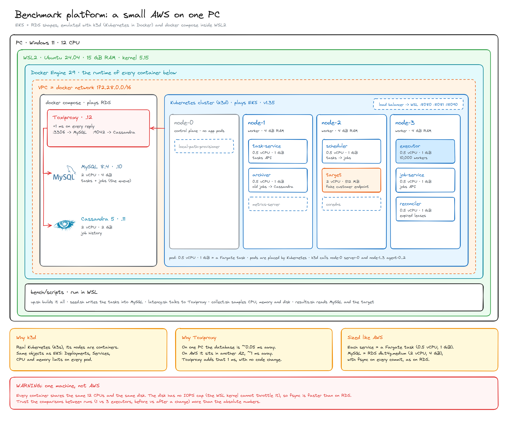

# Benchmarks

> How the scheduler behaves under the load of a real platform: how many jobs it runs, how late they start, and what breaks first.

The tests answer the questions a product owner would ask before launch, measured on a small AWS-shaped deployment that runs on one PC. Each answer comes with its numbers, the resources it used and, for the executor, a CPU profile.

**Status:** the platform is built and the first runs are in [Results](#5-results). The test runner, the 2-second telemetry and the profiling are being built; until then, runs use `bench/scripts/run.sh`.

> [!WARNING]
> Every number here comes from an **emulated** AWS on one machine. It shows the order of magnitude and, above all, **what breaks first**. Comparisons between runs (1 vs 3 executors, before vs after a change) are more reliable than absolute values. See [Threats to validity](#7-threats-to-validity).

---

## 1. The questions

| # | Question |
|---|---|
| **P1** | Does every job run once, and on time, when nothing is going on? |
| **P2** | How many jobs per second can we run, and does adding servers help? |
| **P3** | On a normal day, do jobs start when they should? |
| **P4** | At 09:00, when 30,000 jobs are due in the same second, how long until they have all run? Do the important ones go first? |
| **P5** | What if our customers' endpoints are slow, 10 to 30 seconds per call? |
| **P6** | Can one customer with a broken endpoint slow everybody else down? |
| **P7** | If a server dies in the middle of the work, are its jobs lost or run twice? |
| **P8** | If the database disappears for 30 seconds, do we lose anything? |
| **P9** | After hours of running, is it still as fast as at the start? |

Before P1, a calibration round checks that the bench itself measures well and is never the bottleneck.

## 2. Test platform



*Drawn from [docs/benchmarks/diagram](docs/benchmarks/diagram): edit `draw.mjs` and run `render.sh` to export it again.*

> [!NOTE]
> This is the most realistic setup that can be built quickly on one PC: a real Kubernetes cluster (k3d) with a control plane and three worker nodes, every service sized like an AWS Fargate task, and the databases outside the cluster like RDS, 1 ms away as in another availability zone. The services run unchanged: the same images and configuration as anywhere else.

### What runs where

| Component | Plays the role of | Runs on | CPU | Memory |
|---|---|---|---|---|
| node-0 | EKS control plane | k3d server | shared | no cap |
| node-1, node-2, node-3 | EKS worker nodes | k3d agents | shared | 4 GB each |
| executor-service | | a worker node | 0.5 vCPU | 1 GiB |
| scheduler-service | | a worker node | 0.5 vCPU | 1 GiB |
| reconciler, archiver, task-service, job-service | | worker nodes | 0.5 vCPU each | 1 GiB each |
| target (fake endpoint) | customers' APIs | a worker node | 2 vCPU | 512 MiB |
| MySQL 8.4 | RDS `db.t4g.medium` | docker compose | 2 vCPU | 4 GB (3 GB buffer pool) |
| Cassandra 5 | a small Cassandra node | docker compose | 2 vCPU | 2 GB |
| Toxiproxy | the network between AZs | docker compose | | |

CPU and memory limits equal requests on every pod, so no pod can borrow from another. CoreDNS, metrics-server and the local-path provisioner come with k3s.

> [!IMPORTANT]
> **Decisions forced by the machine** (Windows + WSL2 + Docker Engine 29):
> - **Latency with Toxiproxy, not `tc netem`.** The WSL kernel has no `netem`. The pods reach `mysql:3306` and `cassandra:9042` through Toxiproxy, which delays every reply by 1 ms. Cassandra announces Toxiproxy's address, or the driver would find the real one and skip it.
> - **No disk cap.** The WSL kernel cannot throttle block I/O, and Docker drops the cap without an error. MySQL writes to the local disk, faster than an RDS volume.
> - **Three worker nodes, not two.** Seven pods of 1 GiB do not fit in two nodes of 4 GB, and node-0 runs no app pods, like an EKS control plane.
> - **cgroup v1.** Docker in WSL runs on cgroup v1, which the kubelet refuses since Kubernetes 1.35 unless told otherwise (`fail-cgroupv1=false`).

How it works underneath, in separate articles:

- [How a query reaches MySQL](docs/benchmarks/articles/latency.md): the path through Toxiproxy, and how the 1 ms was checked.
- [The life of a job during a test](docs/benchmarks/articles/life-of-a-job.md): from the seeded task to the saved result.
- [The fake endpoint](docs/benchmarks/articles/fake-endpoint.md): what the jobs call, and how it measures them.

## 3. The workload: a platform like a real one

What defines a cron platform is not its average load but its **aligned peaks**: people schedule at the top of the minute and the hour (`0 * * * *`, `0 9 * * *`), so the average is low and everything lands on second :00.

The model: **1,000 customers and 50,000 active tasks**, the 10 largest customers holding 40% of them.

| Kind of task | Share | Tasks | When they fire |
|---|---|---|---|
| Cron every minute | 2% | 1,000 | 1,000 jobs on second :00 of every minute |
| Cron every 5 minutes | 8% | 4,000 | 4,000 jobs at :00, :05, :10… |
| Cron every hour | 20% | 10,000 | 10,000 jobs at the top of the hour |
| Cron every day at 09:00 | 30% | 15,000 | 15,000 jobs at 09:00:00 |
| One-off (`at`): reminders, delayed webhooks | 40% | ~20,000 per hour | at random times, ~5.5 per second |

About **38 jobs per second on average**, with peaks of 1,000 jobs every minute, 5,000 every 5 minutes, 15,000 every hour and **30,000 at 09:00:00**, when all of them meet.

Every task calls a customer endpoint with one of these behaviours:

| Endpoint | Share | Behaviour |
|---|---|---|
| Fast | 80% | ~150 ms, with a long tail |
| Slow | 12% | 1 to 10 s |
| Very slow | 5% | 10 to 30 s; some reach the timeout |
| Flaky | 2% | 503 on 30% of the calls, so it retries |
| Down | 1% | always 503, ends `dead` |

Every task has a 30 s timeout, 3 attempts and a 5 s backoff. Priorities: 5% critical (0), 15% high (1), 60% normal (2), 20% low (3). The base deployment runs **2 executors**, as production would for availability.

## 4. How we measure

**Service level objectives** for this round:

| | Target |
|---|---|
| On time, normal load | p99 start delay ≤ 1 s, every priority |
| On time, during a peak | priority 0 p99 ≤ 5 s; the whole peak run within 60 s |
| Nothing lost | 0 lost jobs; duplicates only after a failure, at most the jobs in flight |
| Isolation | a customer with a broken endpoint raises the others' p99 by less than 20% |
| Retries | flaky endpoints succeed within their 3 attempts; dead ones end `dead` |

**Start delay** is when the call reached the endpoint minus when the job was due, measured by the fake endpoint. Every test reports it as **p50, p90, p99 and max**, per priority and over time.

**Resources, every 2 seconds**, read straight from the kernel (cgroups and `/proc`), with nothing installed in the cluster:

| What | Metrics | Units |
|---|---|---|
| Every pod | CPU, % of its limit, time throttled by the limit, memory in use | millicores, %, ms per second, MiB |
| MySQL, Cassandra, Toxiproxy | CPU, memory | millicores, MiB |
| Disk | writes, throughput, write latency, busy time | per second, MB/s, ms, % |
| MySQL | commits, redo `fsync`s, row lock waits, running queries, connections | per second, count |
| Queue | jobs pending and running, finished and dead per second | count, per second |

**Profiling:** the executor exposes Go's `pprof` when `PPROF_ADDR` is set. Each test takes a 30-second CPU profile at peak load, plus heap and goroutine profiles.

**Durations**, kept short for this first round:

| Test | Load | Duration |
|---|---|---|
| Calibration | minimal | ~10 min |
| P1 | 10% of the model | 3 min |
| P2 | fast endpoints, 50 → 800 jobs/s in steps; then 2 and 3 executors | ~20 min |
| P3 | the model | 5 min |
| P4 | the model + the 09:00 peak | 5 min |
| P5 | 20 jobs/s, every endpoint 10-30 s; timeout 30 s, then 20 s | 2 × 4 min |
| P6 | the model + one large customer whose endpoint hangs | 5 min |
| P7 | P3 + one executor killed halfway | 6 min |
| P8 | P3 + MySQL cut for 30 s | 6 min |
| P9 | the model | 30 min |

Each test also waits one minute before the load (the scheduler creates jobs 30 s ahead) and until the queue is empty after it.

## 5. Results

### First runs, before the plan

| Run | Load | Executors × workers | Ran | Throughput | Start delay p50 / p99 | Duplicates |
|---|---|---|---|---|---|---|
| E0 | 10 jobs/s, 120 s, 50 ms endpoints | 1 × 50 | 1,200 / 1,200 | **5.0 / s** | 0.002 s / p0 1.4 s, p3 **185 s** | 0 |
| E1 | 50 jobs/s, 120 s, 50 ms endpoints, +1 ms | 1 × 10,000 | 6,000 / 6,000 | 50.4 / s | 0.002 s / 1.24 s | 0 |

> [!NOTE]
> **First bottleneck: the executor's claim loop.** It claims every 10 s, up to 10 s ahead, and a job holds its worker while it waits for its time. One executor runs at most `WORKER_COUNT / 10 s` jobs per second: 5 with 50 workers. Above that, the queue grows and strict priority leaves priority 3 waiting for minutes. With 10,000 workers the ceiling moves to 1,000 jobs/s.

Open question from E1: 16% of the jobs were claimed on time but reached the endpoint 1.23 s late. The delay is between the claim and the HTTP call.

### P1 to P9

*(filled in after each test)*

## 6. Running it

```bash
cp .env.example .env    # set JWT_SECRET
bench/scripts/up.sh             # databases, Toxiproxy, k3d cluster, images, 1 ms latency
bench/scripts/run.sh 1 50 120   # run 1: 50 jobs/s for 120 s
bench/scripts/down.sh           # delete everything except bench/results
```

`bench/scripts/latency.sh 1ms|off` changes the latency live, and `bench/scripts/durability.sh 1|2` the MySQL `fsync` policy.

## 7. Threats to validity

- **One host.** Every pod, both databases and the fake endpoint share 12 CPUs. Limits reduce the interference but do not remove it.
- **Nodes are containers.** The worker nodes cap memory but not CPU; CPU is capped per pod.
- **Toxiproxy is in the path.** Every byte to and from the databases goes through a proxy in user space, even with the latency off: the baseline is "the proxy alone", not "no network".
- **Fixed latency.** 1 ms without jitter, loss or tail, unlike a real network.
- **Disk not capped.** `fsync` on a local SSD is far faster than on an RDS volume: database-bound numbers are an upper bound.
- **Small tables.** The hot table fits in memory; in production it would be larger and miss the cache more often.
- **One endpoint, plain HTTP.** No TLS, and connection reuse is easier than with thousands of customer hosts.
