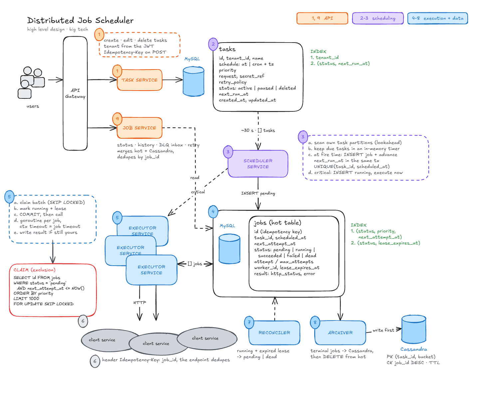

# distributed-job-scheduler



*Drawn from [docs/diagram](docs/diagram): edit `draw.mjs` and run `render.sh` to export it again.*

A distributed job scheduler in Go: `at` and `cron` as a service. Users schedule HTTP calls to their own endpoints (once, at a given time, or on a cron expression) with priorities, automatic retries, a dead letter queue and a queryable execution history.

Designed for big tech scale (~1B executions/day, ~500k/s peak). Built and run here at a much smaller scale.

> [!IMPORTANT]
> **What the benchmarks showed.** The design held up, and its one limit is a simplification I chose. [All the tests and results](benchmarks.md).
>
> - **Nothing is lost.** 10 tests and ~260,000 jobs, with peaks, slow and hanging customers, an executor killed and MySQL cut for 30 s: every job ended `succeeded` or `dead`. Duplicates only came after a failure: 16 when MySQL disappeared.
> - **The bottleneck is the scheduler, by design, not the hardware.** One scheduler creates about 300 jobs per second: each tick takes at most 1,000 tasks and advances each one with its own round trip to MySQL, so a tick lasts ~3.3 s while the scheduler uses a fifth of its CPU. That sets the capacity, the 6.7 s delay at every 5-minute burst and the 94 s of the 09:00 peak. More executors do not help: 301, 336 and 330 jobs/s with 1, 2 and 3.
> - **The hardware had room left.** With 0.5 vCPU per service and 2 CPUs for MySQL (~2,500 commits/s at the peak), only the executor's CPU saturated, for a second or two at each burst, and executors scale out.
> - **How it scales.** Inside one scheduler: larger batches, advanced with one statement instead of one per task. Polling more often does not help, because a tick already lasts longer than the interval. Beyond that: several schedulers, each owning a share of the tasks, and more shards. To keep it simple there is one scheduler per shard, and this deployment runs one shard, so that is where the limit showed first.

---

## Requirements

**Functional**

1. Schedule a task to run now, at a date/time (`at`) or on a cron expression.
2. Each task has a priority (`critical`, `high`, `normal`, `low`). Critical never waits behind low.
3. Failed jobs are retried up to a configurable maximum, then set aside (DLQ) for manual review or retry.
4. Query a job's status and a task's execution history.

**Non-functional**

- **Durability:** an accepted task is never lost.
- **At-least-once execution**, never dropped silently. Each job carries a stable idempotency key so the receiver can dedupe.
- **Scheduling latency (p99):** critical < 1 s, high < 20 s, normal < a few min, low < 20 min.
- **No starvation** for low priority, and **fairness** between tenants.
- **API availability:** 99.99%.
- **Security:** secrets encrypted, never in logs or history.

A **task** is the configuration (schedule, priority, request, retry policy). A **job** is one execution of it.

---

## How it works

1. **Task Service** creates and edits tasks in MySQL. The tenant comes from the JWT; `POST` takes an `Idempotency-Key`.
2. **Scheduler** takes the tasks due in the next 30 s every 5 s, and in one transaction inserts their jobs as `pending` and advances `next_run_at` (`UNIQUE(task_id, scheduled_at)`).
3. **Executors** claim as many jobs as they have free workers with `FOR UPDATE SKIP LOCKED`, up to one polling interval ahead, mark them `running` with a lease and commit. Each job waits on its own timer until its time, then calls the endpoint with the job's timeout.
4. Results are written only if the job is still theirs (`WHERE status = 'running' AND worker_id = ? AND attempt = ?`, with `attempt` as the fencing token). Failures go back to `pending` with exponential backoff, or to `dead` after `max_attempts`.
5. **Reconciler** returns `running` jobs with an expired lease to `pending` (or `dead`).
6. **Archiver** writes terminal jobs to Cassandra and only then deletes them from the hot table.
7. **Job Service** serves status, history (hot table + Cassandra), the DLQ inbox and manual retry.

## Services

| Service | Role |
|---|---|
| [task-service](task-service/readme.md) | Task API: create, edit, pause, resume, delete |
| [scheduler-service](scheduler-service/readme.md) | Creates the jobs of due tasks |
| [executor-service](executor-service/readme.md) | Claims jobs, calls the endpoints, saves the results; SSRF protection |
| [reconciler-service](reconciler-service/readme.md) | Recovers jobs whose executor died |
| [archiver-service](archiver-service/readme.md) | Moves terminal jobs to the Cassandra history |
| [job-service](job-service/readme.md) | Job API: status, history, DLQ and manual retry |

### Run everything

```bash
cp .env.example .env          # then set JWT_SECRET, at least 32 bytes
docker compose up -d --build
```

It starts MySQL (port 3307) and Cassandra (9042), applies the migrations, and runs the six services. The APIs listen on `8080` (tasks) and `8081` (jobs).

Each service has a two-stage Dockerfile: a Go image compiles a static binary with the module and build caches mounted, and only the binary moves to `distroless/static`, which has no shell or package manager, runs as `nonroot`, and still carries the CA certificates the executor needs for `https` and the time zones the scheduler needs for cron. Each image is about 15 MB.

For tenants: [what their endpoint receives and must do](docs/client/receiving-jobs.md). For the race between a late result and an expired lease: [late results](docs/design/late-results.md).

---

## Design decisions

**The jobs table is the queue (no broker).**
A broker (SQS, RabbitMQ) means writing the job to the database _and_ to the queue: a dual write that can leave one without the other. Every service writes straight to MySQL instead, and claiming rows with `SKIP LOCKED` keeps one source of truth. Kafka was discarded anyway: it commits offsets per partition, so one slow job blocks the rest. Cost: all claiming load lands on MySQL, so the jobs table has to be sharded earlier.

Inspired by [Shopify moving inventory reservations from Redis to MySQL](https://shopify.engineering/scaling-inventory-reservations): two stores could not be updated atomically, so they kept one, made each unit a row, and let concurrent transactions claim different rows with `SKIP LOCKED`. The only remaining dual write here is the archive to Cassandra, and it is ordered so a crash leaves a duplicate, never a lost job.

**MySQL for tasks and active jobs.**
Every job goes through several state transitions, and each one must be conditional (`UPDATE ... WHERE status = 'running'`). In MySQL that is a cheap `WHERE`. Postgres was discarded for this table: every index points to the physical row, so each update rewrites the indexes (write amplification), indexing `status` makes those updates non-HOT, and a high-churn queue table means vacuum and bloat.

**Cassandra for history only.**
Cassandra handles huge write volumes, but it resolves conflicts by last-write-wins and conditional updates need Paxos, which is too expensive on every transition. Once a job is terminal it never changes, so those problems disappear: history is append-only, partitioned by `(tenant_id, task_id, month)` with TTL for retention, plus a `job_by_id` table to find a job by its id. The hot table stays small and fast.

**Leases in the database, not Redis locks.**
The claim already writes to the database, so a Redis lock adds a second source of truth that can disagree with it (and can be lost on failover) without saving any write. A lease (`lease_expires_at`, per job from its own timeout) plus a reconciler covers dead executors.

**At-least-once plus idempotency, not exactly-once.**
If a call times out, there is no way to know whether the endpoint processed it. Exactly-once delivery does not exist; the job id is sent as `Idempotency-Key` on every attempt and the receiver dedupes.

**Never run a job that is not persisted.**
The claim commits the job as `running` with its lease before any call. If the executor dies mid-call, the job is still in the table and the reconciler recovers it.

**Precision from an in-memory timer.**
The scheduler creates jobs 30 s ahead, and executors claim them one polling interval ahead and fire each from its own timer at the exact second. That gives sub-second precision without polling the database every second.

---

## Scaling path

- Shard tasks and jobs by hash (e.g. Vitess); one scheduler owns a set of task partitions through a lease.
- Executors per shard; weighted claiming by priority and tenant.
- Concurrency limits per tenant/endpoint, so the 09:00 burst does not flood customer endpoints.
- Multi-region for 99.99%.

---

## To do

Part of the design above is not built yet:

- **A fast path for critical jobs:** inserted as `running` and executed at once instead of waiting for a claim. Today priority only orders the claim.
- **Scheduler partitions:** each scheduler owns a set of tasks through a lease. Today one scheduler does all the work and a second one only adds availability. The [benchmarks](benchmarks.md) found this to be the first limit, at about 300 jobs per second.
- **Adaptive polling:** claim again at once when a batch comes back full, back off when empty. Today the interval is fixed.
- **`Retry-After`** on `429` and `503`, and jitter on the backoff.
- **Concurrency limits per tenant**, and the late-result refinements in [late results](docs/design/late-results.md).
- **Check gap locks under load.** Shopify found that `FOR UPDATE SKIP LOCKED` under `REPEATABLE READ` takes gap locks when the range is empty, which blocked their inserts. The executor claim and the scheduler insert touch the same index range of `jobs`, so this has to be measured, and the claim moved to `READ COMMITTED` if it shows up.

## Benchmarks

The platform was load-tested on a small AWS-shaped deployment (k3d plus MySQL and Cassandra 1 ms away): capacity, a normal day, the 09:00 peak, slow and broken customers, an executor dying and MySQL disappearing. The conclusions are [at the top](#distributed-job-scheduler); every test, with its charts, resources and CPU profiles, is in [benchmarks.md](benchmarks.md).

## Status

Work in progress. Design notes and the full discussion of alternatives live in [joel-software-notes](https://github.com/JoelTeoGom/joel-software-notes).
